# Python基础

> **解释型语言**：Python 是一种解释型语言，代码运行时逐行解释执行。
>
> **动态类型**：变量在运行时决定类型，无需声明。

#### 编码

> 编码是将字符集转换为字节的方式。Python 3 默认使用 UTF-8 编码，能够支持多种语言的字符。

#### 缩进

>  在Python中，缩进用于表示代码块，这意味着代码的结构依赖于缩进而非符号
>
>  通常使用4个空格作为缩进


## 标识符

> **定义**：标识符用于命名变量、函数、类、模块等
>
> **规则**：
>
> - 只能使用字母（A-Z、a-z）、数字（0-9）和下划线（_）
> - 不能以数字开头
> - 区分大小写（例如，`myVar` 和 `myvar` 是不同的）
> - 不能使用Python保留字（如 `if`, `else`, `for`, `class` 等）


## 变量命名

- **规则**：遵循标识符的规则
- **命名规范**：

  - 使用有意义的名称，以便代码可读
  - 对于变量名使用小写字母，多个单词用下划线分隔（如 `total_sum`）
  - 类名通常使用驼峰命名法（如 `MyClass`）
  - 常量（不变的值）通常使用全大写字母（如 `MAX_SIZE`）


## 注释

#### 单行注释：使用 `#` 开头

```python
# 这是一个单行注释
```

#### 多行注释：使用三个引号（`'''` 或 `"""`）

```python
'''
这是一个多行注释
可以用于注释多行代码
'''
```


## 数据类型

> **基本数据类型**：
>
> 整数（int）  浮点数（float）  字符串（str）  布尔值（bool）
>
> 
>
> **复合数据类型**：
>
> 列表（list）   元组（tuple）   字典（dict）   集合（set）
>
>  
>
> **查看数据类型：**
>
> ```python
> print(type(a))
> ```


#### 转换为整形：int()

```python
ling1=int('2')                  # 2

ling2=int(True)                # 1
ling3=int(False)               # 0

ling4=int(2.2)                 # 2 （浮点数向下取整）
ling6=int(2.6)                 # 2
```

#### 转换为浮点型：float()

```python
ling1=float('2')                # 2.0
ling2=float('2.5')              # 2.5
ling3=float(-2)                 # -2.0
ling4=float(True)               # 1.0
```

#### 转换为字符串：str()

```python
data1 = str(3)  # "3"
data2 = str(True)  # "True"
data3 = str(0.0)  # "0.0"
data4 = str(3.5)  # "3.5"
```

#### 转换为布尔值：bool()

```python
data1 = bool("3")       # True

data2 = bool(1)         # True （所有非0的数值为真）
data5 = bool(3.5)       # True
data3 = bool(0)         # False
data4 = bool(-1)        # True
data6 = bool(0.0)       # False
data7 = bool(None)      # False
```


#### 自动转换（隐式转换）

> int + float = float
>
> int + bool = int
>
> bool + bool = int

```python
print(1 + 2.5)            # 3.5
print(1 + True)           # 2
print(True + False)       # 1
```


## 运算符

### 算术运算符：

```python
加（+） 减（-） 乘（*） 除（/） 整除（//） 取余（%） 幂（**）
```

### 比较运算符：

```python
等于（==） 不等于（!=） 大于（>） 小于（<） 大于等于（>=） 小于等于（<=）
```

### 逻辑运算符：

```python
与（and） 或（or） 非（not）
```

### 成员运算符：

> 查看元素在不在其中
>
> `in`                如果在返回true，不在返回false
>
> `not in`         如果不在返回true，在返回false
>
> 字典看的是键


### 优先级（从高到低）

|    运算符类别    | 代表运算符                 |
| :--------------: | -------------------------- |
|       括号       | `()`                       |
|       指数       | `**`                       |
|    单目运算符    | `+x`, `-x`, `~x`           |
| 乘除、取余、整除 | `*`, `/`, `//`, `%`        |
|       加减       | `+`, `-`                   |
|       移位       | `<<`, `>>`                 |
|      位运算      | `&`, `^`, `                |
|       比较       | `in`, `is`, `<`, `>`, `==` |
|      布尔非      | `not`                      |
|      布尔与      | `and`                      |
|      布尔或      | `or`                       |
|    条件表达式    | `x if ... else ...`        |
|       赋值       | `=`, `+=`, `-=`, ...       |


# 控制结构

## 分支语句

```python
if condition:
    # 执行代码块
elif another_condition:
    # 执行其他代码块
elif 条件n:
    ···
else:
    # 执行备用代码块
```


## 循环语句

#### for 循环

```python
for item in range(1, 5):
    print(item)      # 1 2 3 4 5

for item in range(0, 10, 2):
    print(item)      # 0 2 4 6 8
```

#### 示例：

```python
for i in range(1,10):
    for n in range(1,i+1):
        print(f'{i}×{n}={i*n}\t',end='')         # \t 保持对齐
    print()
```


#### while 循环

```python
while condition:
    # 执行代码块
```


## break与continue

> break：跳出循环体，终止后续循环代码的执行
> continue：跳过本次循环，继续下次循环


## pass 语句

> 保持结构的完整性，不做任何作用，一般用作占位语句

```python
for Ling in range(10):
    if Ling == 2:
        pass
    else:
        print(Ling)
```


# 字符串

> 由字符的编码值组成的不可变序列容器，用于表示文本数据。在 Python 中，字符串可以使用单引号 `'`、双引号 `"` 或三引号 `'''`/`"""` 来定义
>
> 单双引号不能包裹其自身，但是可以互相包裹，三引号内可以包含单双引号

## 1.转义

> 以反斜杠`\`开头，改变字符的原始含义
>
> `\\`         `\'`          `\"`          `\n`换行符          `\t和\v`水平/垂直制表符


## 2.`f-string` 格式化字符串字面量

```python
name='黏黏'
chinese=9
math=100
print(f'期末考试{name}总成绩为：{chinese+math}分')
```

| 常见格式说明符（冒号后面） | 含义                                                   |
| :------------------------: | ------------------------------------------------------ |
|           `.2f`            | 浮点数，保留 2 位小数                                  |
|           `02d`            | 整数，至少 2 位，不足补 0                              |
|          `05.2f`           | 总宽 5，保留 2 位小数，补 0 `f"{3.1:05.2f}"` → `03.10` |


## 3.字符串的查找

#### 子字符串查找：关键字`in`

```python
ling='我喜欢凌'
if '凌' in ling:
    print('Found')               # Found
else:
    print('Not found')
```

#### 查找位置：`字符串.fund(要查找的字符)`或`字符串.index(要查找的字符)`

`fund`返回其找到的第一个字符的索引，如果没有找到返回`-1`

`rfund`返回其找到的最后一个字符索引

`index`找不到会引发 `ValueError`

#### 字符出现的次数：`字符串.count(要查找的字符)`


## 4.字符串的基本操作

#### 相加、重复

```python
a = '黏黏'
b = '糊糊'
print(a+b)                 # 黏黏糊糊
print(a*3)                 # 黏黏黏黏黏黏
```

#### 长度、索引、切片

> `len(元素)`获取长度
>
> 索引从0开始，支持负索引
>
> 切片 `字符串[起始:结束:步长]`

#### 大小写转换

> `字符串.upper()`         将字符串中所有字母转换为大写，并返回新的字符
>
> `字符串.lower()`         将字符串中所有字母转换为小写，并返回新的字符
>
> `字符串.capitalize()`         将字符串第一个字母转换为大写，其余转换为小写，并返回新的字符
>
> `字符串.title()`         将字符串每个单词首字母转换为大写，其余转换为小写，并返回新的字符

#### `字符串.strip([指定要去除的字符])`

> 移除字符串开头和结尾的指定字符（默认空格、制表符、换行等）
>
> 在处理文本数据时特别有用，可以去除不必要的空白
>
> `lstrip()`移除左侧字符，`rstrip()`移除右侧字符

```python
a = ' I Love ling '
clear = a.strip()
print(clear)          # I Love ling

a = 'xxI Love lingxx'
clear = a.lstrip('xx')
print(clear)          # I Love lingxx
clear = a.rstrip('xx')
print(clear)          # xxI Love ling
```

#### 字符串的分割、合并

> **分割：**
>
> `字符串.split('分割符')`：将字符串分割成子字符串列表
>
> 默认按照空白字符（空格、换行符\n、制表符\t等）来分割字符串，也可以指定一个字符串作为分割符
>
> `re.split(r'[多个分隔符]',字符串)`：多个分割符要用正则表达式，`\s`表示空白符
>
> 两个都可以指定分割次数：在后面前面加`,次数`
>
> 
>
> **合并：**
>
> `'连接符'.join(可迭代对象)`：将序列中的元素连接成一个新的字符串，只能连接字符串，故要先把元素都转为字符串型

```python
a= 'I Love ling'
print(a.split(' '))          # ['I', 'Love', 'ling']

import re
Ling = '她和文秀娟有一个很大的不同点，或者应该这么说，文秀娟和全班所有人都不同：别人都带着手套解剖，文秀娟不，她赤手！'
print(re.split(r'[，：]',Ling))
# ['她和文秀娟有一个很大的不同点', '或者应该这么说', '文秀娟和全班所有人都不同', '别人都带着手套解剖', '文秀娟不', '她赤手！']
```

```python
a = [2026,'04',17]
print('-'.join(map(str,a)))     # 2026-04-17      map()函数后面讲
```

#### 替换子字符串：`字符串.replace(old, new)`

```python
text = "Hello World"
print(text.replace("World", "Python"))  # 输出 'Hello Python'
```


## 5. 编码与解码

> **编码：`字符串.encode('编码方式')`**
>
> 将字符串转换为字节串（bytes）
>
> **解码：`字符串.decode('解码方式')`**
>
>  
>
> 获取字符串的Unicode码：`ord(字符串)`
>
> 获取Unicode码对应的字符串：`chr(Unicode码)`

```python
text='你好，阿凌'
print(text.encode('utf-8'))
# b'\xe4\xbd\xa0\xe5\xa5\xbd\xef\xbc\x8c\xe9\x98\xbf\xe5\x87\x8c'
```


## 6. 常见检查方法

> 用于判断字符串是否符合特定格式或内容，返回的是布尔值
>
> `字符串.isalpha()`       是否全为字母
>
> `字符串.isdigit()`       是否全为数字
>
> `字符串.isalnum()`       是否全为数字和字母


## 7. 综合练习

将字符串反转输出

```python
str1= 'You Can'
a = [item[::-1] for item in str1.split(" ")]
a = a[::-1]
print(" ".join(a))        # naC uoY
```


# 列表

## 一、创建列表

```python
empty_list = []                         # 空列表
numbers = [1, 2, 3, 4, 5]               # 包含整数的列表
mixed_list = [1, "hello", 3.14, True]   # 混合数据类型的列表

列表名 = list(可迭代对象)
number_list = list(range(1, 5))
```

## 二、列表的基本操作

### 访问元素

使用索引访问列表中的元素，索引从 0 开始，支持负索引

```python
numbers = [1, 2, 3, 4, 5]
print(numbers[0])    # 输出 1
print(numbers[-1])   # 输出 5（最后一个元素）

遍历：
Ling = [1,2,3,4,5]
for i in Ling:
    print(i)
    
反向遍历：
for i in range(len(ling)):
    print(ling[-1-i])
```

### 列表切片

使用切片获取列表中的一部分，格式为 `列表[起始:结束:步长]`。

```python
numbers = [1, 2, 3, 4, 5]
print(numbers[1:4])      # 输出 [2, 3, 4]
print(numbers[:3])       # 输出 [1, 2, 3]
print(numbers[::2])      # 输出 [1, 3, 5]
print(numbers[::-1])     # 输出 [5, 4, 3, 2, 1]（列表反转）
```

### 修改元素

使用索引修改列表中的元素

```python
numbers = [1, 2, 3, 4, 5]
numbers[0] = 10
print(numbers)       # 输出 [10, 2, 3, 4, 5]
```

### 添加元素

```python
# 列表名.append()在列表结尾添加元素
ling =[1,2,3,4,5,6]
ling.append(7)
print(ling)          # 输出 [1, 2, 3, 4, 5, 6, 7]
```

### 删除元素

```python
# 列表名.remove()删除列表中第一个匹配的元素
ling =[1,2,3,4,5,6,2]
ling.remove(2)
print(ling)          # 输出 [1, 3, 4, 5, 6, 2]

# del 列表名[索引或切片]
ling =[1,2,3,4,5,6]
del ling[0]
print(ling)          # 输出 [2, 3, 4, 5, 6]

ling =[1,2,3,4,5,6]
del ling[:3]
print(ling)          # 输出 [4, 5, 6]
```

### 插入元素

```python
# 列表名.insert(index, object) 
ling =[1,2,3,4,5,6]
ling.insert(2,2.5)
print(ling)           # 输出 [1, 2, 2.5, 3, 4, 5, 6]
```

### 扩展列表

```python
# 列表1.extend(列表2)将一个列表的所有元素添加到另一个列表末尾
numbers = [1, 2, 3]
more_numbers = [4, 5, 6]
numbers.extend(more_numbers)
print(numbers)        # 输出 [1, 2, 3, 4, 5, 6]
```

### 清空列表

```python
# 列表名.clear()删除列表中的所有元素
numbers = [1, 2, 3, 4]
numbers.clear()
print(numbers)        # 输出 []
```

### 查找元素的索引

```python
# 列表名.index(element)方法返回元素在列表中的第一个匹配的索引
numbers = [1, 2, 3, 4]
print(numbers.index(3))         # 输出 2
```

### 统计元素出现次数

```python
# 列表名.count(element)统计指定元素在列表中出现的次数
numbers = [1, 2, 2, 3, 4]
print(numbers.count(2))        # 输出 2
```

### 排序

`sort()` 方法对列表进行原地排序，改变原列表

`sorted()` 函数返回一个排序后的新列表，不改变原列表

默认升序，传入`reverse=True` 降序排序

```python
numbers = [3, 1, 4, 2]
numbers.sort()
print(numbers)                # 输出 [1, 2, 3, 4]

numbers = [3, 1, 4, 2]
sorted_numbers = sorted(numbers, reverse=True)
print(sorted_numbers)         # 输出 [4, 3, 2, 1]
```

### 反转列表

`列表名.reverse()`将列表中的元素顺序反转，改变原列表。

```python
numbers = [1, 2, 3, 4]
numbers.reverse()
print(numbers)               # 输出 [4, 3, 2, 1]
```


## 三、列表推导式

```python
[表达式 for 变量 in 可迭代对象 if 条件]
```

#### 示例

```python
numbers = [x**2 for x in range(1, 6)]
print(numbers)           # 输出 [1, 4, 9, 16, 25]

numbers = [x for x in range(10) if x % 2 == 0]
print(numbers)           # 输出 [0, 2, 4, 6, 8]
```


### 练习：列表的降维

```python
ling=[[1,2,3],[4,5,6]]
xgj=[]

for i in ling:
    for j in i:
        xgj.append(j)
print(xgj)                  # 输出 [1, 2, 3, 4, 5, 6]


a= [num for i in ling for num in i]
print(a)                    # 输出 [1, 2, 3, 4, 5, 6]
```


## 四、浅拷贝

> **外层独立，内层共享：**
>
> 浅拷贝会创建一个新的外层对象（如列表、字典），但内部嵌套的对象（如列表中的子列表、字典中的嵌套字典）仍然是原始引用
>
> 修改外层对象的“直接元素”不会影响原对象，但修改“嵌套对象”（如子列表的元素）会影响两者
>
> **与直接赋值的区别：**
>
> `a = b`是让两个变量指向同一个对象，修改其中一个会立即影响另一个
>
> 浅拷贝：`a = copy.copy(b)`（列表也可以用切片`[:]`）会创建一个新对象，但内部嵌套的对象仍与原对象共享

```python
ling1 = ['生吞', ['长夜难明', '十九年间谋杀小叙']]

ling2 = ling1
ling2[0] = '默读'
ling2[1][0] = '白夜行'
print(ling1)        # ['默读', ['白夜行', '十九年间谋杀小叙']]
print(ling2)        # ['默读', ['白夜行', '十九年间谋杀小叙']]
```

```python
ling1 = ['生吞', ['长夜难明', '十九年间谋杀小叙']]

ling2= list.copy(ling1)    # 或者ling1[:]
ling2[0] = '默读'
ling2[1][0] = '白夜行'
print(ling1)        # ['生吞', ['白夜行', '十九年间谋杀小叙']]
print(ling2)        # ['默读', ['白夜行', '十九年间谋杀小叙']]
```


## 五、其它常见函数

|  函数   | 描述                                     |
| :-----: | :--------------------------------------- |
| `len()` | 返回列表长度                             |
| `max()` | 返回列表的最大值元素                     |
| `min()` | 返回列表的最小值元素                     |
| `sum()` | 返回列表中所有元素的和（必须是数值类型） |


# 元组

>  元组是一种有序的、**不可变**的数据结构，可以存储多个元素。与列表类似，元组可以包含任意数据类型，但元组一旦创建，不能修改。元组使用小括号 `()` 表示，元素之间用逗号分隔。

## 一、创建元组

```python
ling1 = ()                    # 空元组
ling2 = (42,)        # 单个元素的元组，需在元素后加逗号

# 小括号可省略       避免使用
tuple = 1, "hello", 3.14
print(tuple)                  # 输出 (1, 'hello', 3.14)

tuple_type = tuple(可迭代对象)
```


## 二、元组的基本操作

> 虽然元组是不可变的，但我们可以通过索引和切片访问其中的元素，且与列表的方式一样

### 统计元素出现次数

```python
# count(element)
numbers = (1, 2, 2, 3, 4)
print(numbers.count(2))          # 输出 2
```

### 查找元素的索引

<span style='font-size:17.5px'>`元组名.index(element)`返回元素在列表中的第一个匹配的索引</span>

```python
numbers = (1, 2, 3, 4)
print(numbers.index(3))          # 输出 2
```

### 元组的不可变性

```python
numbers = (1, 2, 3)
# numbers[0] = 10                # 会引发 TypeError，因为元组不可变
```

```python
tuple1 = (1, 2)
tuple1 = (3, 4)
print(tuple)                 # (3, 4)
'''
tuple1 = (3, 4) 的意思是在另一个新的内存中创建了一个全新的元组对象，其内容是(3, 4)
然后，Python把tuple1这个“标签”从旧的(1, 2)对象上撕下来，贴到了新的(3, 4)对象上
而原来的(1, 2)元组对象因为不再有任何变量名指向它，就会被Python的垃圾回收机制在适当的时候回收掉，释放内存
'''
```


## 三、元组解包

> 将元组中的元素直接赋值给多个变量

#### 基础解包

变量的数量必须与元组中元素的数量相匹配，否则会引发 `ValueError`

```python
coordinates = (10, 20)

x, y = coordinates

print(x)              # 输出 10
print(y)              # 输出 20
```

#### *号解包

收集多余的值到一个**列表**中

```python
tuple1 = (1, 2, 3, 4, 5)

a, b, *c = tuple1
print(a,b,c)          # 1 2 [3, 4, 5]
a, *b, c = tuple1
print(a,b,c)          # 1 [2, 3, 4] 5
```


## 四、元组的使用场景

> 1. **多值返回**：函数返回多个值时，可以将它们放在一个元组中
> 2. **字典键**：元组可以作为字典的键（因为元组是不可变类型），而列表不行
> 3. **不需要修改的数据**：当数据不需要修改时，用元组可以避免数据被意外改变，提高代码的安全性和可读性
>


## 五、其它常见函数

|  函数   | 描述                                     |
| :-----: | :--------------------------------------- |
| `len()` | 返回列表长度                             |
| `max()` | 返回列表的最大值元素                     |
| `min()` | 返回列表的最小值元素                     |
| `sum()` | 返回列表中所有元素的和（必须是数值类型） |


# 集合

> 无序、不重复的元素集合，用花括号`{}`表示，空集合用`set()`
>
> **无序性：**元素没有索引，不能通过下标访问（`{1,2,3} == {3,2,1}`）
>
> **唯一性：**自动去重（`{1,1,2,2} ——> {1,2}`）
>
> **可变性：**集合本身可增删元素，但<span style='color:red'>元素必须是不可变类型</span>

## 一、从其它数据结构转换

```python
list_to_set = set([1, 2, 3])
tuple_to_set = set((1, 2, 3))
str_to_set = set("abc")
```

## 二、集合基本操作

### 添加元素

```python
s = {1, 2, 3}

s.add(4)           # 添加单个元素 → {1, 2, 3, 4}
s.update([5, 6])   # 添加多个元素 → {1, 2, 3, 4, 5, 6}
s.update({7, 8}, (9, 10))  # 可传入多个可迭代对象  {1, 2, 3, 7, 8, 9, 10}
```

### 删除元素

```python
s = {1, 2, 3, 4, 5}

s.remove(3)        # 删除指定元素，不存在则报错 KeyError
s.discard(10)      # 删除指定元素，不存在也不报错 ✅推荐
s.clear()          # 清空集合

del s              # 删除变量
```

### 并集

```python
a = {1, 2, 3, 4}
b = {3, 4, 5, 6}

print(a | b)           # {1, 2, 3, 4, 5, 6}
print(a.union(b))      # {1, 2, 3, 4, 5, 6}
```

### 交集

```python
a = {1, 2, 3, 4}
b = {3, 4, 5, 6}

print(a & b)           # {3, 4}
print(a.intersection(b))  # {3, 4}
```

### 差集

```python
a = {1, 2, 3, 4}
b = {3, 4, 5, 6}

print(a - b)           # {1, 2}（a中有但b中没有的）
print(b - a)           # {5, 6}（b中有但a中没有的）
print(a.difference(b)) # {1, 2}
```

### 集合关系判断

```python
a = {1, 2, 3}
b = {1, 2, 3, 4, 5}

print(a.issubset(b))         # True（a是b的子集）
print(a <= b)                # True（同上）

print(b.issuperset(a))       # True（b是a的超集）
print(b >= a)                # True

print(a.isdisjoint(b))       # False（有交集）
print(a.isdisjoint({7, 8}))  # True（无交集）
```


# 字典

> 字典是一种可变的、无序的（在 Python 3.7+ 版本中是有序的） 键值对集合，用于存储和查找数据。字典通过键（key）来访问值（value），**<span style='color:red'>键必须是唯一的且不可变的</span>**（通常为字符串或数字），而值可以是任意数据类型。字典使用大括号 `{}` 表示，键值对之间用`,`分隔，键和值之间用`:`分隔

## 一、访问值

```python
person = {'name': 'ling', 'age': 18}

# 1. 使用方括号 [] （如果键不存在会报错 KeyError）
print(person['name'])      # ling

# 2. 使用 .get() 方法（更安全，如果键不存在返回 None，可以设置默认值）
print(person.get('name'))  # ling
print(person.get('gender', '未设置'))  # 未设置
```

## 二、添加或修改元素

> 1.直接赋值即可，如果键已经存在，则就是修改值；如果键不存在，则就是添加新的键值对
>
> `字典['键'] = 值`
>
> 2.`字典.update({'键': 值, '': ,})`

## 三、删除元素

```python
person = {'name': 'ling', 'age': 18, 'city': '宁波'}

# 1. del语句（删除指定键值对，键不存在会报错)
del person['city']

# 2. .pop() 方法（删除并返回指定键的值，可以设置默认值避免报错)
delete = person.pop('sex', '没有这个键')

# 3. .popitem() 方法（删除并返回最后一个键值对)
last = person.popitem()

# 4. .clear() 方法（清空字典）
person.clear()
```

## 四、遍历

```python
# 遍历键
for i in person():
    print(i)

# 遍历值
for i in person.values():
    print(i)

# 遍历键值对
for key, value in person.items():
    print(f"{key}: {value}")
```


## 案例

#### 两数之和

> 给定一个整数数组 `nums` 和一个整数目标值 `target`，请你在该数组中找出 **和为目标值** *`target`* 的那 **两个** 整数，并返回它们的数组下标。
>
> 你可以假设每种输入只会对应一个答案，并且你不能使用两次相同的元素。
>
> 你可以按任意顺序返回答案。
>
>  
>
> **示例 1：**
>
> ```
> 输入：nums = [2,7,11,15], target = 9
> 输出：[0,1]
> 解释：因为 nums[0] + nums[1] == 9 ，返回 [0, 1] 。
> ```
>
> **示例 2：**
>
> ```
> 输入：nums = [3,3], target = 6
> 输出：[0,1]
> ```

```python
def twoSum(nums, target):
    num_map = {}
    for i, num in enumerate(nums):
        complement = target - num  # 计算需要的补数
        if complement in num_map:  # 如果补数已经在字典中
            return [num_map[complement], i]  # 返回补数的索引和当前索引
        num_map[num] = i  # 否则，将当前数字和索引存入字典
    return []
```


# 函数

## 一、语法

```python
def function_name(形参):
    """可选的文档字符串"""
    # 函数体
    return result  # 可选的返回值

# 调用
function_name(实参)

# return 后面的代码不执行
```


## 二、参数

### 1. 位置参数

> 按参数定义的顺序传值

### 2. 关键字参数

> 通过`参数名=值`的形式传递，不依赖顺序

### 3. 默认参数

> 为参数指定默认值，调用时可以选择性传入参数

```python
def power(x, n=2):
    return x ** n

print(power(3))        # 输出: 9 (使用默认 n)
print(power(3, 3))     # 输出: 27 (覆盖默认 n)
```

### 4. 可变位置参数

> `*args` 用于传入任意数量的位置参数
>
> `**kwargs` 用于传入任意数量的关键字参数，以字典形式存储

```python
def sum_all(*args):
    return sum(args)

print(sum_all(1, 2, 3, 4))  # 输出: 10

def print_info(**kwargs):
    for key, value in kwargs.items():
        print(f"{key}: {value}")

print_info(name="Alice", age=30)  # 输出: name: Alice, age: 30
```

### 5. 参数解包

> **位置参数解包：**用`*`将列表/元组解包为位置参数
>
> **关键字参数解包：**用`**`将字典解包为关键字参数

```python
def c_all(a, b, c):
    return a * b * c

n = [1, 2, 3]
print(c_all(*n))

kwargs = {"name": "Bob", "age": 30}
print_info(**kwargs)
```

### 6. 参数顺序规则

```python
def func(a, b=0, *args, c, d=1, **kwargs):
    pass
```


## 三、函数的返回值

> `return` 语句指定返回值。如果没有 `return`，函数将返回 `None`
>
> **返回多个值：**使用逗号隔开，返回的是元组了（后续进行解包赋值）


## 四、匿名函数（`lambda`表达式）

> ```python
> 变量 = lambda 参数列表: 表达式
> ```
>
> 参数列表：逗号分割参数
>
> 表达式：只有一行，自动返回结果

### 使用场景：

```python
# 简单运算
square = lambda x: x ** 2
print(square(5))           # 25

# 无参数
greet = lambda: "Hello!"
print(greet())             # Hello!
```


## 五、作用域（Scope）

> Python的作用域遵循 **LEGB规则**，即变量的查找顺序为：**Local（局部）→ Enclosing（嵌套）→ Global（全局）→ Built-in（内置）**

### 1. LEGB作用域层次

> #### Local（局部作用域）
>
> 在函数或代码块内部定义的变量，函数执行时创建，函数结束时销毁
>
> #### Enclosing（嵌套作用域）
>
> 在嵌套函数中，内层函数可以访问外层函数的变量
>
> #### Global（全局作用域）
>
> 在模块（文件）顶层定义的变量或函数，模块加载时创建，程序结束时销毁
>
> #### Built-in（内置作用域）
>
> Python内置的名称，Python解释器启动时创建，关闭时销毁

### 2. 变量的修改与关键字

> **修改全局变量：`global`**
>
> ```python
> count = 0
> def increment():
>        global count  # 声明count为全局变量
>        count += 1
> ```
>
> **修改嵌套作用域变量：`nonlocal`**
>
> ```python
> def outer():
>        x = 10
>        def inner():
>            nonlocal x  # 声明x为外层变量
>            x += 5
>        inner()
>        print(x)  # 15
> ```
> 


## 六、闭包

> 闭包通常出现在嵌套函数中：当一个内层函数引用了其外层函数的变量，并且外层函数返回了这个内层函数，就形成了闭包
>
> ```python
> def 奶茶店(糖度):
>        def 取餐(号码):
>            return f"{糖度}糖的奶茶"  # 自动记住糖度！
>        return 取餐
> 
> 我的专属 = 奶茶店("少糖")  # 说一次就够了
> 
> print(我的专属("#10"))  # 少糖 ✅
> print(我的专属("#11"))  # 还是少糖 ✅
> ```

```python
def outer(x):
    def inner(y):
        return x + y    # 引用了外部变量 x
    return inner  # 返回内部函数

closure = outer(10)
print(closure(5))     # 输出: 15
```


### 闭包中修改外层变量：`nonlocal`

```python
def counter():
    count = 0
    def increment():
        nonlocal count
        count += 1
        return count
    return increment

c = counter()
print(c())  # 1
print(c())  # 2
```


### 装饰器

> 原函数 → 传给装饰器 → 返回一个新函数 → 替换原函数

> 在不改变原函数代码的情况下，给函数添加新功能
>
> ```python
> # 比如有个函数会打招呼：
> def say_hello():
>    	 print("你好！")
> 
> # 每次打招呼前（或者后），都说“我叫尹文轩”
> def new_say_hello(func):
>        def new():
>            print("我叫尹文轩")   # 外加的功能
>            func()              # 调用原来的函数
>        return new
> 
> # 使用：把原函数"包"一下
> say_hello = new_say_hello(say_hello)
> say_hello()
> ```
>
> 再用 `@` 语法糖（简化写法）
>
> ```python
> def new_say_hello(func):
>        def new():
>            print("我叫尹文轩")
>            func()
>        return new
> 
> @new_say_hello
> def say_hello():
>        print("你好！")
> 
> 
> say_hello()
> ```

#### 带参

```python
def timer(func):
    def inner(*args, **kwargs):
        import time
        start = time.perf_counter()
        result = func(*args, **kwargs)
        end = time.perf_counter()
        print(f"函数 {func.__name__} 运行了 {(end-start)* 1000:.6f} 秒")
        return result
    return inner

@timer
def add(a, b):
    return a + b

print(add(3, 5))
```


# 算法

## 冒泡排序

> 重复地遍历要排序的列表，比较相邻的元素，就像气泡一样，**最大（或最小）的元素会"冒泡"到数组的一端**

```python
def bubble_sort(arr):
    n = len(arr)
    # 外层循环：控制排序轮数
    for i in range(n):
        # 内层循环：比较相邻元素
        for j in range(0, n - i - 1):
            if arr[j] > arr[j + 1]:
                arr[j], arr[j + 1] = arr[j + 1], arr[j]  # 交换
    return arr

# 测试
arr = [64, 34, 25, 12, 22, 11, 90]
print("排序前:", arr)
print("排序后:", bubble_sort(arr))

```

#### 优化版本：

```python
def bubble_sort_optimized(arr):
    n = len(arr)
    for i in range(n):
        swapped = False  # 标记本轮是否发生交换
        for j in range(0, n - i - 1):
            if arr[j] > arr[j + 1]:
                arr[j], arr[j + 1] = arr[j + 1], arr[j]
                swapped = True
        
        # 如果本轮没有交换，说明已排序完成
        if not swapped:
            break
    return arr

arr = [5, 1, 4, 2, 8]
print(bubble_sort_optimized(arr))  # [1, 2, 4, 5, 8]

```


# 面向对象（OOP）

> **<span style='font-size:18px'>类（Class）- 图纸/模具</span>**
>
> 类是一个末班或蓝图，它定义了一类事物共有的属性和方法。它本身不占用内存，只是概念上的定义
>
> + “汽车设计图”就是一个类。它规定了汽车应该有4个轮子、1个方向盘、加速、刹车，但它本身不是一辆能开的车。
>
> 使用 `class` 关键字定义一个类，类名通常首字母大写（驼峰命名法）
>
> 
>
> **<span style='font-size:18px'>对象（Object） - 产品</span>**
>
> 对象是根据类这个蓝图创建出来的**具体实例**。每个对象都有自己的独立属性值，但共享相同的方法
>
> - 根据“汽车设计图”制造出来的一辆红色的特斯拉Model 3、一辆黑色的比亚迪汉，这些就是**对象**。它们都是“汽车”**类的实例**。
>
> 
>
> **<span style='font-size:18px'>`__init__` 方法（构造函数）：</span>**
>
> 这是“初始化方法”，在创建对象时自动调用，给新创建的对象设置初始状态（属性）
>
> ```python
> def __init__(self, 参数1, 参数2):
>     self.属性1 = 参数1
>     self.属性2 = 参数2
> ```
>
> 
>
> **<span style='font-size:18px'>类属性：</span>**
>
> 所有实例共享同一个类属性的值，直接在类中通过`变量 = 值`的形式定义，<span style='color:red'>调用：`类名.属性名`</span>
>
> 
>
> **<span style='font-size:18px'>实例方法：</span>**
>
> 是作用于对象的方法，第一个参数为 `self`，表示该方法属于对象，可以访问对象的属性

```python
class Car:
    # 类属性
    wheels = 4

    def __init__(self, color, brand):
        # “实例属性”，每个对象都有自己独立的一份
        # self.指向当前正在创建的对象
        self.color = color
        self.brand = brand
        self.speed = 0      # 初始速度都为0

    # 这是“实例方法”，对象能执行的操作
    def accelerate(self, increment):
        self.speed += increment
        print(f"{self.brand}加速了！当前速度：{self.speed} km/h")

    def brake(self):
        self.speed = 0
        print(f"{self.brand}刹车了！已停止。")

    def show_info(self):
        print(f"这是一辆{self.color}色的{self.brand}")


# 创建对象
my_car = Car('紫色', '法拉利')
you_car = Car('蓝色', '李法拉')

# 调用对象的方法
my_car.accelerate(100)

# 他们共享属性
print(Car.wheels)       # 4
print(my_car.wheels)    # 4
print(you_car.wheels)   # 4
```

**<span style='font-size:21px'>银行案例</span>**

```
D:\py-project\案例\OOP银行存取钱.py
```


## 跨类调用


## 类中的方法

### 1. 静态方法 @staticmethod

> 放在类里的普通函数，可以没有参数，使用 `@staticmethod`装饰器定义

```python
class Friends:
    name = 'ling'

    @staticmethod   # 定义静态方法
    def static_method():
        print(f'2024.2.1，我和{Friends.name}成为最好的朋友')

# 调用静态方法
Friends.static_method()            # 2024.2.1，我和ling成为最好的朋友
```

### 2. 类方法 @classmethod

```python
class Person:

    @classmethod
    def say(cls):         # cls 表示当前类
        print("你好")
        

Person.say()       # 你好
```


## 面向对象三大特性

### 1. 封装

> 将数据和操作数据的代码绑定在一起，隐藏内部实现细节，只暴露必要的接口
>
> 
>
> **封装的好处：**
>
> 安全性：防止外部直接修改数据
>
> 易维护：内部实现可以改变，外部调用不变
>
> 简化使用：只暴露必要的接口

#### 命名约定

> 双下划线 `__` ：私有，外部不可用
>
> 单下划线 `_` ：受保护，子类可用

```python
class Movie:
    def __init__(self, name, type):
        self.name = name
        self.__type = type   # 私有属性

    def __say(self):         # 私有方法
        print(f'电影‘{self.name}’的类型是{self.__type}')
        
    def getType(self):
        return self.__type
    
    def setType(self, val):
        self.__type = val

m1 = Movie('新世界', '韩版无间道')
# 强制访问
m1._Movie__say()
print(m1._Movie__type)
```

#### @property @name.setter

> `@property` 把方法变成<span style='color:red'>只读属性</span>来访问
>
> `@name.setter` 用于<span style='color:red'>给属性赋值时</span>添加逻辑，本质上是把一个方法变成"可写的属性"，名称必须和 `@property` 的名称一致

```python
class Movie:
    def __init__(self, name, type):
        self.name = name
        self.__type = type   # 私有属性

    @property
    def type(self):         # 私有方法
        return self.__type
    @type.setter
    def type(self, val):
        self.__type = val

m1 = Movie('新世界', '韩版无间道')
print(m1.type)        # 韩版无间道

m1.type = '黑帮'
print(m1.type)        # 黑帮
```


### 2. 继承

> 子类可以获得父类的属性和方法，并且可以直接使用/修改/扩展/添加父类的功能

```python
# 父类（基类）
class Animal:
    def __init__(self, name):
        self.name = name

    def speak(self):
        print(f"{self.name}发出声音")


# 子类（派生类）
class Dog(Animal):  # 括号里写父类名
    def fetch(self):
        print(f"{self.name}去捡球")


dog = Dog("旺财")
dog.speak()  # 继承自父类 → 旺财发出声音
dog.fetch()
print(dog.name)  # 继承自父类 → 旺财
```

#### 子类初始化

> 当子类有构造函数的时候使用自己的，不用父类的
>
> 如果既要用子类自己的也要用父类的，需要用`super()`“调用父类方法”

```python
class Person:
    def __init__(self, name, age):
        self.name = name
        self.age = age

class Student(Person):
    def __init__(self, name, age, student_id):
        super().__init__(name, age)  # 调用父类的__init__
        self.student_id = student_id  # 再加自己的属性

# 使用
s = Student("张三",18, 20260511)
print(s.name, s.age, s.student_id)
```


### 3. 多态

> 不同的对象调用不同的方法会有不同的行为

#### 继承 + 方法重写

```python
class Animal:
    def __init__(self, name):
        self.name = name

    def speak(self):
        pass

class Dog(Animal):
    def speak(self):
        print("汪汪汪")

class Cat(Animal):
    def speak(self):
        print("喵喵喵")

class Bird(Animal):
    def __init__(self, name, can_fly):
        super().__init__(name)
        self.can_fly = can_fly

    def speak(self):
        print("叽叽喳喳")
        

dog = Dog("旺财")
dog.speak()

cat = Cat("咪咪")
cat.speak()

bird = Bird("小鸟", True)
bird.speak()
print(f"{bird.name}是否会飞: {bird.can_fly}")
```


## 魔术方法

> Python 在特定情况下自动调用

### 1. `__init__()` 初始化对象

### 2. `__str__()` 控制 `print(对象)` 显示什么

```python
class Person:

    def __init__(self, name):
        self.name = name


p = Person("张三")
print(p)     # <__main__.Person object at 0x0000025AD0114550>
```

```python
class Person:

    def __init__(self, name):
        self.name = name

    def __str__(self):
        return f"姓名：{self.name}"


p = Person("张三")
print(p)     # 姓名：张三
```


# 异常处理

## 常见内置异常

|          异常           | 说明         | 示例            |
| :---------------------: | ------------ | --------------- |
|    **`ValueError`**     | 值错误       | `int('abc')`    |
|     **`TypeError`**     | 类型错误     | `'1' + 1`       |
|    **`IndexError`**     | 索引越界     | `list[100]`     |
|     **`KeyError`**      | 字典键不存在 | `dict['key']`   |
| **`FileNotFoundError`** | 文件不存在   | `open('x.txt')` |
| **`ZeroDivisionError`** | 除以零       | `10 / 0`        |
|  **`AttributeError`**   | 属性不存在   | `obj.method()`  |
|    **`ImportError`**    | 导入失败     | `import xyz`    |


## 语法

```python
try:
    # 尝试执行的代码
    risky_code()
    
except ValueError as e:
    # 捕获特定异常
    print(f"值错误: {e}")
    
except (TypeError, KeyError) as e:
    # 捕获多种异常
    print(f"类型或键错误: {e}")
    
except Exception as e:
    # 捕获所有异常（不推荐，太宽泛）
    print(f"未知错误: {e}")
    
else:
    # ✅ 没有异常时执行
    print("执行成功！")
    
finally:
    # 🔄 无论是否有异常都会执行
    print("清理资源...")
```


## `raise` 主动抛出异常

```python
def set_age(age):
    if age < 0:
        raise ValueError("年龄不能为负数")
    if age > 150:
        raise ValueError("年龄不合理")
    return age

try:
    set_age(-5)
except ValueError as e:
    print(e)  # 年龄不能为负数
```


## 自定义异常

> 通常继承`Exception`或其子类
>
> `super().__init__(f"传给父类的错误信息")` 报错时输出的错误信息

```python
class MyError(Exception):
    """基础自定义异常"""
    pass

# 使用
try:
    pass
except MyError as e:
    print(f"捕获到错误: {e}")
```


## 案例

### 银行账户系统

| 要求                 | 说明                                                         |
| -------------------- | ------------------------------------------------------------ |
| 🔒 封装               | `balance` 私有 `_balance`                                    |
| 📦 `deposit(amount)`  | 存钱，金额必须 > 0，否则抛 `InvalidAmountError`              |
| 💸 `withdraw(amount)` | 取钱，金额必须 > 0，否则抛 `InvalidAmountError`；余额不足抛 `InsufficientBalanceError` |
| 👁️ `get_balance()`    | 查看余额（只读）                                             |

### 异常体系

```
BankError
 ├── InvalidAmountError
 ├── InsufficientBalanceError
 └── NegativeBalanceError
```

### 代码

```
D:\py-project\案例\OOP银行存取钱.py
```


# 迭代器

> 迭代器（Iterator） 是一个可以记住遍历位置的对象，它实现了**迭代器协议**：
>
> **魔术方法：**
>
> `__iter__()`  返回迭代器对象本身
>
> `__next__()`  返回下一个值，没有元素时抛出 `StopIteration` 异常
>
> **内置函数：**
>
> `iter()`
>
> `next()`
>
> 
>
> 迭代器最大的优势是**按需生成值**，而不是一开始就把所有值加载到内存，这在处理大文件或无限序列时尤为关键

```python
for item in [1, 2, 3]:
    print(item)

# 实际上等价于：
it = iter([1, 2, 3])
while True:
    try:
        item = next(it)
        print(item)
    except StopIteration:
        break
```

## 自定义迭代器

```python
class MyRange:
    def __init__(self, start, end):
        self.current = start
        self.end = end

    def __iter__(self):    # for 循环要求对象必须能通过 iter() 变成迭代器
        return self

    def __next__(self):
        if self.current < self.end:
            num = self.current         # 如果没有 num 则输出1 2 3 4 5
            self.current += 1
            return num
        raise StopIteration


# 使用
for i in MyRange(0, 5):
    print(i)  # 0 1 2 3 4
```


## 生成器：最便捷的迭代器

> 生成器是一种特殊的迭代器，通过`yield`关键字定义，自动实现了`__iter__`和`__next__`方法

```python
def my_range(start, end):
    current = start
    while current < end:
        yield current       # 产出值暂停！
        current += 1		# 下次 next()时才执行

gen = my_range(0,5)
print(gen)         # <generator object my_range at 0x000002054C474F90>
# 函数根本没执行，只是返回了一个"生成器对象"

for i in my_range(0, 5):
    print(i)        # 0 1 2 3 4
```


## 生成器表达式

```python
list = [22,33,234,67,76598,5436,76]
gen = (x for x in list if x%2==0)

print(next(gen))
print(next(gen))
```


## `zip()`

> 把多个可迭代对象“拉链”一样配对，返回一个元组迭代器
>
> `zip(*...)`可以把已经“拉上”的配对再“解开”，相当于转置矩阵
>
> 以最短的可迭代对象为准，多余的被忽略

```python
names = ['Alice', 'Bob', 'Charlie']
ages = [25, 30, 35]

for name, age in zip(names, ages):
    print(f"{name} is {age} years old")

# 输出：
# Alice is 25 years old
# Bob is 30 years old
# Charlie is 35 years old
```

### 解压`zip(*...)`

```python
pairs = [(1, 'a'), (2, 'b'), (3, 'c')]

# 解压成两个列表
numbers, letters = zip(*pairs)  # * 是解包操作符

print(numbers)  # (1, 2, 3)
print(letters)  # ('a', 'b', 'c')
```

#### 案例1. 将两个列表合并为字典

```python
dict(zip(list1,list2))
```

#### 案例2. 列表转置

```python
matrix = [[1, 2, 3], 
          [4, 5, 6], 
          [7, 8, 9]]
transposed = [list(row) for row in zip(*matrix)]
print(transposed)
```


## `enumerate()`

> 它接收一个可迭代对象（如列表、元组），并返回一个**迭代器**，这个迭代器会生成 `(索引, 值)` 的元组
>
> `enumerate()` 返回的不是列表，而是一个**迭代器对象**

```python
fruits = ['apple', 'banana', 'cherry']

for index, fruit in enumerate(fruits):
    print(f"{index}: {fruit}")
# 输出：
# 0: apple
# 1: banana
# 2: cherry
```

### 手动实现`enumerate()`

```python
class MyEnumerate:
    def __init__(self, iterable, start=0):
        self.iterable = iterable
        self.index = start
    
    def __iter__(self):
        return self  # 迭代器返回自己
    
    def __next__(self):
        # 尝试从原始可迭代对象获取下一个值
        try:
            value = next(self.iterable)
        except StopIteration:
            raise StopIteration  # 原始迭代器结束，我们也结束
        
        # 返回 (索引, 值) 元组，然后索引+1
        result = (self.index, value)
        self.index += 1
        return result


fruits = ['apple', 'banana', 'cherry']

for index, fruit in MyEnumerate(fruits):
    print(f"{index}: {fruit}")
```


# 高阶函数

> 满足以下至少一个条件的函数：
>
> + 接受一个或多个函数作为参数
> + 返回一个函数作为结果

## 内置高阶函数

### `map(func, iterable, ...)`

> 对可迭代对象中的每个元素应用函数，返回一个迭代器
>
> 当多个可迭代对象使用匿名函数时，匿名函数的参数个数必须与可迭代对象的个数一致
>
> 当 `map()` 函数接收多个可迭代对象时，它会使用类似内置 `zip()` 函数的机制，将这些可迭代对象中相同位置（索引）的元素打包在一起，如果多个可迭代对象长度不一致，以最短的为准

```python
num = [1, 3, 4]
list(map(str, num))      # ['1', '3', '4']

list(map(lambda x, y: x + y, [1, 2], [3, 4]))   # [4,6]


num = ['1', '2', '3', '4']
a,b,c,d = map(int, num)
```


### `filter(func, iterable)`

> 用函数 `func` 过滤元素，保留使 `func` 返回 `True` 的元素

```python
nums = [1, 2, 3, 4, 5, 6]
evens = filter(lambda x: x % 2 == 0, nums)
print(list(evens))  # [2, 4, 6]
```


### `sorted(iterable, key=None, reverse=False)`

> `key`参数接收一个“翻译函数”，比较每个元素“翻译”后的值
>
> `key` 后面跟的是函数本身，而不是调用的结果
>
> 类似地，`max()`、`min()` 也同样支持 `key` 参数

#### 按长度排序

```python
list= ['aa','b','cccc']
sorted_list = sorted(list,key=len)
print(sorted_list)        # ['b', 'aa', 'cccc']
```

#### 按绝对值排序（绝对值相同按原序）

```python
numbers = [-3, 1, -2, 4]
sorted_numbers = sorted(numbers, key=abs)
print(sorted_numbers)    # [1, -2, -3, 4]
```

#### 忽略大小写排序

```python
names = ['Zoe', 'alice', 'Bob']
sorted_names = sorted(names, key=str.lower)
print(sorted_names)      # ['alice', 'Bob', 'Zoe']
```

#### 自定义函数排序

```python
student = [{'name': '尹文轩', 'age': 20},
           {'name': '黏黏', 'age': 18},
           {'name': '糊糊', 'age': 17}]
sorted_student= sorted(student,key=lambda s :s['age'])

for i in sorted_student:
    print(i)
```


# 模块与包

## 模块

> 包含一系列数据、函数、类的文件，用于组织和复用代码，通常以 .py 结尾
>
> 
>
> **`__name__`** 是Python的内置变量
>
> 如果文件当做主程序直接运行，Python会把`__name__`的值设为`"__main__"`（意思是“主程序"）
>
> 如果在另一个文件`import 这个文件`，Python会把`__name__`的值设为**文件名**

### 导入

#### `import` 语句

```
import 模块名
import 模块名 as 别名

使用：
模块名.成员
别名.成员
```

#### `from...import` 语句

```
from 模块名 import 成员
from 模块名 import 成员 as 别名
```


## 包 & 库

> 把相关的模块（.py 文件）放在同一个文件夹（包）里，让代码结构更清晰
>
> 文件夹里必须有一个名为 `__init__.py` 的文件
>
> 库：好多文件夹


# 常用库

## `random` 伪随机数

```python
import random

random.random()               # 返回 [0, 1) 之间的随机浮点数
random.randint(a, b)          # 返回 [a, b] 之间的随机整数
random.uniform(a, b)          # 返回 [a, b] 之间随机浮点数
random.randrange(start, stop[, stepl])     # 从 range(start, stop, step) 中随机选择一个整数

random.choice(sep)            # 从非空序列中随机返回一个元素
random.sample(sep, k)         # 从非空序列中随机返回 k 个元素
random.choices(sep, weights=None, k=1)         # 有放回地随机抽取 k 个元素，支持权重
random.shuffle(列表)          # 原地打乱列表的顺序，直接修改原列表，不会返回任何值

fruits = ['apple', 'banana', 'cherry']
list = random.choices(fruits, weights=[1,2,1], k=80)       # 可能输出 [18个'apple', 41个'banana, 21个'cherry']

random.seed(数字)              # 设置种子，固定随机结果
random.seed(12345)
print(random.randint(1, 100))  # 54 每次运行时都是 54
```


## `datetime` 日期/时间

```
datetime
├── date          # 日期（年/月/日）
├── time          # 时间（时/分/秒/微秒）
├── datetime      # 日期+时间（最常用）
├── timedelta     # 时间差（加减天数/小时）
└── timezone      # 时区（Python 3.2+）
```

```python
from datetime import date, time, datetime, timedelta

print(datetime.now())         # 2026-05-10 09:58:56.110798
print(datetime.now().date())  # 2026-05-10
print(datetime.now().time())  # 09:58:56.110798

now = datetime.now()
print(now.year)               # 2026
print(now.month)              # 5
print(now.day)                # 10
print(now.hour)               # 9
print(now.minute)             # 58
print(now.second)             # 56
print(now.microsecond)        # 110798
print(now.weekday())          # 6  (0-6, 星期一是0)

# 时间戳转化成本地时间
datetime.fromtimestamp(时间戳)
```

### `strftime` & `strptime`

> `对象.strftime(格式字符串)`     把 `datetime` 对象转换成**指定格式的字符串**
>
> `datetime.strptime(日期字符串, 格式字符串)`     把**字符串**解析成 `datetime` 对象，要求字符串与格式 100% 匹配，符号也要相同
>
> #### 常用格式化指令（以`%`开头的特殊字符）
>
> |     指令     | 含义                     | 示例                     |
> | :----------: | :----------------------- | :----------------------- |
> |     `%Y`     | 四位年份                 | 2026                     |
> |     `%y`     | 两位年份                 | 26                       |
> |     `%m`     | 两位月份（01-12）        | 05                       |
> |     `%d`     | 两位日期（01-31）        | 21                       |
> |     `%H`     | 24小时制小时（00-23）    | 14                       |
> |     `%I`     | 12小时制小时（01-12）    | 02                       |
> |     `%p`     | AM/PM                    | PM                       |
> |     `%M`     | 分钟（00-59）            | 30                       |
> |     `%S`     | 秒（00-59）              | 05                       |
> |     `%f`     | 微秒（6位）              | 123456                   |
> |     `%A`     | 星期全称（本地化）       | Thursday                 |
> |     `%a`     | 星期缩写                 | Thu                      |
> |     `%B`     | 月份全称（本地化）       | May                      |
> | `%b` 或 `%h` | 月份缩写                 | May                      |
> |     `%c`     | 本地日期时间表示         | Thu May 21 14:30:05 2026 |
> |     `%x`     | 本地日期表示             | 05/21/26                 |
> |     `%X`     | 本地时间表示             | 14:30:05                 |
> |     `%z`     | UTC时区偏移 (±HHMM)      | +0800                    |
> |     `%Z`     | 时区名称                 | CST                      |
> |     `%j`     | 年内第几天（001-366）    | 141                      |
> |     `%U`     | 年内第几周（周日为首日） | 20                       |
> |     `%W`     | 年内第几周（周一为首日） | 20                       |

```python
now = datetime.now()

print(now.strftime("%Y年%m月%d日 %H:%M:%S"))  # 2026年05月10日 09:58:56   格式化输出
print(now.strftime("%A, %d %B %Y"))           # Thursday, 21 May 2026

dt = datetime.strptime("2026-05-21", "%Y-%m-%d")     # 2026-05-21 00:00:00
```


### 时间差计算

```python
now = datetime.now()

in_3_hours = now + timedelta(hours=3)  # 3小时后
tomorrow = now + timedelta(days=1)     # 明天
last_week = now - timedelta(weeks=1)   # 上周


dt_start = datetime.strptime('2024-02-21', '%Y-%m-%d')
dt_end = datetime.strptime('2026-4-30', '%Y-%m-%d')
print(dt_end - dt_start)            # 799 days, 0:00:00
print((dt_end - dt_start).days)     # 799
print((dt_end - dt_start).total_seconds())   # 69033600.0
```


## `time` 计时

```python
import time

time.sleep(1)            # 睡眠1秒
time.time()              # 表示从 1970 年 1 月 1 日 00:00:00 UTC 到现在的秒数
time.time_ns()           # 整数纳秒，精度更高
```

### 高精度计时

```python
time.perf_counter()
time.perf_counter_ns()   # 返回纳秒

start = time.perf_counter()
# ... 要计时的代码 ...
elapsed = time.perf_counter() - start
print(f"耗时 {elapsed:.6f} 秒")
```


## `os` 模块

> 用来和操作系统交互

### 文件和目录操作

```python
import os

os.getcwd()                    # 查看当前工作目录
os.chdir("D:/py-project")       # 切换工作目录
os.listdir(".")                # 列出目录内容，返回列表
os.mkdir("test_dir")           # 创建单个目录
os.makedirs("a/b/c")           # 递归创建
os.remove("文件路径")           # 删除文件
os.rmdir("文件夹路径")          # 删除空目录
import shutil
shutill.rmtree("文件夹路径")    # 删除文件夹
```


### 路径操作

```python
os.path.join("D:", "project", "test.py")          # 拼接路径

os.path.exists("路径")         # 判断路径是否存在
os.path.isfile("文件路径")      # 判断文件是否存在
os.path.isdir("文件夹路径")      # 判断文件夹是否存在

# 获取文件名
os.path.basename("D:/py-project/测试.txt")     # 测试.txt
# 获取后缀
os.path.splitext("a/b/c.txt")      # ('a/b/c', '.txt')
```

### 执行系统命令

```python
os.system("dir")      # Windows
os.system("ls")       # Linux
```

### 文件信息

```python
os.stat("a.txt")

# st_size  大小（字节）目录固定4096
# st_atime  最后访问时间（时间戳）
# st_mtime  最后修改时间（时间戳）
# st_ctime  Windows上创建时间
```

### 获取进程ID

```python
os.getpid()
os.getppid()         # 获取父进程 ID
```


## `re` 正则

### 元字符

|   符号   | 含义                          | 示例（匹配内容）         |
| :------: | :---------------------------- | :----------------------- |
|   `.`    | 除换行符外的任意字符          | `a.c` → `abc`, `a1c`     |
|   `\d`   | 任意数字 `[0-9]`              | `a\d` → `a1`             |
|   `\D`   | 非数字                        | `a\D` → `ab`             |
|   `\w`   | 字母数字下划线 `[a-zA-Z0-9_]` | `\w+` → `var_1`          |
|   `\W`   | 非单词字符                    | `\W` → `!`               |
|   `\s`   | 空白符（空格、制表、换行等）  | `a\sb` → `a b`           |
|   `\S`   | 非空白符                      |                          |
|   `^`    | 字符串/行的开头               | `^abc` → `abc` 开头      |
|   `$`    | 字符串/行的结尾               | `xyz$` → `xyz` 结尾      |
|   `\b`   | 单词边界                      | `\bcat\b` → 独立的 `cat` |
|   `\B`   | 非单词边界                    |                          |
| `[abc]`  | 匹配括号内任意一个字符        |                          |
| `[^abc]` | 取反，匹配除a、b、c之外的字符 |                          |
| `[a-z]`  | 范围，匹配小写字母            |                          |
|   `*`    | 0次或多次                     |                          |
|   `+`    | 1次或多次                     |                          |
|   `?`    | 0次或1次                      | 非贪婪匹配，手动加`?`    |
|  `{m}`   | 恰好m次                       |                          |
| `{m,n}`  | m到n次                        |                          |

```python
text = '价格: "100元" 和 "200元"'

# 提取两个价格
re.findall(r'"(.*)"', text)       # ['100元" 和 "200元']  — 贪婪
re.findall(r'"(.*?)"', text)      # ['100元', '200元']    — 非贪婪
```


### 常用函数

#### `re.search(pattern, str, flags=0)`

> 返回第一个匹配的 Match 对象，没有返回 None
>
> `pattern` ：要查找的正则表达式规则
>
> `str` ：文本目标
>
> `flags`（可选）：匹配模式开关，多个模式用 `I` 连接，如 `flags = re.I | re.M`

```python
import re

text = 'hello 123'
a=re.search(r'\d',text)
print(a)     # <re.Match object; span=(6, 7), match='1'>

a = re.search(r'(\d+)', text)
print(a.group(1))  # 123             # 打印捕获组
# 否则a.group()只返回1，要循环
```

#### `re.match(pattern, str, flags=0)`

> 如果开头（索引0开始）不匹配则返回 `None`
>

#### `re.findall(pattern, str, flags=0)`

> 返回所有匹配的列表

```python
text = '1hello 123'
a=re.findall(r'\d+',text)
print(a)        # ['1', '123']
```

#### `re.finditer(pattern, str, flags=0)`

> 返回一个迭代器，每次产生一个 `Match` 对象

```python
text = '1hello 123'
a=re.finditer(r'\d',text)
for i in a:
    print(i.group())       # group() 打印捕获组
```

#### `re.compile(pattern)`

> 把正则字符串变成可复用的正则对象

```python
# 用 compile — 只解析一次，重复使用
p = re.compile(r'\d+')
p.search(text1)
p.search(text2)
```


### 编译标志

> 改变匹配行为，多个标志用 `|` 组合

|      标志       |  简称  | 作用                                 |
| :-------------: | :----: | ------------------------------------ |
| `re.IGNORECASE` | `re.I` | 忽略大小写                           |
| `re.MULTILINE`  | `re.M` | `^` 和 `$` 匹配每行的开头/结尾       |
|   `re.DOTALL`   | `re.S` | `.` 可以匹配**换行符** `\n`          |
|  `re.VERBOSE`   | `re.X` | 允许写注释、忽略空格，正则可多行书写 |
|   `re.ASCII`    | `re.A` | `\w` `\d` `\s` 只匹配 ASCII 字符     |
|   `re.DEBUG`    |   —    | 打印正则的调试信息                   |

```python
pattern = re.compile(r"""
    (\d{4})      # 年
    -            # 分隔符
    (\d{2})      # 月
    -            # 分隔符
    (\d{2})      # 日
""", re.X)

a = pattern.search('2026-05-31').groups()
print(a)   # ('2026', '05', '31')
```


## `loguru` 日志库

```
pip install loguru
```

### 基本使用

```python
from loguru import logger

logger.debug("调试信息")
logger.info("普通信息")
logger.warning("警告")
logger.error("错误")
logger.critical("严重错误")
```

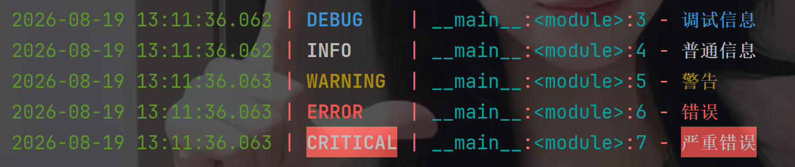


## `json` 模块

```python
import json
```

|     JSON     | Python       |
| :----------: | ------------ |
|    object    | dict         |
|    array     | list         |
|    string    | str          |
|    number    | int / float  |
| true / false | True / False |
|     null     | None         |

### `json.loads()` JSON 字符串转 Python 对象

```python
import json

text = '{"name": "小米", "price": 2999, "stock": true}'

data = json.loads(text)

print(data)     # {'name': '小米', 'price': 2999, 'stock': True} 
print(type(data))      # <class 'dict'>
```

### `json.dumps()` Python 数据类型转 JSON 对象

```python
import json

data = {
    "name": "小米",
    "price": 2999,
    "stock": True
}

result = json.dumps(data, ensure_ascii=False)   # 中文等非 ASCII 字符直接显示不转Unicode

print(result)      # {"name": "小米", "price": 2999, "stock": true}
print(type(result))   # <class 'str'>
```

### `json.load()` 从文件读取 JSON

### `json.dump()` 把 Python 对象写入 JSON文件


# 文件管理

## `pathlib` 模块

```python
from pathlib import Path as p
```

### 1. 构建路径对象

```python
path = p("D:\我的资料库\Desktop\网络安全")
path = p(__file__)         # __file__ 当前文件路径
path = p.home()    # C:\Users\Administrator      用户主目录
path = p.cwd()     # D:\py-project          当前工作目录
path = p(__file__).parent      # 当前文件的父目录
```

#### 快速抽取路径各部分：（只读属性）

|    属性    | 说明                           |
| :--------: | :----------------------------- |
|   `name`   | 文件名（含后缀）               |
|   `stem`   | 文件名不带最后一个后缀         |
|  `suffix`  | 最后一个后缀                   |
| `suffixes` | 处理多后缀文件输出所有后缀列表 |

### 2. 路径判断与检查（`True`/`False`）

```python
path=p('D:/py-project/文件操作.py')

path.exists()             # 检查文件是否存在
path.is_file()            # 检查是否为文件
path.is_dir()             # 检查是否为文件夹
path.is_symlink()         # 检查是否为符号链接（Windows的.lnk 快捷方式是文件）
path.is_absolute()        # 检查是否为绝对路径
path.is_relative_to('路径')    # 检查是否在某路径下
```

### 3. 拼接路径 `/`

```python
from pathlib import Path as p

path = p("D:/py-project")

path2 = path / 'test.txt'

print(path2)      # D:\py-project\test.txt
```

### 4. 创建与删除

#### `mkdir()` 创建文件夹

> `mkdir(parents=True, exist_ok=True)`
>
> `parents=True`：如果父目录不存在自动创建缺失的父目录
>
> `exist_ok=True`：如果要创建的目录已存在，通常会报错，加上这个参数不会报错

#### `touch()` 创建文件

> 如果文件已存在，运行后文件内容不变，但“修改时间”会变成当前时间

#### `unlink()` 删除文件或符号链接

#### `shutil.rmtree()` 删除文件夹

#### `rename('路径')` 重命名或移动文件/文件夹

> 参数必须是完整的路径，而不仅仅是一个目录
>
> **限制：**不能跨文件系统（跨盘符）

```python
# 确保目标目录存在
target_dir = p("subfolder")

file_to_move = p("file.txt")

# 移动文件到 subfolder 目录下
file_to_move.rename(target_dir / file_to_move.name)
```

#### `replace('路径')` 跨盘符移动


### 5. 遍历目录

#### `iterdir()` 列出目录下所有子文件和文件夹

```python
for i in p.cwd().iterdir():
    print(i)
```

#### `glob(pattern)` 带规则的查找

> 根据通配符规则，在目录下查找匹配的文件（和`iterdir`一样只看第一层）
>
> **通配符：**
>
> `*`  匹配任意多个字符（例如 `*.txt` 匹配所有 txt 文件）
>
> `?`  匹配任意一个字符（例如 `file?.txt` 匹配 `file1.txt` 但不匹配 `file10.txt`）
>
> `[abc]`  匹配方括号里的任意一个字符

#### `rglob(pattern)` 递归查找（看所有层）


## 文件读写

> 使用内置 `open()`打开文件，搭配 `with` 语句可自动关闭文件
>
> ```python
> with open('file.txt', 'r', encoding='utf-8') as f:
>        content = f.read()
>        print(content)
> # 退出 with 块后自动关闭文件
> ```

### 1. 文件模式

| 模式   | 说明             | 文件不存在 | 文件存在       |
| ------ | ---------------- | ---------- | -------------- |
| `'r'`  | 只读（默认）     | ❌ 报错     | 读取           |
| `'w'`  | 只写（覆盖）     | ✅ 创建     | ⚠️ 清空后写入   |
| `'a'`  | 追加             | ✅ 创建     | 在末尾追加     |
| `'x'`  | 独占创建         | ✅ 创建     | ❌ 报错         |
| `'r+'` | 读写             | ❌ 报错     | 初始指针在开头 |
| `'b'`  | 二进制模式       | -          | -              |
| `'t'`  | 文本模式（默认） | -          | -              |

### 2. 文件读取方式

#### `read([size])` 读取指定字节数（默认读取全部）

> 包括换行符与空行

#### `readline()` 读取一行

#### `readlines()` 读取所有行返回列表

#### 逐行遍历

```python
with open('file.txt', 'r', encoding='utf-8') as f:
    for line in f:
        print(line.strip())
```


### 3. 写入文件

#### `write` 写入字符串

> 换行符：`\n`
>
> 追加内容`'a'`模式


# Numpy

> 提供一个高性能的多维数组对象 `ndarray`
>
> ```
> pip install numpy
> ```

## 一、创建数组

```python
import numpy as np

np.array([1, 2, 3, 4], dtype=None, ndmin=0)
# 传入‘能按顺序取出数值，且类型可统一’
# 数据类型自动判断，ndmin ：强制最小维度
```

```python
np.arange([start,] stop[, step,], dtype=None)
# 起始值默认为 0，步长默认为 1，数据类型默认自动判断
# 支持浮点数步长
```

```python
np.linspace(start, stop, num=50, endpoint=True, retstep=False, dtype=None, axis=0)
# 生成指定个数的等间距数组
# num ：生成的元素个数
# endpoint ：是否包含 stop
# retstep ：是否同时返回步长
# dtype ：数据类型（自动判断）
# axis ：插入新轴的位置
```

## 二、ndarray 基本属性

|    属性     | 说明     |
| :---------: | -------- |
| **`ndim`**  | 维度     |
| **`shape`** | 形状     |
| **`size`**  | 元素数量 |
| **`dtype`** | 数据类型 |


## 三、伪随机数 `np.random`

```python
# 0~1之间随机3个均匀分布的数
np.random.rand(3)

# 0~1之间正态分布，均值=0，方差=1
np.random.randn(3)

# 1~9随机5个整数
np.random.randint(1, 10[, 5])

# 0~1随机浮点数
np.random.random()

# 均匀分布随机数
np.random.uniform(0, 1, 5)   # [0,1) 5个均匀分布的随机数

# 随机抽样
np.random.choice([1,2,3,4])

# 多个抽样
np.random.choice([1,2,3,4], size=3)
# [,replace=False]不重复抽样

# 打乱数组，直接修改原数组
arr = np.array([1, 2, 3, 4])
np.random.shuffle(arr)

# 不改变原数组
np.random.permutation([1, 2, 3, 4])

# 设置随机数种子
np.random.seed(42)
```


## 四、向量化运算

```python
a = np.array([1, 2, 3, 4, 5])
b = np.array([6, 7, 8, 9, 10])
result = a + b
print(type(result), result)
# <class 'numpy.ndarray'> [ 7  9 11 13 15]
```

## 五、二维索引与切片

```python
a[0, 1]     # 第0行第1列
a[:, 1]     # 第2列
a[1, :]     # 第2行
```

## 六、统计函数

|           函数           | 说明                |
| :----------------------: | ------------------- |
|       **`sum()`**        | 求和                |
|       **`mean()`**       | 平均值              |
|    **`max()/min()`**     | 最大值/最小值       |
| **`argmax()/argmin()`**  | 最大值/最小值的索引 |
|       **`var()`**        | 方差                |
|       **`std()`**        | 标准差              |
|       **`axis=0`**       | 按列操作            |
|       **`axis=1`**       | 按行操作            |
| **`cumsum()/cumprod()`** | 累加/累乘           |

## 七、算数函数

|             函数              | 说明                           |
| :---------------------------: | ------------------------------ |
|    **`np.power(a, 指数)`**    | 幂运算                         |
|      **`np.square(a)`**       | 平方                           |
|       **`np.sqrt(a)`**        | 开方                           |
|       **`np.floor(a)`**       | 向下取整                       |
|       **`np.ceil(a)`**        | 向上取整                       |
| **`np.round(a, decimals=0)`** | 四舍五入                       |
|        **`np.abs(a)`**        | 绝对值                         |
|  **`np.mod(被除数, 除数)`**   | 取余                           |
|    **`np.greater(a, b)`**     | a > b 为True，返回的是布尔数组 |
|      **`np.less(a, b)`**      | <                              |
|     **`np.equal(a, b)`**      | ==                             |

## 八、广播

> 不同形状的数组，在进行逐元素运算时，NumPy自动扩展较小数组，使它们形状兼容

```python
import numpy as np

a = np.array([1, 2, 3])
b = 10

print(a + b)         # [11 12 13]

# b 被广播成 [10, 10, 10]
```

### (3,1) + (1,3)

```python
a = np.array([[1],
              [2],
              [3]])

b = np.array([[10, 20, 30]])

'''
[[1+10, 1+20, 1+30],
 [2+10, 2+20, 2+30],
 [3+10, 3+20, 3+30]]
 
输出
[[11 21 31]
 [12 22 32]
 [13 23 33]]
 '''
```

### (2,3) + (2,1)

```python
a = np.array([[1,2,3],
              [4,5,6]])

b = np.array([[10],
              [20]])

'''
[[11 12 13]
 [24 25 26]]
 '''
```

### 广播规则

> 从右往左对齐，维度相同或为1就能广播


# Pandas

## `Series(data, index)`（一维数组）

> 类似：Excel一列 / NumPy一维数组
>
> 用字典创建：key → index
>
> <span style='color:red'>继承于Numpy</span>
>
> Pandas 会主动把 `None` 替换成 `np.nan`（浮点型缺失值），以便统一处理

```python
import pandas as pd

s = pd.Series([10, 20, 30])
print(s)
'''
0    10
1    20
2    30
dtype: int64
'''
```

### 1. 访问

```python
import pandas as pd

s = pd.Series({'a': 1, 'b': 2, 'c': 3})

# 按索引取值
s['a']

# 按位置取值
s.iloc[0]

# 切片
s[0:2]

# 按标签切片（右端取到）
s["a":"c"]


s.values   # 值（NumPy数组）
s.index    # 索引
s.dtype    # 数据类型
s.size     # 元素个数
```

### 2. 筛选

```python
s[s > 10]

s.isin(values)       # 判断某个值是否在指定集合（列表、Series、set）中，返回布尔值
```

### 3. 修改数据

```python
s["a"] = 100

s[s > 10] = 0
```

### 4. 排序

```python
s.sort_values()         # 升序
s.sort_values(ascending=False)     # 降序

s.sort_index()          # 升序
s.sort_index(ascending=False)     # 降序
```

### 5. 索引对齐机制

```python
s1 = pd.Series([1,2,3], index=['a','b','c'])
s2 = pd.Series([10,20,30], index=['b','c','d'])

print(s1+s2)
'''
a     NaN
b    12.0
c    23.0
d     NaN
dtype: float64
'''
```


### 6. 缺失值处理

> 以下几个方法默认都是**返回新 Series**，原数据 `s` 保持不变。直接修改原数据需要加参数 `inplace=True`
>
> 如果原 Series 是整数类型（`int`），一旦出现 `NaN`，Pandas 会自动将其转为浮点数（`float64`）。用 `fillna(0)` 填充后，它依然保持浮点型（如 `0.0`），不会变回纯整数。

```python
import numpy as np

s = pd.Series([1, 2, np.nan, 4, np.nan])

s.isna()   # 检测缺失值
'''
0    False
1    False
2     True   <- 这里缺失
3    False
4     True   <- 这里缺失
dtype: bool
'''

s.notna()   # 检测非缺失值
'''
0     True
1     True
2    False
3     True
4    False
dtype: bool
'''

s.dropna()  # 删除缺失值
'''
0    1.0
1    2.0
3    4.0
dtype: float64
'''

s.fillna(0)   # 填充缺失值（用0代替NaN）
'''
0    1.0
1    2.0
2    0.0
3    4.0
4    0.0
dtype: float64
'''
```


### 7. 去重与唯一值

```python
s = pd.Series(['A', 'B', 'A', 'C', 'B', None])

s.unique()   # 列出有哪些不重复的值（返回数组）
# ['A' 'B' 'C' None]

s.nunique()   # 计算有多少种（默认不统计 NaN，要统计加上 dropna=False）
# 3

s.value_counts()   # 统计各自有多少个（这里加入了 dropna=False）
'''
A       2
B       2
C       1
None    1
Name: count, dtype: int64
'''
```


### 8. 类型转换

```python
s.astype(int)
s.astype(float)
```


## `DataFrame(data, index, columns)`

> 多个 Series 按列拼起来的二维表，由三部分组成：**index**（行索引），**columns**（列索引），**values**（二维Numpy数组）
>

### 1. 创建

#### 字典

```python
import pandas as pd

df = pd.DataFrame({
    "name": ["A", "B", "C"],
    "age": [18, 20, 22]
})

print(df)
'''
  name  age
0    A   18
1    B   20
2    C   22
'''
```

#### 列表嵌套

```python
pd.DataFrame([
    [1, 2],
    [3, 4]
], columns=["A", "B"])
'''
   A  B
0  1  2
1  3  4
'''
```

#### Series 组成

```python
s1 = pd.Series([1, 2])
s2 = pd.Series([3, 4])

pd.DataFrame({"A": s1, "B": s2})
'''
   A  B
0  1  3
1  2  4
'''
```

#### 列表字典

```python
pd.DataFrame([
    {"name": "A", "age": 18},
    {"name": "B", "age": 20}
])
'''
  name  age
0    A   18
1    B   20
'''
```

### 2. 访问

```python
# 获取一列
df['name']

# 获取多列
df[["name", "age"]]

# 行/列选择
df.loc[0]    # 第0行
df.loc[0, 'name']   # 行 + 列

df.iloc[0]   # 第0行
df.iloc[0, 1]   # 第0行第1列

# 快速查看前/后几行数据（默认5行）
df.head()
df.tail()
```


### 3. 切片

```python
df[0:2]      # 行切片
df.loc[0:2]   # 标签切片（包含2）
df.loc[:,'gender']
df.loc[df2['name']=='lisa','gender']
df.iloc[0:2,0:2]    # 不包含2
```

### 4. 对列操作

```python
# 新增列
df["score"] = [90, 80, 70]


# 修改列
df["age"] = df["age"] + 1


# 删除列
df1 = df.drop("age", axis=1)
```

### 5. 对行操作

```python
# 新增行
new_row = pd.DataFrame({
    "name": ["C"],
    "age": [22]
})
df = pd.concat([df, new_row], ignore_index=True)
concat表示拼接，ignore_index=True表示重新排列索引


# 直接插入（不推荐）
df.loc[len(df)] = ["D", 30]      # 最后一行之后的索引加入


# 逐行追加
data = []

data.append({"name": "A", "age": 18})
data.append({"name": "B", "age": 20})

df = pd.DataFrame(data)


# 删除行
df1 = df.drop('行索引', axis=0)
```

### 6. 条件筛选

> 位运算符 & 的优先级高于比较运算符 >（下面的例子要加括号）

```python
df1 = df[(df['age']>18) & (df['gender']>60)]
```

### 7. 统计函数

```python
df["age"].mean()
df["age"].sum()
df["age"].max()
df["age"].min()

# 整体：
df.describe()
```


### 8. 练习

```python
import pandas as pd
df = pd.DataFrame({
    'id':[4,5,6,7],
    'name':['lisa','cc','john','lili'],
    'age' :[18,21,20,19],
    'score':[98,95,59,75]
})
df.index = ['a','b','c','d']

# 新增一行id为9，姓名为lulu，年龄为22，成绩为98
new_row = pd.DataFrame({
    'id':9,
    'name':['lulu'],
    'age':22,
    'score':98
},index=['e'])
df = pd.concat([df,new_row])

# 新增一列 性别 分别为：女 男 男 女 女
df['sex'] = ['女','男','男','女','女']

# 所有学生的年龄加1
df['age']= df['age']+1

# cc的性别
df1 = df.loc[df['name']=='cc','sex']

# 所有女生的数据
df1 = df.loc[df['sex'] == '女', 'sex']

# 成绩大于80的学生姓名和年龄
df1 = df.loc[df['score']>80,['name','age']]

# 第三行、第四行，第一列、第三列数据
df1 = df.iloc[2:4, [0, 2]]

# 把cc的年龄 +1
df1 = df.loc[df['name'] == 'cc', 'age']+1
```


### 9. 缺失值处理

#### 判断缺失值 `isnull()`

```python
df.isnull()

# 统计每列缺失值数量
df.isnull().sum()

# 是否存在缺失值
df.isnull().any()
```

#### 删除缺失值 `dropna()`

```python
# 删除包含缺失值的行
df.dropna()

# 修改原DataFrame
df.dropna(inplace=True)

# sales 列为空的行删除
df.dropna(subset=['sales'])
```

#### 填充缺失值 `fillna()`

```python
# 填固定值
df.fillna(0)

# 填中位数
df['sales'].fillna(
    df['sales'].median()
)

# 平均数 .mean()
```


### 10. 数据清洗

#### 去重

```python
df.drop_duplicates()          # 按整行去重
df.drop_duplicates(subset="name")     # 指定列去重
```

#### 类型转换

```python
df["age"] = df["age"].astype(int)
```

#### 字符串处理

```python
df["name"].str.lower()    # 全部转小写
df["name"].str.contains("a")      # 判断每个字符串是否包含 "a"（支持正则）
df["name"].str.contains("a", case=False)    # 忽略大小写
df["name"].str.replace("A", "B")     # 把所有 "A" 替换成 "B"（支持正则替换）
```


### 11. 排序

```python
df.sort_values(by="列名")      # 从小到大
df.sort_values(by="age", ascending=False)     # 从大到小

df.sort_values(by=["age", "score"])     # 多列排序（先按age排，age相同再按score排）
df.sort_values(by=["age", "name"], ascending=[True, False])

df.sort_values(by="age", inplace=True)   # 直接修改原数据

df.sort_index()     # 索引升序排列
df.sort_index(ascending=False)   # 降序
df.sort_index(axis=1)      # 按列索引排序（字母）
```


### 12. `groupby` 分组统计

> 语法：
>
> ```python
> df.groupby("分组列")
> ```
>
> 创建了分组对象，配合聚合函数
>
> ```python
> df.groupby("部门")["工资"].mean()      # 每个部门平均工资
> ```

#### `agg()` 多种统计一起做

```python
df.groupby("部门")["工资"].agg(["count", "mean", "max"])
'''
      count    mean     max
部门
人事部    1    5000    5000
技术部    2    8500    9000
销售部    2    6500    7000
'''
```

#### 多个字段分组

```python
df.groupby(["部门","性别"])["工资"].mean()
'''
部门    性别
技术部  女    9000
       男    8000
销售部  女    7000
       男    6000
'''
```

#### `reset_index()`

> groupby之后默认会把分组字段变成索引
>
> 恢复普通DataFrame：
>
> ```python
> df.reset_index()
> ```


### 13. `apply(func)`

#### 传入系统函数

```python
df = pd.DataFrame({
    "数学": [80, 90, 70],
    "英语": [85, 95, 75]
})

print(df.apply(max))
'''
数学    90
英语    95
dtype: int64
'''
```

#### 自定义函数

```python
df = pd.DataFrame({
    "数学": [80, 90, 70],
    "英语": [85, 95, 75]
})

def cha(x):
    return x.max() - x.min()

print(df.apply(cha))
'''
数学    20
英语    20
dtype: int64
'''

df["英语"] = df["英语"].apply(
    lambda x:x+5
)
print(df["英语"])
'''
0     90
1    100
2     80
Name: 英语, dtype: int64
'''
```

#### 横向传入 `axis=1`

```python
df = pd.DataFrame({
    "数学": [80, 90, 70],
    "英语": [85, 95, 75]
})

df['总分'] = df.apply(
    lambda x: x['数学'] + x['英语'], axis=1
)
print(df["总分"])
'''
0    165
1    185
2    145
Name: 总分, dtype: int64
'''
```

### 14. `concat()` 拼接

#### 语法

```python
pd.concat(
    [objs],         # 要拼接的数据
    axis=0,         # 上下拼接（默认），axis=1左右拼接
    join='outer',   # 连接方式
    ignore_index=False    # 是否重新生成索引（默认不）
)
```

#### 重新生成索引

```python
import pandas as pd

df1 = pd.DataFrame({
    "姓名": ["张三", "李四"],
    "年龄": [20, 21]
})

df2 = pd.DataFrame({
    "姓名": ["王五", "赵六"],
    "年龄": [22, 23]
})

df = pd.concat(
    [df1, df2],
    ignore_index=True
)

print(df)
'''
   姓名  年龄
0  张三  20
1  李四  21
2  王五  22
3  赵六  23
'''
```


### 15. `pivot_table()` 数据透视表

> 语法：
>
> ```python
> pd.pivot_table(
>     data,          # 数据表
>     index,         # 行分组字段
>     columns,       # 列分组字段
>     values,        # 要统计的数值列
>     aggfunc        # 统计方法
> )
> ```
>
> ```
> D:\py-project\科学计算库\商品练习.ipynb ---- 3.
> ```
>
> ```python
> pd.pivot_table(
>     data=df,
>     index='region',
>     columns='category',
>     values=['sales'],
>     aggfunc=['mean']
> )
> ```

### 16. `to_datetime()` 时间处理

```python
df["日期"] = pd.to_datetime(df["日期"])
```

#### 提取年份

```python
df["年份"] = df["日期"].dt.year
```

#### 提取月份

```python
df["月份"] = df["日期"].dt.month
```


## 获取/保存数据

### 1. 查看文件编码

```
pip install chardet
```

```python
import chardet

with open("豆瓣.csv", "rb") as f:
    data = f.read()

result = chardet.detect(data)
print(result)
# {'encoding': 'UTF-8-SIG', 'confidence': 1.0, 'language': ''}
'''
encoding : 推测编码
confidence : 置信度（0~1）
rb : 必须用二进制读，否则无法分析
'''
```

```python
pip install charset-normalizer    # 更现代
```

```python
from charset_normalizer import from_path

result = from_path("豆瓣.csv").best()
print(result.encoding)
# utf_8
```


### 2. 从文件读取

#### CSV

```python
import pandas as pd

pd.read_csv(
    "豆瓣.csv"[,
    encoding="utf-8",   # 编码
    sep=",",            # 分隔符
    usecols=['列名']    # 只读取几列
    header=0,           # 把某行数据作为列名（或者 names = [] 自定义列名）
    index_col=0]        # 指定索引列
)


df.to_csv(              # 保存
    "data.csv",
    index=False,       # 不保存索引列
    encoding="utf-8-sig",  # 编码
    sep=",",           # 分隔符
)
```

#### Excel

```python
df = pd.read_excel("data.xlsx", sheet_name="Sheet1")


df.to_excel("data.xlsx", index=False)          # 保存
with pd.ExcelWriter("data.xlsx") as writer:    # 多sheet保存
    df1.to_excel(writer, sheet_name="A")
    df2.to_excel(writer, sheet_name="B")
```

#### JSON

```python
df = pd.read_json("data.json")
```


### 3. 练习

```
D:\py-project\科学计算库\企业人力资源分析表.csv
```

```python
import pandas as pd

df = pd.read_csv(r"D:\py-project\科学计算库\企业人力资源分析表.csv", encoding='gbk')
print(df)
```


# Matplotlib

> 最基础、最核心的**数据可视化库**，主要用来把数据画成各种图（折线图、柱状图、散点图、直方图等）
>
> **<span style='font-size:20px'>pyplot</span>**  ----->   类似“快捷画图接口”
>
> ```python
> import matplotlib.pyplot as plt
> ```
>
> `plt.show`  显示图像

## 中文乱码问题

```python
plt.rcParams["font.sans-serif"] = ["SimHei"]    # 中文字体
plt.rcParams["axes.unicode_minus"] = False      # 负号正常显示
```

### 模块位置：

```python
D:\py-project\科学计算库\font_config.py

# import font_config
```


## 常见图形

### 1. 折线图 -`plot`

```python
plt.plot(
    x,
	y,
    color= / 简写：'r',
    linestyle='-'/'--'/':'     # 实线（默认）/虚线/点线
    linewidth=1.5              # 线宽（默认1.5）
    marker='o'/'s'/'^'/'*'     # 数据点样式（圆点/方块/三角/星号）
    markersize=10              # 点大小
)          # 默认索引当 x轴
```

### 2. 柱状图 -`bar/barh`

```python
plt.bar(["A","B","C"],
        [10,20,15],
        width=1,
        color=['r','g','b','y','c','m','k','w'],
        align='center'/'edge',     # 柱子居中对齐刻度（默认）/柱子从刻度左侧开始
        edgecolor='black', linewidth=1,
        alpha=0~1
       )
```

### 3. 散点图 -`scatter`

```python
plt.scatter(
    x,
    y,
    s=点的大小（面积）也可以是数组（每个点大小不同）,
    c='颜色',    # 固定颜色不映射
	alpha=0~1,   # 透明度
    marker='o'/'x'/'^'/'s'    # 点形状（圆点/×/三角/方块）
)

# 用数值映射颜色
plt.scatter(
    x,
    y,
    c=y,            # 用 y 的数值决定颜色（值越大颜色越深）
    cmap='viridis'/'plasma'/'cool'/'hot'   # 配色方案
    # 默认（蓝-->黄）/紫-->黄/蓝-->青/黑-->红-->黄
)
plt.colorbar()    # 颜色说明书
```

### 4. 直方图 -`hist`（连续型数值数据）

```python
plt.hist(
    x,              # 数据必须是数值型
    bins=10,            # 把数据分成 10 个“区间”
    range=None,         # 超出指定分布范围的数据会被忽略
    density=False,     # 是否转成概率密度
    color=None,
    edgecolor=None    # 边框颜色
    alpha=1
)
```

### 5. 饼图 -`pie`

```python
labels = ['Python', 'Java', 'C++', 'JavaScript']
sizes = [40, 25, 20, 15]

plt.pie(
    sizes,               # 每一块的数据
    labels=labels,       # 每一块的名称
    autopct='%1.1f%%',   # 显示百分比（保留一位小数）
    startangle=90        # 起始角度（90°表示从上方开始）
)
```

### 6. 核密度估计图 -`kde`

```python
import seaborn as sns

sns.kdeplot(
    data=df['工作时间'],
    bw_adjust=1,         # 小--->曲线波动越多，更贴近数据；大--->曲线更平滑
    ax=axes[1]
)
# Y轴表示：某个满意度附近的数据集中程度
```

### 7. 线箱图 -`boxplot`

```python
import seaborn as sns

sns.boxplot(
    data,
    x='',       # 分类变量
    y='',       # 数值变量
    hue='',     # 增加第三个分类维度
    width=0.8,  # 箱子宽度
    palette='Set1'/'Set2'/'pastel'/'deep'   # 设置颜色
    showfliers=True   # 是否显示异常值
)

最小值
  |
下四分位数 Q1
  |
中位数 Q2
  |
上四分位数 Q3
  |
最大值
```


## 常用配置

### 添加画布

```python
plt.figure(figsize=( , ), dpi=100)
# dpi 表示每 1 英寸里有多少个像素点，值越大清晰度越高，文件越大

# 多图布局（后面的配置要加set_）
fig, axes = plt.subplots(行, 列, figsize=( , ))

axes[0].plot([1,2,3],[4,5,6])
axes[0].set_title('折线图')
axes[1].bar(['A','B','C'],[3,5,2])
axes[1].set_title('柱状图')

# 2x2 布局
fig, axes = plt.subplots(2, 2, figsize=( , ))

axes[0,0].plot([1,2,3],[1,4,9])
axes[0,1].bar(['A','B'],[3,5])
axes[1,0].scatter([1,2,3],[3,2,1])
axes[1,1].hist([1,1,2,3,3,3,4])


plt.tight_layout()     # 自动调整标题、子图、坐标轴间距
```

### 标题

```python
plt.title(
    '标题',
    fontsize= ,
    color=' ',
    loc='center'/'left'/'right',
    pad= ,          # 间距
    fontweight='normal'/'bold'      # 字体粗细
)
```

### 坐标轴标签

```python
plt.xlabel("横轴标题")
plt.ylabel("纵\n轴\n标\n题", rotation=0, labelpad=10)
# rotation : 控制水平旋转角度（默认为90）
# labelpad : 控制离坐标轴的距离
```

### 坐标轴范围

```python
plt.xlim( , )
plt.ylim( , )
```

### 设置轴刻度

```python
plt.xticks(
	ticks,      # 刻度位置
    labels,     # 显示的文字
    rotation=   # 文字旋转，45度常用
)
plt.yticks()
```


### 网格

```python
plt.grid(True)
```

### 图例

```python
plt.plot(x, y, label="销量")
plt.legend()
```

### 添加文字

```python
# 在坐标系 (x, y) 位置写一段文本
plt.text(x, y, s, ha='', va='top'/'center'/'bottom', ha='left'/'center'/'right')
```

### 保存

```python
plt.savefig('', api=100)
```


## 练习

```
D:\py-project\爬虫\案例\豆瓣.csv
```

> 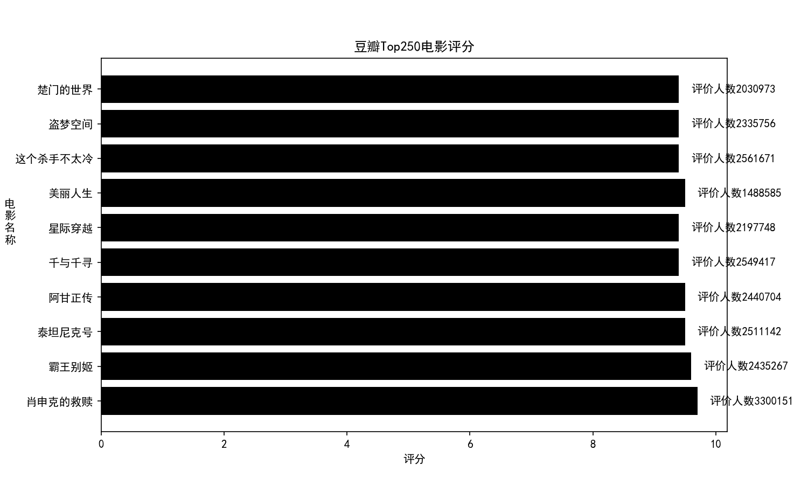

```python
import matplotlib.pyplot as plt
import font_config
import pandas as pd

df = pd.read_csv(r"D:\py-project\爬虫\案例\豆瓣.csv", encoding='utf-8-sig')
df1 = df.head(10)

plt.figure(figsize=(10, 6))
plt.barh(df1['电影名称'], df1['评分'], color='black')
plt.xlabel('评分')
plt.ylabel('电\n影\n名\n称', rotation=0)
plt.title('豆瓣Top250电影评分')

# 添加评价人数
for i, v in enumerate(df1['评价人数']):
    plt.text(df1['评分'].iloc[i] + 0.2, i, f'评价人数{v}', va='center')

plt.show()
```


> 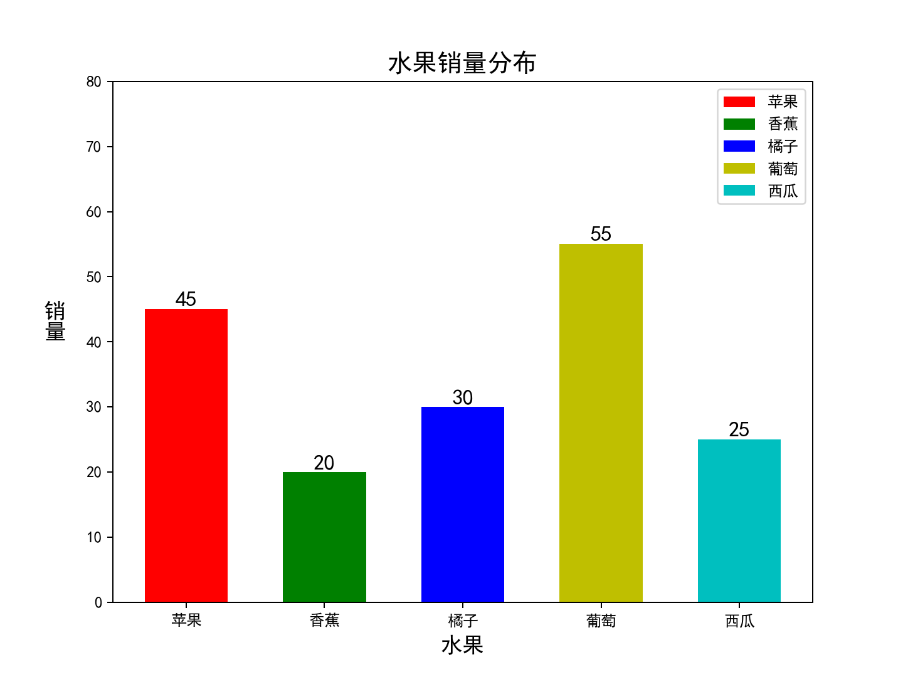

```python
import matplotlib.pyplot as plt
import font_config

# 数据
x = ['苹果','香蕉', '橘子', '葡萄', '西瓜']
y = [45, 20, 30, 55, 25]
colors = ['r','g','b','y','c']

# 创建画布
plt.figure(figsize=(8,6), dpi=120)

# 绘制柱状图（为每个柱子单独设置 label 以生成正确图例）
for i in range(len(x)):
    plt.bar(x[i], y[i], color=colors[i], width=0.6, label=x[i])

# 设置坐标轴范围和标签
plt.ylim(0, 80)
plt.title('水果销量分布', fontsize=16)
plt.xlabel('水果', fontsize=14)
plt.ylabel('销\n量', fontsize=14, rotation=0, labelpad=20)

# 在柱子上方添加数值标签
for a, b in zip(x, y):
    plt.text(a, b, b, ha='center', va='bottom', fontsize=14)

# 显示图例
plt.legend()

plt.show()
```


```
D:\py-project\科学计算库\企业人力资源分析表.csv
D:\py-project\科学计算库\人力资源分析表练习.ipynb
```

### 1. 工作时间（从小到大）人数分布趋势 折线图

```python
import matplotlib.pyplot as plt
import font_config
import pandas as pd

df = pd.read_csv('企业人力资源分析表.csv', encoding='gbk')

s1 = df['每月在公司工作时间'].value_counts().sort_index()

plt.plot(s1)

plt.title('工作时间人数分布图')
plt.xlabel('工作时间')
plt.ylabel('人数')
plt.show()
```

### 2. 项目数量与人数分布趋势 柱状图

```python
df = pd.read_csv('企业人力资源分析表.csv', encoding='gbk')

s1 = df['项目数量'].value_counts().sort_index()

plt.bar(s1.index,s1.values)
plt.title('项目数量人数分布图')
plt.xlabel('项目数量')
plt.ylabel('人数')
plt.show()
```

### 3. 离职人数饼状图

```python
df = pd.read_csv('企业人力资源分析表.csv', encoding='gbk')

s1 = df['是否离职'].value_counts().sort_index()

plt.pie(
    s1.values,
    labels=s1.index,
    autopct='%1.1f%%',
    startangle=90
)

plt.title('离职率统计')
plt.show()
```

### 4. 散点图示例

```python
import matplotlib.pyplot as plt
import font_config
import numpy as np

np.random.seed(42)
x= np.random.randint(50,100,100)
y = np.random.uniform(100,1000,100)
plt.scatter(
    x, y,
    s=200,
    c=y,
    cmap='viridis',
    alpha=1,
    marker='o',
    label='Scatter 示例'
)

plt.colorbar()
plt.title("Scatter 示例")
plt.xlabel("销售数据")
plt.ylabel("销售额数据")
plt.show()
```

### 5. 综合案例

> 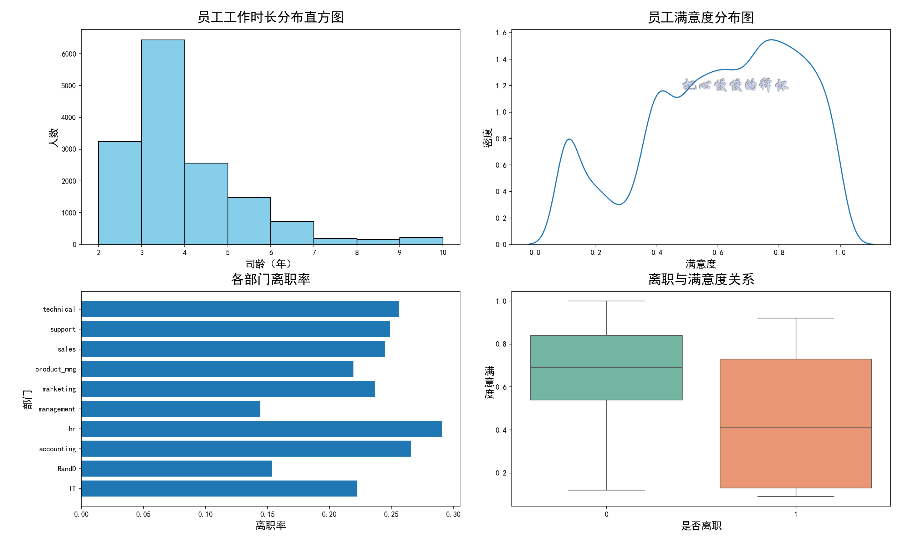

```python
import matplotlib.pyplot as plt
import font_config
import pandas as pd
import seaborn as sns

# 读取数据
df = pd.read_csv('企业人力资源分析表.csv', encoding='gbk')

# 创建画布
fig, axes = plt.subplots(2, 2, figsize=(17, 14))


# 1. 司龄分布直方图
axes[0,0].hist(
    df['司龄'],
    bins=8,
    color='skyblue',
    edgecolor='black'
)

axes[0,0].set_title('员工工作时长分布直方图', fontsize=18, pad=10)
axes[0,0].set_xlabel('司龄（年）', fontsize=14)
axes[0,0].set_ylabel('人数', fontsize=14)


# 2. 员工满意度 KDE图
sns.kdeplot(
    df['员工满意度'],
    ax=axes[0,1]
)

axes[0,1].set_title('员工满意度分布图', fontsize=18, pad=10)
axes[0,1].set_xlabel('满意度', fontsize=14)
axes[0,1].set_ylabel('密度', fontsize=14)


# 3. 各部门离职率
rate = df.groupby('部门')['是否离职'].mean()

axes[1,0].barh(
    rate.index,
    rate.values
)

axes[1,0].set_title('各部门离职率', fontsize=18, pad=10)
axes[1,0].set_xlabel('离职率', fontsize=14)
axes[1,0].set_ylabel('部门', fontsize=14)


# 4. 离职与满意度关系
sns.boxplot(
    data=df,
    x='是否离职',
    y='员工满意度',
    hue='是否离职',      # 添加这一行
    palette='Set2',
    legend=False,        # 关闭图例
    ax=axes[1,1]
)

axes[1,1].set_title('离职与满意度关系', fontsize=18, pad=10)
axes[1,1].set_xlabel('是否离职', fontsize=14)
axes[1,1].set_ylabel('满\n意\n度', fontsize=14, rotation=0, labelpad=8)


# 调整布局
plt.tight_layout(pad=3)
plt.show()
```


### 6. 商品练习

```
D:\py-project\科学计算库\商品练习.csv
D:\py-project\科学计算库\商品练习.ipynb
```


# 网络编程 `Socket（套接字）`

> ````python
> D:\我的资料库\Desktop\网络安全\计算机网络基础\计算机网络基础.md
> ````
>
> `Socket` 是操作系统提供的**两台计算机之间通信的接口**

## 一、TCP 通信过程

```
客户端                服务端

socket()  ───────► socket()            # 创建套接字

connect()   # 连接服务器 ───────►  bind()    # 绑定IP地址和端口

                   listen()            # 监听客户端连接请求

                   accept()            # 接受客户端连接

send()    ───────► recv()              # 收发数据

recv()    ◄──────  send()              # 收发数据

close()   ───────► close()             # 关闭连接
```

### 服务器端

```python
import socket

# 创建socket对象
s = socket.socket()
# 等价于
s = socket.socket(
    socket.AF_INET,
    socket.SOCK_STREAM
)
# AF_INET 表示使用IPv4 ，AF_INET6 表示使用IPv6
# SOCK_STREAM 表示使用TCP协议 ，SOCK_DGRAM 表示使用UDP协议

# 绑定IP和端口，必须使用元组
s.bind(("127.0.0.1", 8888))

# 开始监听
s.listen()
print("服务器启动成功，等待连接...")

# 接受客户端连接
conn, addr = s.accept()

# 接收数据
data = conn.recv(1024)
print("收到：", data.decode())    # 收到的是 bytes 要解码，同理发送数据时也要先编码

# 回复客户端
conn.send("收到消息".encode())

# 关闭连接
conn.close()

# 关闭服务器
s.close()
```

> `accept()` 是一个阻塞函数，如果没有客户端连接，程序会停在这里等待
>
> 返回两个值：
> `conn`  表示与客户端通信的新 Socket 对象
> `addr`  表示客户端地址
>
>  
>
> `data = conn.recv(1024)` 表示最多读取 1024 字节的数据
>
> 
>
> `listen([n])`  `n`用于设置等待连接的队列大小，当服务器当前连接达到上限时，后续的请求会被当如一个列队，知道有可用的连接
>
> 
>
> `b`前缀表示**字节串字面量**引号里的内容当作**原始字节序列**处理（只认单字节的 ASCII 字符，中文是多字节字符）

### 客户端

```python
import socket

# 创建socket对象
client = socket.socket()

# 连接服务器
client.connect(("127.0.0.1", 8888))

# 发送数据
client.send("你好服务器".encode())

# 接收回复
data = client.recv(1024)
print(data.decode())

# 关闭连接
client.close()
```


## 二、UDP 通信过程

> `UDP` 不需要建立连接

```
客户端                     服务端

socket()  ────────────►  socket()        # 创建套接字

                         bind()         # 绑定IP地址和端口

sendto()  ────────────►  recvfrom()      # 接收客户端发送的数据

recvfrom() ◄──────────   sendto()         # 回复客户端数据

close()   ────────────►  close()         # 关闭套接字
```

### 服务端

```python
import socket

s = socket.socket(socket.AF_INET, socket.SOCK_DGRAM)

s.bind(("127.0.0.1", 8888))

data, addr = s.recvfrom(1024)
print(data.decode())

s.sendto("收到".encode(), addr)

s.close()      # 关闭本地创建的 Socket 对象，释放操作系统资源
```

### 客户端

```python
import socket

client = socket.socket(socket.AF_INET, socket.SOCK_DGRAM)

client.sendto("你好".encode(), ("127.0.0.1", 8888))

data, addr = client.recvfrom(1024)
print(data.decode())

client.close()
```


## 三、`struct` 模块

> 把 Python 数据类型转换成二进制字节（打包），或者把二进制字节还原成 Python 数据（解包）

### 常见格式

| 格式 | 类型               | 字节数   |
| :--: | ------------------ | -------- |
| `b`  | signed char        | 1        |
| `B`  | unsigned char      | 1        |
| `h`  | short              | 2        |
| `H`  | unsigned short     | 2        |
| `i`  | int                | 4        |
| `I`  | unsigned int       | 4        |
| `q`  | long long          | 8        |
| `Q`  | unsigned long long | 8        |
| `f`  | float              | 4        |
| `d`  | double             | 8        |
| `?`  | bool               | 1        |
| `s`  | 字节串             | 指定长度 |

### `struct.pack(格式, 数据)`

> 把 Python 数据打包成 bytes

```python
import struct

data = struct.pack("i", 100)

print(data)       # b'd\x00\x00\x00'
```

### `struct.unpack(格式, 数据)`

> 把 bytes 解析成 Python 数据，返回的是元组

```python
import struct

data = b'd\x00\x00\x00'
num = struct.unpack("i", data)

print(num)           # (100,)
```


# 多任务编程

## 并发

> 假设有两个任务：
>
> ```
> 任务A：吃饭
> 任务B：看电视
> ```
>
> 如果只有一个 CPU 核心，同一时刻实际上只能执行一个任务
>
> ```
> 时间 →
> ────────────────────────────>
> 
> A   A   B   B   A   B   A   B
> ```
>
> 并发：在同一时间段内处理多个任务。

## 并行

> 如果有两个 CPU 核心
>
> ```
> CPU核心1       CPU核心2
>    │              │
>    ↓              ↓
> 任务A            任务B
> ```
>
> A 和 B 可以在**同一时刻真正执行**
>
> ```
> 时间 →
> ────────────────────────>
> 
> 核心1： A A A A A A
> 核心2： B B B B B B
> ```
>
> 并行：多个任务在同一时刻真正同时执行。


## 实现方式

> **让程序在同一时间处理多个任务**，提高CPU利用率和程序运行效率
>
> 
>
> 主要的三种方式：
>
> ```
>                多任务编程
>                    │
>       ┌────────────┼────────────┐
>       │            │            │
>     多线程       多进程         协程
>    (Thread)    (Process)     (Asyncio)
> ```

### 多进程

> 每个进程拥有独立的内存空间，一个进程崩溃通常不会影响其他进程
>
> 稳定性极高，能充分利用多核 CPU
>
> 创建和切换开销大，进程间通信（IPC，如管道、队列）相对复杂
>
> 


### 多线程

> 进程内的“轻量级选手”。线程共享其所属进程的内存空间，就像一间大屋子里的几个工人
>
> 创建、切换开销小，共享数据非常方便快捷
>
> 共享内存带来了数据竞争的噩梦，需要复杂的同步机制来保护数据，且一个线程的崩溃可能拖垮整个进程

### 协程

> 用户态的“超轻量级选手”。协程的调度完全由程序员在代码中控制，而非操作系统
>
> 切换开销极小（远小于线程），无锁编程，能用同步的写法，实现异步的、高并发的效果
>
> 无法利用多核优势（除非配合多进程），需要特定语言和库支持，对阻塞性系统调用需要小心处理


### 绕过 GIL 实现真正并行

> CPython 解释器里有个**全局解释器锁（GIL）**，它强制同一时刻只有一个线程能执行 Python 字节码。因此，多线程无法利用多核做并行计算
>
> 多进程就完美避开了 GIL：**每个进程都有自己独立的 Python 解释器和内存空间**，各自持有独立的 GIL


# 队列

```python
import queue
```

|     队列      | 作用                 |
| :-----------: | -------------------- |
|     Queue     | 普通队列（先进先出） |
|   LifoQueue   | 栈（后进先出）       |
| PriorityQueue | 优先级队列           |

## Queue 普通队列

```python
from queue import Queue

q = Queue()    # 空队列
q = Queue(maxsize=3)     # 限制队列大小
```

### `put()` 放数据

```python
q.put("任务1")
q.put("任务2")
q.put("任务3")
```

### `get()` 取数据

> 如果没有数据会一直等待
>
> `q.get(timeout=3)`    最多等待 3 秒

```python
print(q.get())    # 任务1
print(q.get())    # 任务2
print(q.get())    # 任务3
# 先进先出
```

### `qsize()` 查看队列大小

### `empty()` 判断是否为空

### Empty 异常

```python
from queue import Queue, Empty

q = Queue()

try:
    data = q.get(timeout=2)

except Empty:
    print("队列没有数据")
```


## LifoQueue 栈

```python
from queue import LifoQueue

q = LifoQueue()

q.put(1)
q.put(2)
q.put(3)

print(q.get())     # 3
```


## PriorityQueue 优先级队列

> 数字越小优先级越高

```python
from queue import PriorityQueue

q = PriorityQueue(3)

q.put((2,'普通任务'))
q.put((1,'紧急任务'))
q.put((3,'其他任务'))

print(q.get())     # (1, '紧急任务')
print(q.get())     # (2, '普通任务')
print(q.get())     # (3, '其他任务')
```


# `multiprocessing` 模块

## `Process` 手动创建独立子进程

```python
from multiprocessing import Process
```

### 创建`Process`对象

> ```python
> p = Process(target= , args=, kwargs=)
> ```
>
> `target` ：要执行的任务名称
>
> `args` ：传给函数的参数，且必须是元组

### 启动然后等待运行完

> **Linux / macOS（fork）**
>
> 直接复制父进程，子进程继承内存状态，不会重新`import`
>
> 
>
> **Windows（spawn）**
>
> spawn：重新启动一个 Python 解释器，子进程会**重新 import 一遍主文件**，导致无限递归+崩溃
>
> 所有跟 `Process` 创建和启动相关的代码，都放在 `if __name__ == '__main__':` 块里面
> 防止代码在“被导入时自动执行”，只允许在“直接运行时执行”

```python
p.start()
p.join()

# 主进程运行到 p.join() 时会暂停，直到子进程 p 彻底跑完（或自己退出），才继续往下
# 如果不写 join()，主程序可能不管子进程是否结束就直接退出了
```


# `threading` 模块

> 用于**多线程编程**的核心模块

## 创建线程

```python
import threading

def task(name):
    print(f"hello {name}")

# 填入的是函数名：把函数对象交给线程，等线程启动的时候再执行
t = threading.Thread(target=task, args=("Alice",))   

t.start()
t.join()     # 等待这个线程执行结束
```


## `daemon` 守护线程

> **非守护线程**：`daemon=False`，默认
>
> **守护线程**：`daemon=True`
>
> 守护线程会随着主线程/主程序的结束而结束
>
> > **创建时设置：**
> >
> > ```python
> > t = threading.Thread(target=task, daemon=True)
> > ```
>
> > **创建后设置：**
> >
> > ```python
> > t = threading.Thread(target=task)
> > t.daemon = True
> > t.start()
> > ```

```python
import threading
import time

def task():
    while True:
        print("线程运行中...")
        time.sleep(1)

t = threading.Thread(target=task)
t.daemon = True
t.start()

print("主线程结束")
```


## `is_alive()` 判断线程是否运行


## 线程同步

> 假设有一个共享变量：
>
> ```python
> money = 100
> ```
>
> 两个线程：
>
> ```
> 线程1：取 50
> 线程2：取 80
> ```
>
> 多线程可能发生：
>
> ```
> 线程1：读取 money → 100
> 线程2：读取 money → 100
> 
> 线程1：100 - 50 = 50
> 线程2：100 - 80 = 20
> 
> 线程1：写回 50
> 线程2：写回 20
> ```
>
> 最后得到结果：20
>
> 这种情况叫：
>
> > **竞态条件（Race Condition）：**
> >
> > 多个线程同时操作同一个共享数据，执行顺序不确定，导致结果出现错误
>
> **线程同步 = 多个线程一起干活时，怎么避免它们互相搞乱，以及怎么让它们按照一定条件配合。**


## Lock

> 同一个线程不能重复加锁

> 同一时间只允许一个线程进入某一段代码
>
> ```python
> from threading import Lock
> 
> # 创建锁对象
> lock = Lock()
> 
> money = 100
> 
> def withdraw():
>     	global money
> 
>    	# 加锁，阻止其它线程
>    	lock.acquire()
> 
>        money -= 50
> 
>        # 解锁
>        lock.release()
> ```

### 使用 `with`

```python
import threading

lock = threading.Lock()

money = 100

def withdraw():
    global money

    with lock:
        money -= 50
    '''
    相当于：
    lock.acquire()

	try:
    	money -= 50
	finally:
    	lock.release()
    '''
```


## RLock

> 同一个线程可以重复加锁


## 线程池

> ```python
> import requests
> from threading import Thread
> 
> 
> def get_page(url):
>        response = requests.get(url)
>        print(url, response.status_code)
> 
> 
> urls = [
>     "https://example.com/1",
>     "https://example.com/2",
>     "https://example.com/3",
>     "https://example.com/4",
>     "https://example.com/5",
> ]
> 
> threads = []
> 
> for url in urls:
>        t = Thread(target=get_page, args=(url,))
>        t.start()
>        threads.append(t)
> 
> for t in threads:
>        t.join()
> 
> print("全部完成")
> ```
>
> 假设有 10000 个 URL，就要创建 10000 个线程，显然不合理，实际爬虫用
>
> **线程池 ThreadPoolExecutor**
>
> 比如创建 4 个线程：
>
> ```
> 线程1 → 任务1 → 任务5 → 任务9 → ...
> 线程2 → 任务2 → 任务6 → 任务10 → ...
> 线程3 → 任务3 → 任务7 → 任务11 → ...
> 线程4 → 任务4 → 任务8 → 任务12 → ...
> ```
>
> 线程干完一个任务，再从任务队列拿下一个任务
>
> ```python
> from concurrent.futures import ThreadPoolExecutor
> ```

```python
from concurrent.futures import ThreadPoolExecutor
import time

def work(num):
    print(f'开始执行任务{num}')
    time.sleep(2)
    print(f'任务{num}执行完毕')

with ThreadPoolExecutor(max_workers=4) as pool:

    for i in range(1,21):
        pool.submit(work, i)
```

### `max_workers`

> 创建一个最多同时运行 4 个线程的线程池

### `submit()`

> 把 `work(i)` 这个任务提交给线程池，负责提交任务

### Future

> 未来的结果，因为任务可能还没执行完

```python
from concurrent.futures import ThreadPoolExecutor
import time

def add(a, b):
    time.sleep(2)
    return a + b

with ThreadPoolExecutor(max_workers=4) as pool:
    future = pool.submit(add, 10, 20)

    print(future)   # <Future at 0x200b2f55940 state=running>
    print(future.result())   # 等待任务完成拿到结果
```

### `map()`

```python
from concurrent.futures import ThreadPoolExecutor

def square(x):
    return x * x

nums = [1, 2, 3, 4, 5]

with ThreadPoolExecutor(max_workers=3) as pool:
    results = pool.map(square, nums)

for result in results:
    print(result)
# 1
# 4
# 9
# 16
# 25
```

> `submint()` 适合一个一个提交任务，并且需要单独处理每个 Future
>
> `map()` 适合一批数据交给同一个函数处理


# `asyncio` 模块

## 定义协程函数

> `async def` ：定义协程函数
>
> `await` ：等待结果，期间挂起当前协程，去执行别的

```python
import asyncio

async def say_hello(name, delay):
    await asyncio.sleep(delay)   # await = 暂停，交出控制权
    print(f"Hello {name}")
```


## 运行协程

```python
asyncio.run(say_hello("wenx", 1))
```

## 并发协程

### `asyncio.gather`

> 自动 `create_task`，统一等待所有任务结束，自动收集 return 值

```python
import asyncio
import time


async def task(name, delay):
    print(f"{name} 开始")
    await asyncio.sleep(delay)
    print(f"{name} 结束")
    return f"{name}"


async def main():
    start = time.time()

    results = await asyncio.gather(
        task("A", 2),
        task("B", 2),
    )

    end = time.time()
    print(end - start)
    print(results)

asyncio.run(main())

'''
A 开始
B 开始
A 结束
B 结束
2.012158155441284
['A', 'B']
'''
```

### `asyncio.create_task`

> 立刻开始调度执行，返回一个 Task 对象，更自由

```python
import asyncio
import time

async def task(name):
    print(name, "开始")
    await asyncio.sleep(2)
    print(name, "结束")

async def main():
    start = time.time()

    t1 = asyncio.create_task(task("A"))
    t2 = asyncio.create_task(task("B"))

    await t1
    await t2

    end = time.time()
    print("总耗时：", end - start)

asyncio.run(main())

'''
A 开始
B 开始
A 结束
B 结束
总耗时： 2.0037925243377686
'''
```


## `aiohttp` 模块

> 基于`asyncio` 的异步 HTTP 框架（多个请求可以同时进行）
>
> `requests` 是同步

### GET 请求

```python
import aiohttp
import asyncio

async def main():
    async with aiohttp.ClientSession() as session:
        async with session.get("https://example.com") as res:
            text = await res.text()
            print(text)

asyncio.run(main())
```

> `async with` ：异步上下文管理器，自动处理连接的打开/关闭
>
> `aiohttp.ClientSession()` ：异步 HTTP 会话对象，负责维持连接，管理 Cookie，复用 TCP 连接，发送所有 HTTP 请求（如果不用Session每次请求都要建立连接）
>
> `await resp.text()` ：这里是异步操作，必须等待读完才能拿到结果

### POST 请求

```python
import aiohttp
import asyncio

async def main():
    async with aiohttp.ClientSession() as session:
        async with session.post(
            "https://httpbin.org/post",
            data={"name": "xiaoming"}
        ) as res:
            print(await res.json())

asyncio.run(main())
```

### 响应对象属性

|        属性         | 说明                                 |
| :-----------------: | ------------------------------------ |
|      `status`       | 状态码                               |
|      `headers`      | 响应头                               |
|        `url`        | 重定向后 URL                         |
|     ` content`      | 流对象                               |
| ` await res.text()` | 网页源码                             |
| `await res.json()`  | 返回JSON接口数据                     |
| `await res.read()`  | `bytes` 原始字节（图片/文件/二进制） |


# Flask

> **Web 后端开发框架**
>
> ```
> pip install flask
> ```
>
> **导入 Flask**
>
> ```python
> from flask import Flask
> ```

## 创建 Flask 对象

```python
app = Flask(__name__)
```

## 路由

```python
@app.route("/")          # 访问 / 执行下面的函数
def hello():
    return "Hello, wenx!"
```

## 接收 GET 参数

> 访问：`/search?id=1`

```python
from flask import request

@app.route("/search")
def search():

    id = request.args.get("id")

    return id
```

## 接收 POST 数据

```python
from flask import request

@app.route("/login", methods=["POST"])
def login():

    username = request.form["username"]

    return username
```

## 返回 HTML 页面

> 导入 **`render_template`** 模块
>
> 模板文件必须放在名为 **`templates`** 的文件夹中

```python
from flask import Flask, render_template

# 创建Flask对象
app = Flask(__name__)

# 定义路由
@app.route("/")
def index():
    return render_template("index.html")


# 启动Flask应用
if __name__ == "__main__":
    app.run(debug=True)      # 默认(host="127.0.0.1", port=5000)
```

```html
<!DOCTYPE html>
<html lang="en">
<head>
    <meta charset="UTF-8">
    <title>Flask测试</title>
</head>
<body>
<h1>吃啥呢给我也来一口</h1>
</body>
</html>
```

```
访问：
http://127.0.0.1:5000/
```


## 连接数据库

> 在 **pymysql** 里


# Django

> **高层 Web 框架**，核心用途：做网站后端
>
> ```
> pip install django
> ```
>
> ```
> django-admin --version
> ```


## 创建项目

```python
django-admin startproject mysite
```


# pymysql

```cmd
pip install pymysql
```

```python
import pymysql
```

## 连接数据库

```python
mysql = pymysql.connect(
    host='localhost',       # 数据库服务器地址
    port=3306,              # MySQL 默认端口
    user='root',            # 用户名
    password='root',        # 密码
    database='xgj',         # 数据库名
    charset='utf8'          # 字符集
)
```

```
D:\py-project\爬虫\DB.py
```

## 创建游标对象

> 相当于拿到一个操作数据库的工具
>
> ```python
> cur = mysql.cursor()
> ```


## 执行 sql 

```python
cur.execute(sql语句)
```


## 获取查询结果

### `fetchone()` 获取一条记录

```python
cur.execute("SELECT * FROM students")

print(cur.fetchone())
```

### `fetchall()` 获取全部

### `fetchmany(n)` 获取 n 条


## 关闭

```python
cur.close()
mysql.close()
```

### 自动关闭

```python
with mysql.cursor() as cur:
    pass
```


## 参数化查询防止注入

> `%s` 是pymysql的占位符
>
> 使用 `%s` 后，数据库驱动会先编译 SQL 语句的结构（`SELECT ... WHERE pid = ?`），然后再把 `pid` 当作纯粹的“数据”填进去
>
> + 如果 `pid` 是数字（如 `100`），它会直接填入 `100`
> + 如果 `pid` 是字符串（如 `'abc'`），驱动会自动给它加上引号，变成 `'abc'`，防止 SQL 语法错误
>
> ```python
> from DB import mysql
> 
> cur = mysql.cursor()
> pid = input('请输入 ID：')
> sql = '''
> select * from tedu.pro where pid = %s;
> '''
> cur.execute(sql, [pid])
> print(cur.fetchall())
> 
> # 多个参数
> sql = "SELECT * FROM user WHERE name=%s AND age=%s"
> 
> cur.execute(sql, [name, age])
> ```
>
> **案例：**
>
> ```
> D:\py-project\爬虫\参数化查询.py
> ```


## 修改数据

> 修改数据后需要提交事务
>
> ```python
> mysql.commit()
> ```
>
> 或在连接时指定
>
> ```python
> autocommit=True
> ```


# pymongo

```cmd
pip install pymongo
```

```python
import pymongo
```

## 连接数据库

```python
import pymongo

client = pymongo.MongoClient('mongodb://localhost:27017/')
```


## 获取数据库

> 如果不存在，MongoDB会在第一次插入数据时自动创建

```python
db = client["test"]
```


## 获取集合

```python
collection = db["users"]
```

### 清空集合

```python
collection.delete_many({})
```


## 插入数据

### 插入一条

```python
data = {
    "name":"张三",
    "age":18,
    "job":"安全工程师"
}


collection.insert_one(data)
```

### 插入多条

```python
users = [
    {
        "name":"Tom",
        "age":20
    },
    {
        "name":"Jack",
        "age":22
    }
]


collection.insert_many(users)
```


## 查询数据

### 全部查询

```python
result = collection.find()

for item in result:
    print(item)
```

### 查询一条

```python
result = collection.find_one()

print(result)


# 去重：
if collection.find_one({"url":url}):
	print("已经爬过")
```

### 条件查询

```python
collection.find({
    'age':18,
    'name':"张三"
})
```

### 比较查询

```
$gt  大于         $lt  小于        $gte  大于等于         $lte  小于等于
```


## 修改数据

### 修改一条

```python
collection.update_one(
	{
        "name":"张三"
    },
    {
        "$set":{"age":19}
    }
)
```

### 修改多条

> 假设 MongoDB 里面有这些数据
>
> ```js
> [
>     {
>         "name":"张三",
>         "age":18
>     },
>     {
>         "name":"李四",
>         "age":18
>     },
>     {
>         "name":"王五",
>         "age":20
>     }
> ]
> ```

```js
collection.update_many(
    {
        "age":18
    },
    {
        "$set":{"status":"学生"}
    }
)
```

```js
[
    {
        "name":"张三",
        "age":18,
        "status":"学生"
    },
    {
        "name":"李四",
        "age":18,
        "status":"学生"
    },
    {
        "name":"王五",
        "age":20
    }
]
```


## 删除数据

### 删除一条

```python
collection.delete_one(
    {
        "name":"张三"
    }
)
```

### 删除多条

```python
collection.delete_many(
    {
        "age":18
    }
)
```


## 排序

```python
collection.find().sort("age", 1)    # 升序
collection.find().sort("age", -1)     # 降序
```


# Redis

```cmd
pip install redis
```

## 连接 Redi

```python
from redis import Redis

r = Redis(
	host='localhost',
    port=6379,
    db=0
)

print(r.ping())        # 测试连接
```


# 爬虫基础

> **通用网络爬虫：**搜索引擎使用，遵守 robots 协议（属于君子协议），告诉来访的爬虫：哪些页面可以抓取，哪些不允许抓取
>
> `disallow` ：禁止
>
> 
>
> **聚焦网络爬虫：**自己写的爬虫程序
>
>  
>
> <span style='font-size:20px'>**`requests` 模块：**</span>
>
> ```
> pip install requests
> ```


## 一、常用方法

### `requests.get(url, params=None, **kwargs)`

> `params` ：查询参数，自动拼接到 URL 后
>
> `**kwargs` ：包括 `headers`、`timeout`、`cookies`、`auth` 等所有通用参数

### `requests.post(url, data=None, json=None, **kwargs)`

> `data` ：把字典转成`username=admin&password=123456`放在HTTP请求body里发送

### UA头伪装

#### `Win+Chrome`

```
Mozilla/5.0 (Windows NT 10.0; Win64; x64) AppleWebKit/537.36 (KHTML, like Gecko) Chrome/135.0.0.0 Safari/537.36
```

#### `Win+Edge`

```
Mozilla/5.0 (Windows NT 10.0; Win64; x64) AppleWebKit/537.36 (KHTML, like Gecko) Chrome/135.0.0.0 Safari/537.36 Edg/135.0.0.0
```

#### `Win+Firefox`

```
Mozilla/5.0 (Windows NT 10.0; Win64; x64; rv:136.0) Gecko/20100101 Firefox/136.0
```

#### 随机生成各种浏览器的 User-Agent

```python
from fake_useragent import UserAgent

{'User-Agent': UserAgent().random}
```


### 携带 `Cookie`

#### 在headers中带 `Cookie`

```
headers = {
    "User-Agent": "Mozilla/5.0",
    "Cookie": "sessionid=abc123; csrftoken=xyz456;"
}
```

#### `requests.Session` 自动管理 `Cookie`

```python
import requests

session = requests.Session()
session.headers.update({
    "User-Agent": "Mozilla/5.0"
})

# 先登录（假设有账号密码接口）
login_data = {"username": "xxx", "password": "yyy"}
session.post("https://example.com/login", data=login_data)

# session 会自动保存服务器返回的 cookie
response = session.get("https://example.com/data")
print(response.text)
```


## 二、响应对象属性

|     属性      | 说明                                   |
| :-----------: | -------------------------------------- |
| `status_code` | 状态码，如 `200`、`404`、`500`         |
|    `text`     | 响应源码                               |
|   `content`   | 原始字节（图片/文件用这个）            |
|   `json()`    | 解析 JSON，返回 dict/list              |
|   `headers`   | 响应头，如 `r.headers['Content-Type']` |
|     `url`     | 最终 URL（跟完重定向后的）             |

> `text` 会出现乱码，使用`.content.decode('utf-8')`


## 三、URL 编码模块

> ```python
> from urllib import parse
> ```
>
> 给 URL 地址中查询参数进行编码

### `parse.quote(str, safe='/')`

> `safe` ：指定哪些字符不被编码，默认`/`
>
> 空格会被编码为 `%20`

```python
from urllib import parse

url = 'http://example.com/?student=张三'
parsed_url = parse.quote(url, safe=':/?=&')
print(parsed_url)    # http://example.com/?student=%E5%BC%A0%E4%B8%89
```

### `parse.quote_plus(str, safe='')`

> 与 `quote` 类似，但**空格会被编码为加号 `+`**
>
> 通常用于编码 query 参数的值

```python
from urllib import parse

query = 'python 爬虫'
parsed_query = parse.quote_plus(query)
print(parsed_query)    # python+%E7%88%AC%E8%99%AB
```

### `parse.urlencode(query)`

> 将字典或元组列表形式的查询参数编码，并转换为 `key=value&key2=value2` 格式的字符串
>
> 空格编码为`+`，可以通过参数 `quote_via=quote` 改为 `%20`

```python
from urllib import parse

querys = {
    'q': 'python 爬虫',
    'page': 1,
    'tag': '教程'
}
parse_querys = parse.urlencode(querys)
print(parse_querys)    # q=python+%E7%88%AC%E8%99%AB&page=1&tag=%E6%95%99%E7%A8%8B
```

### `URL` 查询字符串解析成字典

```python
from urllib.parse import parse_qs
```

```python
result = parse_qs('name=John&age=30&hobby=run&hobby=swim')
print(result)
# 输出：{'name': ['John'], 'age': ['30'], 'hobby': ['run', 'swim']}
```


## 四、CSV 模块

> CSV 文件是最常用的文本表格文件格式，类似 Excel 里的表格，只是用文本保存，每行是一条记录，每列用逗号或其他分隔符分隔
>
> `csv` 模块主要有两个接口：
>
> **reader** → 用于读取 CSV 文件
>
> **writer** → 用于写入 CSV 文件

### 读取

> ```python
> import csv
> 
> with open('example.csv', 'r', newline='', encoding='utf-8') as f:
>     	reader = csv.reader(f)  # 默认分隔符是逗号
>        for row in reader:
>            print(row)
> ```
>
> 每行返回一个列表
>
> 可以通过 `delimiter` 参数自定义分隔符
>
> `newline=''` 是官方推荐用法，防止换行符被错误解析

### 写入

> ```python
> import csv
> 
> data = [
>     ['姓名', '年龄', '城市'],
>     ['小明', 18, '北京'],
>     ['小红', 20, '上海']
> ]
> 
> with open('output.csv', 'w', newline='', encoding='utf-8') as f:
>        writer = csv.writer(f)
>        writer.writerows(data)  # writerows 可以写入多行
> ```
>
> `writer.writerow()` 写一行
>
> `writer.writerows()` 写多行


## 案例：搜狗翻译

```
D:\py-project\爬虫\案例\搜狗翻译.py
https://fanyi.sogou.com/text
```

### Ajax 接口


### 获取 `data`


```python
from urllib.parse import parse_qs

data_test = 'from=auto&to=zh-CHS&client=web&text=dog&uuid=ece0ff76-b0cc-4966-94b6-255fb3189b12&pid=sogou-dict-vr&addSugg=on'

data = parse_qs(data_test)
'''
{'from': ['auto'], 'to': ['zh-CHS'], 'client': ['web'], 'text': ['dog'], 'uuid': ['ece0ff76-b0cc-4966-94b6-255fb3189b12'], 'pid': ['sogou-dict-vr'], 'addSugg': ['on']}
'''
clean = {k:v[0] for k,v in data.items()}
print(clean)
'''
{'from': 'auto', 'to': 'zh-CHS', 'client': 'web', 'text': 'dog', 'uuid': 'ece0ff76-b0cc-4966-94b6-255fb3189b12', 'pid': 'sogou-dict-vr', 'addSugg': 'on'}
'''
```

### `pprint` 美化打印

```python
from urllib.parse import parse_qs
from fake_useragent import UserAgent
import requests
from pprint import pprint

url = 'https://fanyi.sogou.com/reventondc/suggV3'

data_test = 'from=auto&to=zh-CHS&client=web&text=dog&uuid=ece0ff76-b0cc-4966-94b6-255fb3189b12&pid=sogou-dict-vr&addSugg=on'
data = parse_qs(data_test)
clean = {k: v[0] for k, v in data.items()}

res = requests.post(url, data=clean, headers={'User-Agent': UserAgent().random})
pprint(res.json())
```


### 打印翻译后的内容

```python
from urllib.parse import parse_qs
from fake_useragent import UserAgent
import requests
from pprint import pprint


url = 'https://fanyi.sogou.com/reventondc/suggV3'

while True:
    keyword = input('请输入要翻译的内容：')

    data_test = f'from=auto&to=zh-CHS&client=web&text={keyword}&uuid=ece0ff76-b0cc-4966-94b6-255fb3189b12&pid=sogou-dict-vr&addSugg=on'
    data = parse_qs(data_test)
    clean = {k: v[0] for k, v in data.items()}
    
    try:
        res = requests.post(url, data=clean, headers={'User-Agent': UserAgent().random})
        result = res.json()['sugg'][0]['v']
        pprint(result)
    except Exception as e:
        print("请求失败：", e)
        print(res.text)
```


## 案例：豆瓣电影 Top 250

```
https://movie.douban.com/top250
D:\py-project\爬虫\案例\豆瓣Top 250.py
```

```python
import requests
import csv

class DoubanSpider:
    def __init__(self):
        self.url = 'https://movie.douban.com/top250'
        self.headers = {
            'User-Agent': 'Mozilla/5.0 (Windows NT 10.0; Win64; x64) AppleWebKit/537.36 (KHTML, like Gecko) Chrome/120.0.0.0 Safari/537.36'}
        self.f= open(文件路径,'w',newline='',encoding='utf-8-sig')
        self.writer = csv.writer(self.f)
        self.writer.writerow(['电影名称','评分','评价人数'])

    def get_html(self, url):
        """获取网页内容"""

        html = requests.get(url, headers=self.headers).content.decode('utf-8')
        return html


    def parse_html(self, html):
        """解析网页内容"""

        import re
        name = re.findall('<span class="title">(.*?)</span>', html)
        score = re.findall('<span class="rating_num" property="v:average">(.*?)</span>', html)
        numbers = re.findall('<span>(.*?)人评价</span>', html)
        return name, score, numbers


    def run(self):
        """程序入口"""

        for start in range(0, 250, 25):
            url = self.url + f'?start={start}'
            html = self.get_html(url)

            name, score, numbers = self.parse_html(html)
            chinese_name = [i for i in name if '/' not in i]

            for n, s, num in zip(chinese_name, score, numbers):
                print(f'电影名称：{n}')
                print(f'评分：{s}')
                print(f'评价人数：{num}')
                print('=' * 20)
                self.writer.writerow([n, s, num])
        self.f.close()

if __name__ =='__main__':
    DoubanSpider().run()
```


## 案例：豆瓣电影-2

```
https://movie.douban.com/
```

### Ajax 接口

> 这里查询参数在 URL 里，用 `get` 方法
>
> 
>
> 通过 category 参数改变
>
> 网页上点击“更多”，type 参数改变类型


### 使用 `Referer`

> 访问发现和 `Preview` 不一样
>
> 
>
> 这里尝试添加 `Referer`
>
> 

```python
from fake_useragent import UserAgent
import requests
from urllib import parse
import csv


def get_choice(prompt, options):
    while True:
        print(options)
        choice = input(prompt)
        if choice in options:
            return choice
        print('输入无效，请重新输入！')

category = get_choice('请输入搜索关键字：', ['热门', '最新', '豆瓣高分', '冷门佳片'])
movie_type = get_choice('请输入搜索类型：', ['全部', '华语', '欧美', '日本'])


k_parse = parse.quote(category)
type_parse = parse.quote(movie_type)
url = f'https://m.douban.com/rexxar/api/v2/subject/recent_hot/movie?limit=50&category={k_parse}&type={type_parse}&ck=ouyc'

res = requests.get(url, headers={'User-Agent': UserAgent().random, 'Referer': 'https://movie.douban.com/'})
result = res.json()


movies = [
    (item['title'], item['rating']['value'])
    for item in result['items']
    if item['rating']['value'] >= 7.0
]


with open('豆瓣.csv', 'w', newline='', encoding='utf-8-sig') as f:
    writer = csv.writer(f)
    writer.writerow(['电影名称', '评分'])

    for name, score in movies:
        print(f'电影名称：{name}, 评分：{score}')
        writer.writerow([name, score])

```


## 五、XPath

> XPath（XML Path Language）是一种**定位 HTML/XML 节点的查询语言**

### 基本语法

#### `/` 绝对路径

```xpath
/html/body/div
```

#### `//` 从整个文档中查找

```xpath
//a
```

#### `.` 当前节点

```xpath
.//a          当前节点下找<a>
```

#### `[]` 筛选条件

```xpath
//li[1]          第一个li
```

#### `@` 取属性

```xpath
<a href="/1.html">宝马</a>

//a/@href          返回/1.html
```

```xpath
<div class="car">宝马</div>

//div[@class="car"]         找 class 等于 car 的 div
```

#### `text()` 获取文本

```xpath
<a href="/1.html">宝马3系</a>

//a/text()            返回宝马3系
```

#### `contains()` 模糊匹配

```xpath
<a href="/car/123.html">

//a[contains(@href,"car")]
```


### `lxml` 解析库（开头有 `l` 不是 `xml`）

```python
from lxml import etree
```

#### `etree.HTML()`

> 把 HTML 字符串解析成 **Element 对象**
>
> 得到 Element 对象之后就可以使用 `xpath`
>
> #### `对象.xpath('xpath语法')`

#### `etree.parse('test.html', parser=etree.HTMLParser(encoding="utf-8"))`

> 解析的是本地文件可以用这个


## 案例：名言名句

```
https://www.mingyannet.com/mingyan/257311586
D:\py-project\爬虫\案例\名言名句.py
```

```python
import requests
from fake_useragent import UserAgent
from lxml import etree

url = 'https://www.mingyannet.com/mingyan/257311586'

res = requests.get(url, headers={'User-Agent': UserAgent().random})

element = etree.HTML(res.content.decode('utf-8'))
content = element.xpath('//div[@id="txt"]/p/text()')

import re

result = []

for i in content:
    match = re.search(r'\d+、(.+)', i)    # 、匹配中文顿号
    # (.+) 匹配顿号后面的一个或多个任意字符（除换行符外），外面的括号表示把匹配到的这部分内容单独捕获出来
    if match and len(match.group(1)) > 3:
        result.append(match.group(1))

for index, item in enumerate(result, start=1):   # 打印时让枚举计数显示 1 开始（默认0）
    print(f'{index}、{item}')
```


## 六、下载图片

```
https://pic.dmjnb.com/pic/be90d56f500c4b0493ff81f674d561c9
```

```python
import requests
from fake_useragent import UserAgent

url = "https://pic.dmjnb.com/pic/be90d56f500c4b0493ff81f674d561c9"

res = requests.get(url, headers={"User-Agent": UserAgent().random})

with open("图片.jpg", "wb") as f:
    f.write(res.content)

print("下载完成！")
```


## 七、BeautifulSoup4（简称 BS4）

> 最流行的 HTML/XML 解析库
>
> ```
> pip install beautifulsoup4
> ```
>
> ```python
> from bs4 import BeautifulSoup
> ```

### 创建 BeautifulSoup 对象

```python
from bs4 import BeautifulSoup
import requests

# 获取网页源码
html = requests.get('https://www.baidu.com').text

soup = BeautifulSoup(html, 'lxml') # 或 'html.parser'（内置）
```

### 两大搜索方法

|         方法          | 作用                     | 返回类型                 |
| :-------------------: | :----------------------- | :----------------------- |
|   **`对象.find()`**   | 查找**第一个**匹配的标签 | 单个 `Tag` 对象或 `None` |
| **`对象.find_all()`** | 查找**所有**匹配的标签   | 列表                     |

#### 常用查找方式（按标签名、属性、CSS类）：

```python
# 按标签名
soup.find('div')

# 按 class 类名（class 是 Python 关键字，需加下划线）
soup.find_all('div', class_='title')

# 按任意属性（如 id）
soup.find_all('a', id='link1')

# 按属性字典（灵活写法）
soup.find_all('div', attrs={'data-id': '123'})
```


### CSS 选择器定位（select）

```python
# 通过 id 定位
soup.select('#container')

# 通过 class 定位
soup.select('.article .title')

# 通过属性定位
soup.select('input[name="username"]')

# 获取所有超链接
soup.select('a')
```


### 提取数据

#### `.text` 获取标签内的文本

```python
html = '''
<div class="header">
    <span class="title">标题A</span>
</div>
<div class="footer">
    <span class="title">标题B</span>
</div>'''

soup = BeautifulSoup(html, 'html.parser')
for i in soup.find_all(class_='title'):
    print(i.text)
	# 标题A
	# 标题B
```

#### `['属性名']` 获取标签的属性值

```python
for i in soup.find_all('div'):
    print(i['class'][0])
    # header
	# footer
```


## 案例：爱奇艺存入 MongoDB

```url
https://list.iqiyi.com/www/2/15-------------11-1-1-iqiyi--.html?s_source=PCW_SC
```

### Fetch 请求

```
https://pcw-api.iqiyi.com/search/recommend/list?channel_id=2&data_type=1&mode=11&page_id=1&ret_num=48&three_category_id=15;must
```

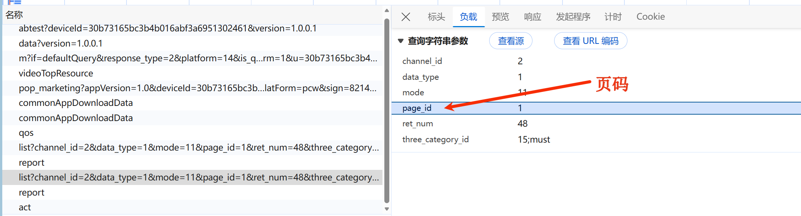

### 代码

```
D:\py-project\爬虫\MongoDB\爱奇艺.py
```

```python
from pymongo import MongoClient
import requests
from fake_useragent import UserAgent


class AiQiYi:
    def __init__(self):
        self.url = 'https://pcw-api.iqiyi.com/search/recommend/list'
        self.headers = {'User-Agent': UserAgent().random}
        self.client = MongoClient("mongodb://localhost:27017/")
        self.collection = self.client['AiQiYi_spider']['movies']

    # 发送请求
    def send_request(self, params):
        res = requests.get(url=self.url, params=params,headers=self.headers)
        return res.json()

    # 解析数据
    def parse_data(self,data):
        data = data['data']['list']
        title = []
        url = []
        content = []
        for i in data:
            title.append(i['title'])
            url.append(i['playUrl'])
            content.append(i['description'])
        return title, url, content

    # 保存数据
    def save_data(self,title,url, content):
        for i in range(len(title)):
            self.collection.insert_one({'title': title[i], 'url': url[i], 'content': content[i]})

    # 主函数
    def run(self):
		self.collection.delete_many({})  # 清空整个集合

        for page in range(1, 11):
            params = f'channel_id=2&data_type=1&mode=11&page_id={page}&ret_num=48&three_category_id=15;must'
            data = self.send_request(params)
            title, url, content = self.parse_data(data)
            self.save_data(title, url, content)
            
            print(f'第{page}页数据爬取完成')
            
        self.client.close()

if __name__ == '__main__':
    aqy = AiQiYi()
    aqy.run()
```


# Selenium

> 浏览器自动化工具，控制真实浏览器去打开网页、点击、滚动、执行JS，然后把结果拿下来
>
> ```
> pip install selenium
> ```

## `webdriver` 模块

> Selenium 用来驱动浏览器执行操作的统一接口
> 
> 
> ```python
> from selenium import webdriver
> ```
>

```python
driver = webdriver.Chrome()  # 启动浏览器
driver.get('https://baidu.com')  # 打开网页
driver.click()  # 点击
driver.quit()   # 关浏览器
```


## `By` 模块：找元素

```python
from selenium.webdriver.common.by import By
```

### 8种定位方式

> `find_element` 找不到会**报错**，`find_elements`（多了s）找不到返回**空列表**
>
> 返回的要是元素节点（后面有相应的常见操作）

|   方式    | 代码                                          | 什么时候用           |
| :-------: | --------------------------------------------- | -------------------- |
|  **ID**   | `find_element(By.ID, 'username')`             | 有唯一ID，优先用     |
|  **CSS**  | `find_element(By.CSS_SELECTOR, '#kw')`        | 灵活强大，实际最常用 |
| **XPath** | `find_element(By.XPATH, '//input[@id="kw"]')` | 结构复杂时用         |
| **Name**  | `find_element(By.NAME, 'wd')`                 | 表单里常见           |
| **Class** | `find_element(By.CLASS_NAME, 'btn')`          | 单个class名          |
| 链接文本  | `find_element(By.LINK_TEXT, '登录')`          | 找`<a>`标签          |
|  标签名   | `find_element(By.TAG_NAME, 'input')`          | 很少用               |
| 部分文本  | `find_element(By.PARTIAL_LINK_TEXT, '登录')`  | 模糊匹配链接         |


## 三种等待

> 等待元素加载出来，再去运行代码找元素

|     方式     | 代码                                  | 说明                         |
| :----------: | ------------------------------------- | ---------------------------- |
| **强制等待** | `time.sleep(3)`                       | 等待3秒，不管元素加载没      |
| **隐式等待** | `driver.implicitly_wait(10)`          | 全局生效，找不到就等最多10秒 |
| **显式等待** | `WebDriverWait(driver,10).until(...)` | 等某个特定条件（推荐）       |

> ```python
> # 显式等待
> from selenium.webdriver.support.ui import WebDriverWait
> from selenium.webdriver.support import expected_conditions as EC
> ```
>
> **`WebDriverWait`** ：最多等10秒，元素一出来立刻继续
>
> **`expected_conditions`** ：条件菜单，告诉 `WebDriverWait` 等待什么
>
> |                             代码                             | 示例                                 |
> | :----------------------------------------------------------: | ------------------------------------ |
> |        `EC.presence_of_element_located((By.□□, ...))`        | 等待元素出现在页面上                 |
> |            `lambda d: d.find_element(By.□□, ...)`            | 自动传入`driver`（selenium4）        |
> |     `EC.presence_of_all_elements_located((By.□□, ...))`      | 必须等所有元素加载出来，返回的是列表 |
> |       `EC.visibility_of_element_located((By.□□, ...))`       | 出现且能看见                         |
> |    `lambda d: d.find_element(By.□□, ...).is_displayed()`     |                                      |
> |          `EC.element_to_be_clickable((By.□□, ...))`          | 出现+可见+可点击                     |
> | `lambda d: d.find_element(By.□□, ...).is_displayed() and d.find_element(By.□□, ...).is_enabled()` |                                      |
> |   `EC.text_to_be_present_in_element((By.□□, ...), '文字')`   | 等某个元素里出现指定文字             |
> |    `lambda d: "文字" in d.find_element(By.□□, ...).text`     |                                      |
>
> <span style='color:red'>EC 模块填入的是元组，双括号</span>
>
> `until()` 里面必须传入的是可调用对象，`lambda` 
>
> 多个元素变成 `all_elements`


## 执行 JS

```python
driver.save_screenshot('a.png')
driver.execute_script('return JS代码')
```


## 窗口与标签页管理

#### 创建并切换到新标签

```python
driver.switch_to.new_window('tab')    # 'tab' 表示标签页

driver.get('https://www.baidu.com')
```

#### 创建并切换到新窗口

```python
driver.switch_to.new_window('window')
```

#### 切换窗口

> 句柄：**浏览器底层给每个标签页分配的**唯一标识符（ID）

```python
driver.switch_to.window(driver.window_handles[0])    # 切换回第一个标签
```

#### 关闭当前标签/窗口

```python
driver.close()
```

#### 示例：

```python
from selenium import webdriver
import time

driver = webdriver.Edge()

driver.get('https://www.douban.com')
time.sleep(2)

# 创建并切换到新标签
driver.switch_to.new_window('tab')

driver.get('https://www.baidu.com')
time.sleep(2)

# 切换回主标签
driver.switch_to.window(driver.window_handles[0])
time.sleep(2)

# 关闭当前主标签
driver.close()
time.sleep(2)
```


## 窗口大小与位置

```python
driver.minimize_window()               # 最小化（Selenium 4 新增）
driver.fullscreen_window()             # 全屏
driver.set_window_size(1024, 768)      # 设置大小
size = driver.get_window_size()        # 获取大小
driver.set_window_position(0, 0)       # 设置位置
pos = driver.get_window_position()     # 获取位置
```


## 元素交互

#### 点击

```python
element.click()
```

#### 输入文本

```python
element.send_keys("输入内容")
```

#### 清空输入框

```python
element.clear()
```

#### 提交表单（仅 `<form>` 内的元素）

```python
element.submit()
```

#### 获取文本

```python
text = element.text
```

#### 获取属性

```python
href = element.get_attribute("href")
```

#### 获取标签名

```python
element.tag_name
```


## 键盘按键

```python
from selenium.webdriver.common.keys import Keys
```

#### 回车键

```python
element.send_keys(Keys.ENTR)
```

#### 空格键

```python
Keys.SPACE
```

#### 全选（Ctrl + A）

```python
Keys.CONTROL, "a"
```

#### 删除

```python
Keys.BACKSPACE
```

#### 方向键

```python
Keys.ARROW_DOWN     # ↓
Keys.ARROW_UP       # ↑
Keys.ARROW_LEFT     # ←
Keys.ARROW_RIGHT    # →
```

#### Tab 切换

```python
Keys.TAB
```


## 处理弹窗、iframe、下拉菜单

#### 弹窗

```python
alert = driver.switch_to.alert
alert.accept()    # 确定
alert.dismiss()   # 取消
```

#### iframe

```python
iframe = driver.find_element(By.XPATH, '//*[@id="reg-new"]/div/iframe')
driver.switch_to.frame(iframe)

driver.switch_to.default_content()     # 返回主文档
```

#### 下拉菜单

```python
from selenium.webdriver.support.select import Select

select = Select(driver.find_element(By.XPATH, "//select"))
select.select_by_index(2)
select.select_by_value("value")
select.select_by_visible_text("Option")
```


## 滚动条

> 通过 JavaScript 执行
>
> ```python
> driver.execute_script('JS 代码')
> driver.execute_script('return JS代码')
> ```

#### 滚动到页面底部

```python
from selenium import webdriver
import time


driver = webdriver.Edge()

driver.get('https://36kr.com/')
time.sleep(1)

driver.execute_script("window.scrollTo(0,document.body.scrollHeight)")
time.sleep(1)
```

#### 滚动到顶部

```python
driver.execute_script("window.scrollTo(0,0)")
```

#### 滚动到指定距离

```python
driver.execute_script("window.scrollBy(0,500)")
```

#### scrollBy：相对于当前位置

```js
scrollBy(0,500)
```

#### 滚动到某个元素位置

```python
from selenium import webdriver
import time


driver = webdriver.Edge()

driver.get('https://36kr.com/')
time.sleep(1)

element = driver.find_element("xpath",'//*[@id="app"]/div/div[2]/div[3]/div/div/div[3]/div[1]/div[1]/div[2]/div[29]/div/div/div[2]/div[2]/p')

driver.execute_script(
    "arguments[0].scrollIntoView();",
    element
)
time.sleep(10)

# 平滑的滚动要给 scrollIntoView 加参数：{behavior: 'smooth'}
```

#### 模拟人慢慢往下滑

```python
from selenium import webdriver
import time

driver = webdriver.Edge()

driver.get('https://36kr.com/')
time.sleep(1)

element = driver.find_element("xpath",'//*[@id="app"]/div/div[2]/div[3]/div/div/div[3]/div[1]/div[1]/div[2]/div[37]/div/div/div[2]/div[2]/p')

import random

for i in range(10):
    distance = random.randint(200, 600)

    driver.execute_script(f"""
    window.scrollBy({{      
        top:{distance},
        behavior:'smooth'
    }})
    """, element)               # 两个括号，前一个括号避免转义

    time.sleep(random.uniform(0.5, 2))

time.sleep(10)
```


## ActionChains（复杂操作）

```python
from selenium.webdriver import ActionChains

# 创建动作对象
actions = ActionChains(driver)

# 动作链
# action.动作
# ...

# 调用 perform() 执行
actions.perform()
```

### 常用动作

|                             方法                             | 功能                              |
| :----------------------------------------------------------: | --------------------------------- |
|                 **`click(on_element=None)`**                 | 单击鼠标左键                      |
|            **`click_and_hold(on_element=None)`**             | 按住鼠标左键不松开                |
|             **`context_click(on_element=None)`**             | 右键单击                          |
|             **`double_click(on_element=None)`**              | 双击                              |
|             **`drag_and_drop(source, target)`**              | 拖拽元素到目标元素                |
|   **`drag_and_drop_by_offset(source, xoffset, yoffset)`**    | 按偏移量拖拽元素                  |
|              **`move_to_element(to_element)`**               | 鼠标移动到元素中心                |
| **`move_to_element_with_offset(to_element, xoffset, yoffset)`** | 移动到元素相对偏移位置            |
|            **`move_by_offset(xoffset, yoffset)`**            | 从当前位置移动鼠标                |
|                **`release(on_element=None)`**                | 释放按住的鼠标键                  |
|             **`key_down(value, element=None)`**              | 按下键盘按键（如 `Keys.CONTROL`） |
|              **`key_up(value, element=None)`**               | 释放键盘按键                      |
|                **`send_keys(*keys_to_send)`**                | 输入文本或按键序列                |
|      **`send_keys_to_element(element, *keys_to_send)`**      | 对指定元素输入（会先获得焦点）    |
|                     **`pause(seconds)`**                     | 等待指定秒数（浮点数）            |
|                    **`reset_actions()`**                     | 清空当前构建的动作队列            |

### 案例：鼠标拖拽

```
D:\py-project\爬虫\Selenium\鼠标拖拽.py
```

```python
from selenium import webdriver
from selenium.webdriver.common.by import By

from selenium.webdriver.support.ui import WebDriverWait
from selenium.webdriver.support import expected_conditions as EC   # 这里没用到

from selenium.webdriver import ActionChains

driver = webdriver.Edge()
driver.get('https://www.runoob.com/try/try.php?filename=jqueryui-api-droppable')


WebDriverWait(driver, 10).until(
    lambda d: d.find_element(By.ID, 'draggable')
    and d.find_element(By.ID, 'droppable')
)

# 拖拽元素
source = driver.find_element(By.ID, 'draggable')
# 目标元素
target = driver.find_element(By.ID, 'droppable')

# 创建动作对象
actions = ActionChains(driver)

actions.drag_and_drop(source, target)
actions.perform()


import time
time.sleep(10)
```


## 案例：登录豆瓣 - version 1

```
D:\py-project\爬虫\Selenium\登录豆瓣.py
```

```python
from selenium import webdriver
from selenium.webdriver.common.by import By

from selenium.webdriver.support.ui import WebDriverWait
from selenium.webdriver.support import expected_conditions as EC

driver = webdriver.Edge()
driver.get('https://www.douban.com/')

# 切换到 iframe
WebDriverWait(driver, 10).until(
    EC.presence_of_element_located((By.XPATH, '//*[@id="anony-reg-new"]/div/div[1]/iframe'))
)
iframe = driver.find_element(By.XPATH, '//*[@id="anony-reg-new"]/div/div[1]/iframe')
driver.switch_to.frame(iframe)

# 点击到密码登录
driver.find_element(By.CLASS_NAME,'account-tab-account').click()

# 输入手机号
driver.find_element(By.NAME, 'username').send_keys('18358579849')
# 输入密码
driver.find_element(By.NAME, 'password').send_keys('Xgj123456')

# 点击登录
driver.find_element(By.CLASS_NAME, 'account-form-field-submit').click()


import time
time.sleep(10)
```


## 案例：仙逆 - version 1

```
https://www.hetushu.com/book/36/index.html
D:\py-project\爬虫\案例\仙逆.py
```

`````python
from selenium import webdriver
from selenium.webdriver.common.by import By
from selenium.webdriver.support.ui import WebDriverWait
from selenium.webdriver.support import expected_conditions as EC
from selenium.common.exceptions import TimeoutException
import time
import random

````
class XianNi:
    def __init__(self):
        self.url_index = 'https://www.hetushu.com/book/36/index.html'
        self.driver = webdriver.Edge()
        self.wait = WebDriverWait(self.driver, 15)  # 超时拉长

    def get_url(self):
        self.driver.get(self.url_index)

        # 等待目录链接完全可见
        self.wait.until(
            EC.presence_of_all_elements_located((By.XPATH, '//dl[@id="dir"]/dd/a'))
        )

        boxs = self.driver.find_elements(By.XPATH, '//dl[@id="dir"]/dd/a')
        href = [box.get_attribute('href') for box in boxs]
        return href

    def content(self, url):
        self.driver.get(url)

        try:

            self.wait.until(
                EC.presence_of_element_located((By.ID, "content"))
            )

            # 额外等一下，确保动态内容加载完
            time.sleep(random.uniform(0.5, 1))

        except TimeoutException:
            print("超时:", url)
            return ""

        content = self.driver.execute_script(
            "return document.getElementById('content').innerText"
        )
        return content

    def run(self):
        href = self.get_url()
        for i, url in enumerate(href):
            text = self.content(url)
            print(f"=== 第{i + 1}章 ===")
            print(text)
            print("\n" + "=" * 50 + "\n")


if __name__ == '__main__':
    book = XianNi()
    book.run()
`````


## 添加 Cookie

```python
from selenium import webdriver

driver = webdriver.Edge()

# 先打开对应网站
driver.get("https://www.baidu.com")

# 添加 Cookie，必须是字典格式
cookies = {
    "name": "username",
    "value": "admin"
}
driver.add_cookie(cookies)

cookies = {
    "vip_city_code": "104104101",
    "vip_wh": "VIP_NH",
    "vip_ipver": "31",
}
for k,v in cookies.items():
    cookie_dict = {'name': k, 'value': v}
    driver.add_cookie(cookie_dict)

# 刷新页面，让Cookie生效
driver.refresh()
```


## 异常处理

> Selenium 的异常都在：
>
> ```python
> from selenium.common.exceptions import *
> ```

### NoSuchElementException ：找不到元素

```python
from selenium.common.exceptions import NoSuchElementException


try:
    driver.find_element(By.ID,"username")

except NoSuchElementException:
    print("没有找到输入框")
```

### TimeoutException ：等待超时

```python
from selenium.common.exceptions import TimeoutException


try:
    WebDriverWait(driver,10).until(
        EC.presence_of_element_located((By.ID,"login"))
    )

except TimeoutException:
    print("等待超时")
```

### ElementNotInteractableException ：元素存在，但不能操作

```python
try:
    input_box.send_keys("admin")

except ElementNotInteractableException:
    print("元素不能操作")
```

### StaleElementReferenceException ：元素失效

### WebDriverException ：WebDriver整体错误


## 绕过检测

> 网站通常通过 **JavaScript 检测浏览器环境指纹** 来判断是否为自动化工具
>
> Selenium 驱动的浏览器在环境特征上与真实浏览器存在一些差异，这些差异就是检测点
>
> **配置对象：**
>
> ```python
> options = webdriver.EdgeOptions()
> # ...
> ```
>
> 作为参数传入 `webdriver.Edge(options=options)`

### `navigator.webdriver` 属性

> W3C WebDriver 标准规定，自动化驱动的浏览器必须将 `navigator.webdriver` 设为 `true`。这是最明显的“我是机器人”标志。
>
> 需要在页面任何 JS 执行之前，把该属性“藏起来”或改为 `false/undefined`。Selenium 提供了 **CDP (Chrome DevTools Protocol)** 在页面加载前注入脚本：

```python
driver.execute_cdp_cmd('Page.addScriptToEvaluateOnNewDocument', {
    'source': 'Object.defineProperty(navigator, "webdriver", { get: () => undefined });'
})
```


### 浏览器启动参数暴露自动化身份

> WebDriver 启动浏览器时会在命令行加上 `--enable-automation` 等标志，浏览器窗口顶部会显示“正受到自动化测试软件的控制”。JS 可以通过这些参数或 UI 残留判断是否为自动化环境。
>
> 

```python
# 关闭自动化受控特征
options.add_argument('--disable-blink-features=AutomationControlled')
# 不要带上 enable-automation 启动标志
options.add_experimental_option('excludeSwitches', ['enable-automation'])
# 禁用自动化扩展
options.add_experimental_option('useAutomationExtension', False)
```


### User-Agent 异常

> WebDriver 的 User-Agent 通常会带有 `HeadlessChrome`、`WebDriver` 等字样，或者与常见浏览器 UA 不匹配

```python
# 手动设置 Edge 的
options.add_argument('Mozilla/5.0 (Windows NT 10.0; Win64; x64) AppleWebKit/537.36 (KHTML, like Gecko) Chrome/135.0.0.0 Safari/537.36 Edg/135.0.0.0')
```


### 行业检测网站

```
https://bot.sannysoft.com/
```


## 设置不加载图片

> 极大的减少网络带宽消耗，提升页面加载速度（`driver.get()` 阻塞时间变短）
>
> **副作用：**
>
> 1.&nbsp;**懒加载（Lazy-load）失效**：很多网站（尤其小说/文章站）用图片做“占位符”或触发滚动加载。禁用图片可能导致页面 JS 逻辑判定异常，导致正文内容（文字）也加载不出来。
>
> 2.&nbsp;**验证码（Captcha）无法显示**：如果后续需要登录，验证码图片是空白的

```python
# 数值 2 代表不加载，1 代表加载，0 代表默认
options.add_experimental_option("prefs", {
    "profile.managed_default_content_settings.images": 2
})
```


## 案例：唯品会商品（电脑）

```https
https://category.vip.com/suggest.php?keyword=%E7%94%B5%E8%84%91&ff=235|12|1|1
```

### Cookie

> 用爬虫工具库得到字典

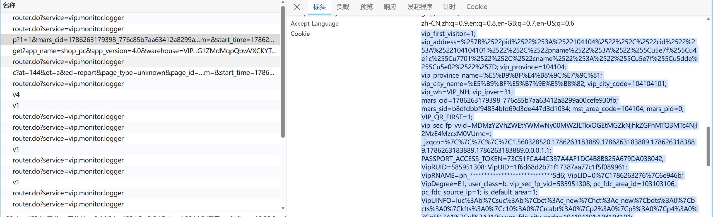
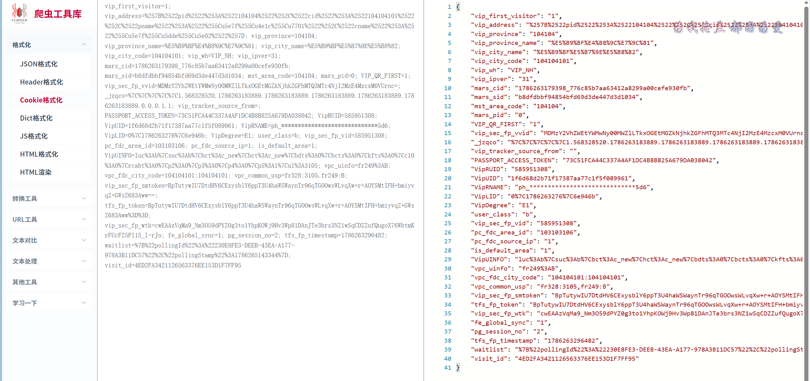

### 定位所有商品 div

```
//section[@id="J_searchCatList"]/div[@class="c-goods-item  J-goods-item c-goods-item--auto-width"]
```

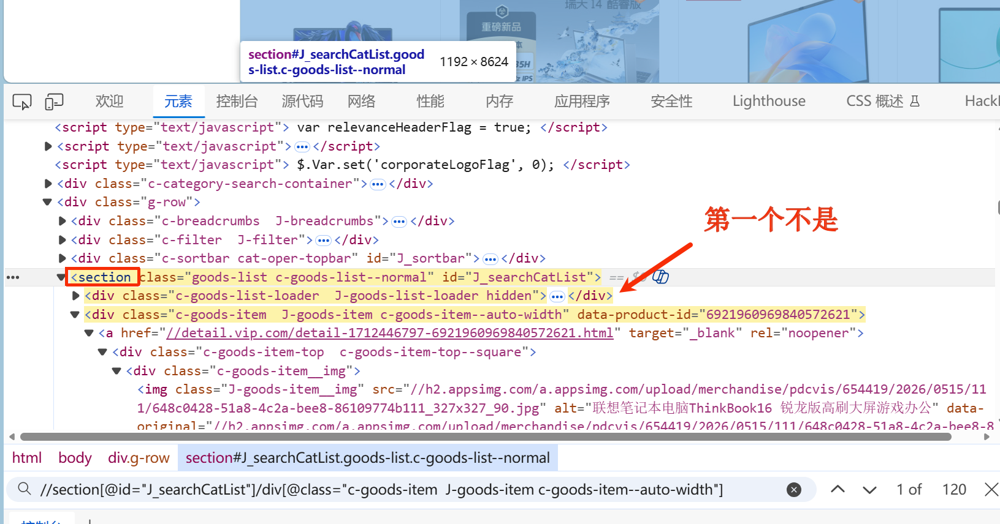

### 定位当前商品价格、标题

> 这里我也不知道 title 用 XPath 定位到 class 为什么不行
>
> > 2026.8.10

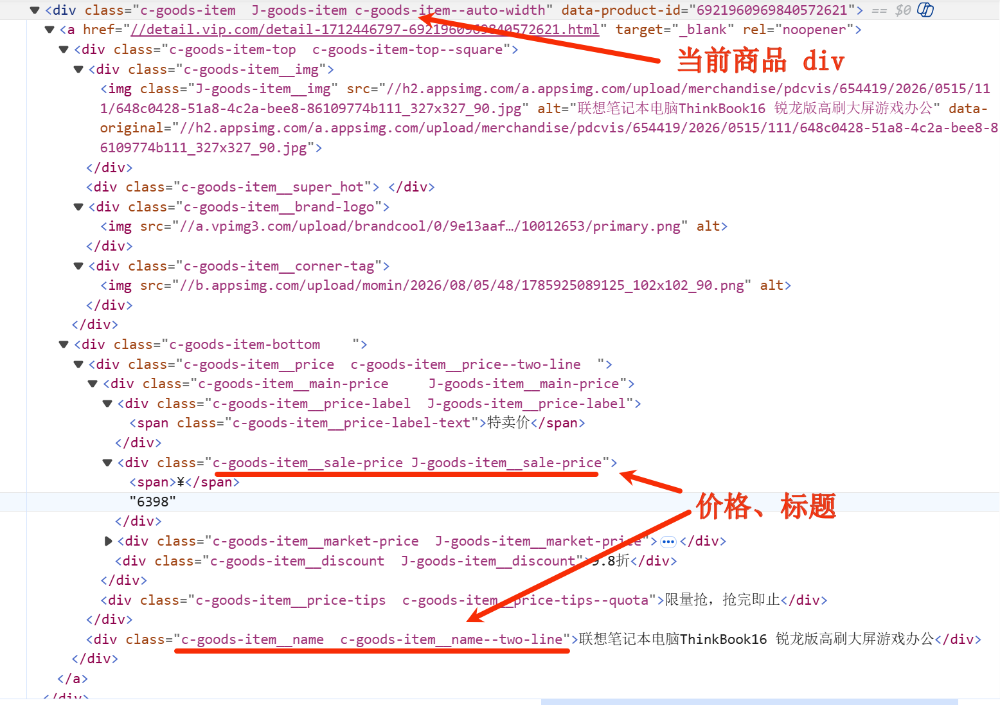

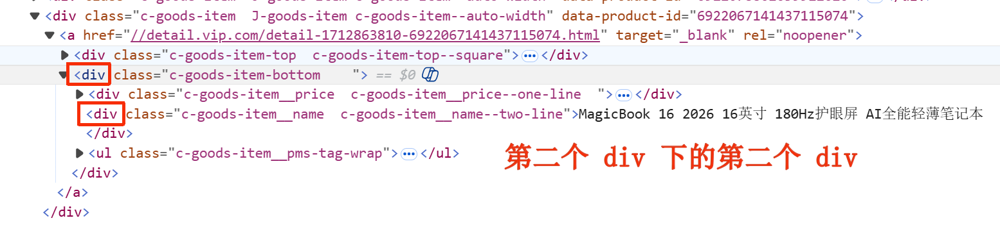

### 代码

```
D:\py-project\爬虫\Selenium\唯品会.py
```

```python
import time
import random

from selenium import webdriver
from selenium.webdriver.common.by import By

from pymongo import MongoClient


class Weiph:
    def __init__(self):
        self.client = MongoClient("mongodb://localhost:27017/")
        self.collection = self.client['Weiph']['computers']

        # 创建edge浏览器配置对象
        options = webdriver.EdgeOptions()
        # 关闭自动化受控特征
        options.add_argument('--disable-blink-features=AutomationControlled')
        # 不要带上 enable-automation 启动标志
        options.add_experimental_option('excludeSwitches', ['enable-automation'])
        # 禁用自动化扩展
        options.add_experimental_option('useAutomationExtension', False)
        # 禁用图片加载
        options.add_experimental_option("prefs", {
            "profile.managed_default_content_settings.images": 2
        })

        self.driver = webdriver.Edge(options=options)
        self.driver.maximize_window()
        self.cookie = {
            "vip_province": "104104",
            "vip_province_name": "%E5%B9%BF%E4%B8%9C%E7%9C%81",
            ...
        }


    def show_shop(self, url):
        self.driver.get(url)
        for key, value in self.cookie.items():
            cookie_dict = {'name': key, 'value': value}
            self.driver.add_cookie(cookie_dict)
        self.driver.refresh()
        # 给页面加载时间
        time.sleep(2)

        # 往下滑渲染出所有商品
        while True:
            distance = random.randint(350, 700)

            self.driver.execute_script(f"""
            window.scrollBy({{
                top: {distance},
                behavior: 'smooth'
            }})
            """)

            time.sleep(random.uniform(0.5, 1))

            # 判断是否到底
            height = self.driver.execute_script(
                "return document.documentElement.scrollHeight"
            )

            position = self.driver.execute_script(
                "return window.pageYOffset + window.innerHeight"
            )

            if position >= height:
                break


    def parse_data(self):
        # 定位所有商品标签
        div_list = self.driver.find_elements(By.XPATH, '//section[@id="J_searchCatList"]/div[@class="c-goods-item  J-goods-item c-goods-item--auto-width"]')
        for i in div_list:
            # 在当前商品标签内部找价格标签，提取文本
            title = i.find_element(By.XPATH, './/div[2]/div[2]').text
            money = i.find_element(By.XPATH, './/div[@class="c-goods-item__sale-price J-goods-item__sale-price"]').text

            data = {'title':title,'money':money}
            print(data)

            # 调用保存方法，存入数据库
            self.cv_response(data)


    def cv_response(self, data):
        # 插入数据
        self.collection.insert_one(data)


    def main(self):
        self.collection.delete_many({})   # 清空整个集合
        for i in range(1,20):
            url = f'https://category.vip.com/suggest.php?keyword=%E7%94%B5%E8%84%91&page={i}'
            self.show_shop(url)
            self.parse_data()
            print(f'第{i}页爬取完成')


if __name__ == '__main__':
    Weiph().main()
```


# Playwright

```
pip install playwright

# 安装浏览器
playwright install
```

## 启动控制环境

```python
from playwright.sync_api import sync_playwright

with sync_playwright() as p:
```

## 启动浏览器

```python
browser = p.chromium.launch(headless=False)    # 有头模式能看到窗口
```

## 网页标签

```python
page = browser.new_page()
```


## 示例：

```python
from playwright.sync_api import sync_playwright


with sync_playwright() as p:

    browser = p.chromium.launch()

    page = browser.new_page()

    page.goto("https://www.baidu.com")

    print(page.title())         # 百度一下，你就知道

    browser.close()
```


## 等待

> Playwright 的 `click()`、`fill()`、`check()` 等操作本身会自动等待：
>
> 元素存在、元素可见、元素可编辑、页面稳定

#### 固定等待 `wait_for_timeout()`

```python
page.wait_for_timeout(3000)     # 单位 毫秒
```

#### 元素等待 `wait_for_selector()`

```python
page.wait_for_selector("#login", state=visible)    # 等待登录按钮可见
```


## 元素定位

#### CSS 选择器

```python
page.locator("#user")
```

#### XPath

```python
page.locator("//input[@id='user']")
```

#### 根据文字定位

```python
page.get_by_text("登录")
```


## 输入操作

#### 普通输入 `fill('')`

> 自动清空原内容后输入

```python
page.locator("选择器").fill("输入内容")
```

#### 按键 `press('')`

> 针对某个元素

```python
# 回车
page.locator("#kw").press("Enter")

# 删除
page.locator("#kw").press("Backspace")

# 全选
page.locator("#kw").press("Control+A")

# 复制
page.locator("#kw").press("Control+C")
```

#### 页面级按键 `keyboard`

```python
page.keyboard.press("Enter")
```

#### 键盘输入

> 获得焦点的元素进行键盘输入，需要 `.click()`

```python
page.locator("#username").click()
page.keyboard.type("admin")
```

#### 模拟人输入

```python
# press_sequentially() 自动对元素进行操作
page.locator("#chat-textarea").press_sequentially("你好文轩", delay=500)

# 键盘对象的方法，需要单位并点击
page.locator("#username").click()
page.keyboard.type("admin", delay=500)
```


## 选择元素

```python
items = page.locator('.item-title')
```

> 网页：
>
> ```
> 标题1
> 标题2
> 标题3
> ···
> ```

#### 选择第一个

```python
items.first

# 等价于
items.nth(0)
```

#### 选择第二个

```python
items.nth(1)
```

#### 选择最后一个

```python
items.last
```

#### 获取全部

```python
div_list = page.locator('//div/li').all()
```

#### 获取数量

```python
items.count()
```

#### 获取内容

```python
for i in range(items.count()):
    print(items.nth(i).inner_text())
```

#### 获取 HTML 标签的属性值

```python
link = page.locator("a")

print(link.get_attribute("href"))
```

#### 示例：

```
D:\py-project\爬虫\Playwright\文章标题和链接获取.py
https://www.labr.cc/document/list.html?sort=-pubdt
```

```python
from playwright.sync_api import sync_playwright

with sync_playwright() as p:
    browser = p.chromium.launch(headless=False)
    page = browser.new_page()
    page.goto("https://www.labr.cc/document/list.html?sort=-pubdt")

    items = page.locator('.item-title')

    for i in range(items.count()):
        # 获取第 i 个元素
        item = items.nth(i)
        
        # 获取标题
        title = item.inner_text()
        # 获取链接
        link = item.locator('a').first
        href = link.get_attribute('href')

        print(title, href)

    browser.close()
```


## 鼠标操作

#### 最基本 `click()`

```python
page.locator("#btn").click()
```

#### 双击 `dblclick()`

```python
page.locator(".item").dblclick()
```

#### 右键/中键 `button='right'/'middle'`

```python
page.locator(".item").click(button="right")
page.locator("a").click(button="middle")
```

#### 鼠标移动 `hover()`

```python
page.locator(".menu").hover()
```

#### 按下/松开

```python
page.mouse.down()     # 按住鼠标
page.mouse.up()     # 松开鼠标
page.mouse.click(500, 300)    # 在浏览器页面坐标 (500, 300) 的位置点击
page.mouse.move(500, 300)    # 鼠标移动到指定坐标
'''        X →
   0  100  200  300  400
 0 ┌─────────────────────
   │
50 │
   │
100│
   │
150│
   ↓
   Y
'''
```

#### 鼠标拖动 `drag_and_drop()`

```python
page.drag_and_drop(source, target)
page.drag_and_drop('#box22', '#box11')
```

#### 滚轮

```python
page.mouse.wheel(0, 500)
```


## 执行 JS

```python
page.evaluate("alert('你好')")

result = page.evaluate("document.title")
```


## 滚动条

#### 滚动到底部

```python
page.evaluate("window.scrollTo(0, document.body.scrollHeight)")
```

#### 平滑滚动到底部

```python
page.evaluate("""
    window.scrollTo({
        top: document.body.scrollHeight,
        behavior: 'smooth'
    })
""")
```

#### 平滑滚动到某个元素

```python
page.locator("#box11").evaluate("""
    e => e.scrollIntoView({
        behavior: 'smooth',
        block: 'center'
    })
""")
```

#### 模拟人滚动到某个元素

```python
import random
import time

target = page.locator("#box11").evaluate("e => e.offsetTop")

while True:
    now = page.evaluate("window.scrollY")

    if now >= target:
        break

    page.mouse.wheel(0, random.randint(200,500))

    time.sleep(random.uniform(0.3,0.8))
```

#### 模拟人滚动到底部

```python
import random
import time

while True:
    current_y = page.evaluate("window.scrollY")

    total_height = page.evaluate("document.body.scrollHeight")

    # 浏览器窗口高度
    window_height = page.evaluate("window.innerHeight")

    if current_y + window_height >= total_height:
        break

    page.mouse.wheel(0, random.randint(300, 700))

    time.sleep(random.uniform(0.5, 1.5))
```

#### 元素出现在浏览器窗口中

```python
page.locator("#box").scroll_into_view_if_needed()
```


## iframe

```python
page.frame_locator("iframe选择器")
```

#### 示例：登录QQ空间

```python
from playwright.sync_api import sync_playwright

with sync_playwright() as p:
    browser = p.chromium.launch(headless=False)
    page = browser.new_page()
    page.goto("https://i.qq.com/")

    iframe = page.frame_locator('#login_frame')
    iframe.locator("//*[@id='switcher_plogin']").click()
    iframe.locator("//*[@id='uin_tips']").fill("3165889264")
    iframe.locator("//*[@id='pwd_tips']").fill("xgj123456")
    iframe.locator("//*[@id='login_button']").click()

    page.wait_for_timeout(1000000)
    browser.close()
```


## 案例：华研数据-考研资料获取

```
https://www.handebook.com/web/#/1234/document
D:\py-project\爬虫\Playwright\华研数据-考研资料获取.py
```

> Playwright 的 `sync_playwright()` 返回的是一个 **Playwright 进程管理器**。它会启动一个独立的驱动进程（通常是基于 Node.js 的服务端），负责与浏览器进行 CDP 协议通信。
>
> 写在 `main` 方法中，使得 **整个自动化流程的“生到死”都在一个可控的代码块里**，结束后自动清理，安全且清晰
>
> Selenium 的 WebDriver 是一个**直接与浏览器驱动通信的客户端对象**，没有 Playwright 那样的顶层“进程管理器”。

### 需要通过点击来翻页

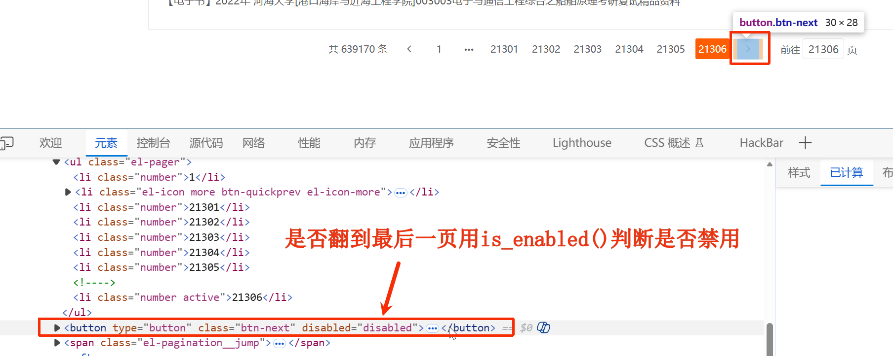

```python
from playwright.sync_api import sync_playwright
from pymongo import MongoClient

class KaoYan_system:
    def __init__(self):
        self.url = 'https://www.handebook.com/web/#/1234/document'
        self.client = MongoClient("mongodb://localhost:27017/")
        self.collection = self.client['KaoYan_sys']['datas']

    def get_res(self, page):
        page_num = 1
        while True:
            # 等待当前页数据加载完成
            page.wait_for_selector('//div[@class="school-list"]', state="visible")
            items = page.locator('//div[contains(@class, "school-list")]/div[contains(@class, "content-document")]')

            # 1. 先爬取当前页所有数据
            print(f'—————————— 正在爬取第 {page_num} 页 ——————————')
            for i in range(items.count()):
                data = {# 这里要声明 xpath，否则会被识别为 CSS 选择器
                    'title': items.nth(i).locator('xpath=./span[1]').inner_text().strip(),
                    'money': items.nth(i).locator('xpath=./span[2]').inner_text().strip(),
                }
                # self.collection.insert_one(data)
                print(data['title'], data['money'])

            print(f'———————————— 第 {page_num} 页完成 ——————————')

            # 2. 准备翻到下一页
            page.locator('//li[contains(@class, "number")]').first.scroll_into_view_if_needed()
            next_button = page.locator('//button[contains(@class, "btn-next")]')

            if next_button.count() == 0 or not next_button.is_enabled():
                print('没有下一页了')
                break

            # 3. 点击下一页并等待新页面加载
            next_button.click()
            page.wait_for_timeout(500)  # 等待爬取完成
            page_num += 1

    def main(self):
        with sync_playwright() as pw:
            browser = pw.chromium.launch(headless=False)
            page = browser.new_page()
            page.goto(self.url)

            self.get_res(page)

            browser.close()

        self.client.close()

if __name__ == '__main__':
    KaoYan_system().main()
```


# DrissionPage

```
pip install DrissionPage
```

## Chromium —— 浏览器连接管理器

```python
from DrissionPage Chromium
```

## 连接浏览器创建标签对象

```python
tab = Chromium().latest_tab
```


## 浏览器配置

```python
from DrissionPage import ChromiumOptions
```

```python
from DrissionPage import Chromium, ChromiumOptions

# 创建配置对象
co = ChromiumOptions()

# 使用配置启动浏览器
browser = Chromium(co)

# 获取页面
tab = browser.latest_tab
```

#### 设置浏览器路径

```python
co.set_browser_path(
    r"C:\Program Files (x86)\Microsoft\Edge\Application\msedge.exe"
)
```

#### 设置窗口大小

```python
co.set_argument("--window-size=1200,800")

co.set_argument("--start-maximized")       # 最大化
```

#### 设置代理

```python
co.set_proxy("http://127.0.0.1:7897")
```

#### 禁止加载图片

```python
co.set_pref("profile.managed_default_content_settings.images", 2)
```

#### 关闭自动化提示

```python
co.set_argument("--disable-blink-features=AutomationControlled")
```

#### 设置用户数据目录

```python
co.set_user_data_path("./chrome_data")
# 保存到当前工作目录下面的 chrome_data 文件夹
```


## 标签页管理

#### 新建标签页

```python
tab2 = browser.new_tab()
```


## 元素定位

> ```python
> tab.ele()    # 获取单个元素
> tab.eles()    # 获取多个元素
> ```
>
> 找不到返回 None

#### CSS 选择器定位

```python
'''
<div class="container">
    <input class="search">
</div>
'''

tab.ele(".container input")
tab.ele(".container .search")
```

#### XPath 定位

```python
tab.ele("xpath://input[@id='username']")
```

#### 文本定位

```python
tab.ele("text=登录")
```

#### 属性定位

```python
'''
<input name="username">

<input id="user" name="account">
'''

tab.ele("@name=username")
tab.ele("@id=user@name=account")
```

#### 多个元素获取

```python
'''
<div class="item">商品1</div>
<div class="item">商品2</div>
<div class="item">商品3</div>
'''
items = tab.eles(".item")

# 第一个
items[0]

# 第二个
items[1]
tab.ele(".item",index=2)
```

#### 获取元素信息

```python
ele.text           # 文本
ele.attr("href")   # 属性      所有属性：ele.attrs  
```


## 输入和点击

```python
tab.ele("#kw").input("你好文轩！")

tab.ele("#su").click()

tab.ele("#kw").clear()    # 清空
```


## 等待

#### 等待页面加载完成

```python
tab.wait.load_start()
```

#### 等待元素出现

```python
tab.wait.ele_displayed("#username")
tab.wait.ele_displayed("#username", timeout=2)    # 最多等待两秒
```

#### 等待时间

```python
tab.wait(3)
```


## 监听接口

### 开启监听 `tab.listen.start()`

> 不写参数：监听全部请求
>
> 写 URL 关键字：只要 URL 包含 `"xxx"`，就把它抓下来
>
> 可以写正则
>
> 多个接口监听：
>
> ```python
> tab.listen.start(
> [
>     "login",
>     "user",
>     "product"
> ]
> )
> ```

### 持续监听获取到的结果 `tab.lisen.steps()`

> 返回的是生成器
>
> ```python
> tab.listen.start("api")
> 
> # ...
> 
> for packet in tab.listen.steps():
>        print(packet.url)
> ```
>
> 包含：
>
> `packet.url` ：请求 URL
>
> `packet.method` ：请求方法
>
> `packet.request.headers` ：请求头
>
> `packet.response.body` ：返回数据

### `tab.lisen.wait()`

> 与 `steps` 的区别：拿到一个接口结束

### 示例：

```python
from DrissionPage import Chromium

# 创建浏览器
browser = Chromium()

# 获取标签页
tab = browser.latest_tab

# 开启监听
# 监听包含 jsonplaceholder 的请求
tab.listen.start("jsonplaceholder")


# 打开网页
tab.get("https://jsonplaceholder.typicode.com/")


# 获取监听结果
for packet in tab.listen.steps():

    print("请求地址:")
    print(packet.url)

    print("返回数据:")
    print(packet.response.body)

    break
```


## 案例：华能电子商务招标专栏公告获取

```
https://ec.chng.com.cn/channel/home/?SIJfApfmEBp=1786452240563&SlJfApAfmEBp=1786505263802#/purchase

D:\py-project\爬虫\DrissionPage\华能电子商务招标公告.py
```

### 接口地址

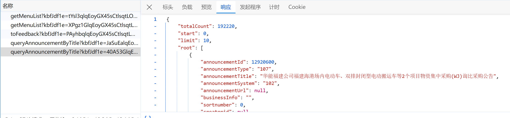

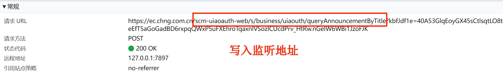

### 翻页

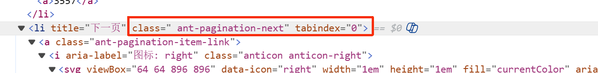

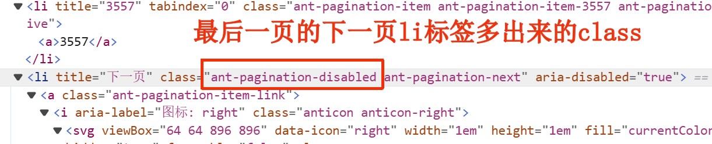

```python
if "ant-pagination-disabled" in button.attr("class"):
    print("已经最后一页")
    browser.quit()
else:
    button.click()
```

### 代码

```python
from DrissionPage import Chromium, ChromiumOptions

co = ChromiumOptions()
co.set_browser_path(
    r"C:\Program Files (x86)\Microsoft\Edge\Application\msedge.exe"
)
co.set_proxy('http://127.0.0.1:7897')
co.set_argument('--start-maximized')
co.set_user_data_path("./chrome_data")

browser = Chromium(co)
tab = browser.latest_tab

# 只监听 URL 包含：scm.../Title 的请求
tab.listen.start('scm-uiaoauth-web/s/business/uiaouth/queryAnnouncementByTitle')
tab.get('https://ec.chng.com.cn/channel/home/?SIJfApfmEBp=1786452240563#/purchase')


page = 1
# 获取监听结果
for i in tab.listen.steps():
    data = i.response.body['root']
    for j in data:
        print(j['announcementTitle'])
    print(f'———————————————————第{page}页————————————————————')
    page += 1

    button = tab.ele('xpath://*[@id="app"]/div/div[2]/div[3]/div/div[2]/div/div/div/ul/li[last()]')
    if "ant-pagination-disabled" in button.attr("class"):
        print("最后一页")
        browser.quit()
    else:
        button.click()
```


## iframe

> DrissionPage 无需切入切出即可处理`<iframe>`元素。
>
> 可实现跨级元素查找、元素内部单独跳转、同时操作`<iframe>`内外元素、多线程控制多个`<iframe>`等操作
>
> 推荐优先使用 **`get_frame()`** 方法，因为当作普通元素获取时，IDE 无法正确识别获取到的是`<iframe>`元素


## 滚动

#### 滚动到页面底部

```python
tab.scroll.to_bottom()
```

#### 平滑滚动到底部

```python
tab.run_js("""
    window.scrollTo({
        top: document.body.scrollHeight,
        behavior: 'smooth'
    });
""")
```

#### 滚动到某个元素

```python
ele.scroll.to_see()
```

#### 指定滚动距离

```python
tab.scroll.down(500)
```

#### 滚动到指定坐标

```python
tab.scroll.to_location(0, 1000)
```


## 动作链

```python
from DrissionPage.common import Actions
```

### 创建

```python
from DrissionPage import Chromium
from DrissionPage.common import Actions


browser = Chromium()

tab = browser.latest_tab

ac = Actions(tab)
```

### 鼠标移动

```python
box = tab.ele("#box")

ac.move_to(box)
ac.move(100, 0)    # 相对位置移动，参数是位移量，而不是元素
```

### 点击

```python
ac.click(box)
ac.double_click(box)       # 双击
ac.right_click(box)       # 右键
```

### 按住鼠标

```python
ac.hold(box)
ac.hold()    # 在当前位置按住
```

### 释放鼠标

```python
ac.release()
```

### 鼠标移动指定距离

```python
ac.move_by(300, 0)
```

### 获取元素位置和尺寸

```python
box = tab.ele('#sliderBtn')

x, y = box.rect.location     # 位置坐标
w, h = box.rect.size       # 宽度和高度
```

### 键盘操作

```python
ac.type("你好文轩！")        # 输入文字

from DrissionPage.common import Keys

ac.key_down(Keys.ENTER)     # 回车

from DrissionPage.common import Keys

ac.key_down(Keys.CTRL)
ac.type("a")
ac.key_up(Keys.CTRL)        # Ctrl + A
```

### 示例：滑块验证码

```
D:\py-project\爬虫\DrissionPage\滑块验证码.py
```

```python
from DrissionPage import Chromium, ChromiumOptions
from DrissionPage.common import Actions

co = ChromiumOptions()
co.set_browser_path(
    r"C:\Program Files (x86)\Microsoft\Edge\Application\msedge.exe"
)
co.set_proxy('http://127.0.0.1:7897')
co.set_argument('--start-maximized')
co.set_user_data_path("./chrome_data")

browser = Chromium(co)
tab = browser.latest_tab

tab.get(r"D:\py-project\爬虫\DrissionPage\滑块验证码.html")

box = tab.ele('#sliderBtn')

print('位置:', box.rect.location)
print('大小:', box.rect.size)

box = tab.ele('#sliderBtn')

x, y = box.rect.location
w, h = box.rect.size

ac = Actions(tab)

# x坐标加上元素宽的一半，y坐标加上元素高的一半，就是元素中心的位置
ac.move_to((x + w / 2, y + h / 2))

# 按住
ac.hold()

# 相对当前位置向右移动
ac.move(310, 0)

# 松开
ac.release()
```


### 使用内置 `actions` 属性

> 会等到页面框架文档（不包括 js 数据）加载完成再执行动作

#### 鼠标移动

```python
tab.actions.move_to('text=登录')
```

#### 移动指定距离

```python
tab.actions.move(300,0)
```

#### 点击（更像真人）

```python
tab.actions.click('#kw')         # 左键
tab.actions.r_click('#menu')     # 右键
tab.actions.m_click('#link')     # 中键
```

#### 输入文字

```python
tab.actions.click('#kw').type('Python')          # 键盘输入
```


## 执行 JS

```python
tab.run_js('alert("你好")')

height = tab.run_js('return document.body.scrollHeight')
print(height)

content = tab.ele('#content')     # 对某个元素运行 JS
content.run_js("""
    this.style.background = 'red'
""")
```


## SessionPage —— 使用 `requests` 发送请求

> 没有鼠标、点击、JS执行、浏览器渲染
>
> ```python
> from DrissionPage import SessionPage
> 
> page = SessionPage()
> page.get("https://www.baidu.com")
> ```

## 设置请求头

```python
page.headers = {"User-Agent":"Mozilla/5.0"}
```

## 获取内容

```python
page.html
page.cookies
```


## 案例：网易招聘数据

```
https://hr.163.com/job-list.html?workType=1&lang=zh
D:\py-project\爬虫\DrissionPage\网易招聘数据.py
```

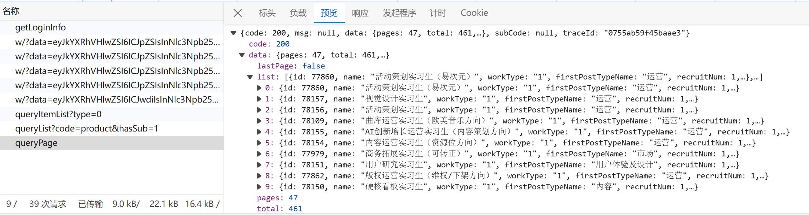

### 代码

```python
from DrissionPage import Chromium, ChromiumOptions
from pymongo import MongoClient

# 连接数据库
client = MongoClient('localhost', 27017)
collection = client['WangYi']['recruitment']

co = ChromiumOptions()
co.set_browser_path(
    r"C:\Program Files (x86)\Microsoft\Edge\Application\msedge.exe"
)
co.set_proxy('http://127.0.0.1:7897')
co.set_argument('--start-maximized')
co.set_user_data_path("./chrome_data")

browser = Chromium(co)
tab = browser.latest_tab

tab.listen.start('api/hr163/position/queryPage')
tab.get('https://hr.163.com/job-list.html?workType=1&lang=zh')


page = 1
collection.delete_many({})

for i in tab.listen.steps():
    data = i.response.body['data']['list']
    for j in data:
        dict = {'name': j['name'], 'reqEducationName': j['reqEducationName'], 'requirement': j['requirement']}
        collection.insert_one(dict)

        print(f'名称：{j['name']}')
        print(f'学历：{j['reqEducationName']}')
        print('岗位要求：')
        print(j['requirement'])
        print('')

    print(f'———————————————————第{page}页————————————————————')
    page += 1

    button = tab.ele('xpath://*[@id="p-job-list"]/div[2]/div[2]/div/div/ul/li[last()-1]')
    if button.attr("aria-disabled") == "true":
        print("最后一页")
        browser.quit()
        client.close()
        break
    else:
        button.click()


```


# 多线程爬虫

## 案例：爱奇艺

```url
https://list.iqiyi.com/www/2/15-------------11-1-1-iqiyi--.html?s_source=PCW_SC
```

### 代码：线程数为 5

```python
from pymongo import MongoClient
import requests
from fake_useragent import UserAgent
from concurrent.futures import ThreadPoolExecutor as pool

import time


class AiQiYi:
    def __init__(self):
        self.url = 'https://pcw-api.iqiyi.com/search/recommend/list'
        self.headers = {'User-Agent': UserAgent().random}
        self.client = MongoClient("mongodb://localhost:27017/")
        self.collection = self.client['AiQiYi_spider']['movies']

    # 发送请求
    def send_request(self, params):
        res = requests.get(url=self.url, params=params,headers=self.headers)
        return res.json()

    # 解析数据
    def parse_data(self,data):
        data = data['data']['list']
        title = []
        url = []
        content = []

        for i in data:
            title.append(i['title'])
            url.append(i['playUrl'])
            content.append(i['description'])

        return title, url, content

    # 保存数据
    def save_data(self,title,url, content):
        for i in range(len(title)):
            self.collection.insert_one({'title': title[i], 'url': url[i], 'content': content[i]})

    # 主函数
    def run(self):
        start_time = time.perf_counter()

        self.collection.delete_many({})  # 清空整个集合

        with pool(max_workers=5) as p:
            futures = []

            # 提交任务
            for page in range(1, 11):
                params = f'channel_id=2&data_type=1&mode=11&page_id={page}&ret_num=48&three_category_id=15;must'
                future = p.submit(self.send_request,params)

                futures.append((page, future))

            # 获取结果
            for page, future in futures:
                data = future.result()
                title, url, content = self.parse_data(data)
                self.save_data(title, url, content)

                print(f'第{page}页数据爬取完成')

        end_time = time.perf_counter()

        print(f'程序运行时间：{end_time - start_time:.2f} 秒')
        
        self.client.close()

if __name__ == '__main__':
    aqy = AiQiYi()
    aqy.run()
```


### 不使用线程：

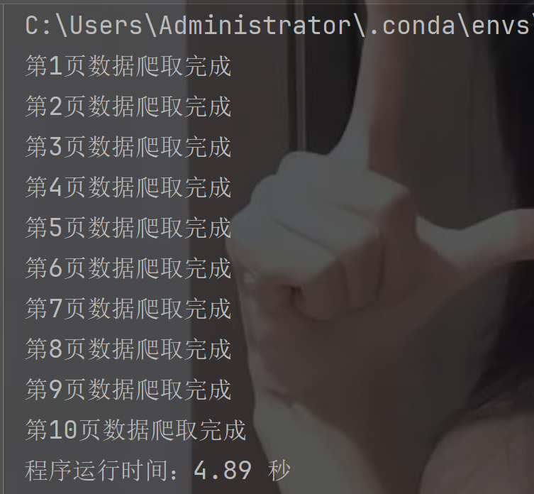


# 高并发爬虫

## 案例：吃啥呢给我也来一口图片下载

```
https://tse1.mm.bing.net/th/id/OIP.d2MrsioagZeQA_VkwzSkKgHaO4?rs=1&pid=ImgDetMain&o=7&rm=3

https://tse3.mm.bing.net/th/id/OIP.E_d_vpR--tKu3Venp5nIswHaOq?rs=1&pid=ImgDetMain&o=7&rm=3

https://tse3.mm.bing.net/th/id/OIP.SG1cjjWS9JdmniXwaR8CqgHaNK?rs=1&pid=ImgDetMain&o=7&rm=3
```

```python
import asyncio
import aiohttp
import aiofiles


urls = [
    'https://tse1.mm.bing.net/th/id/OIP.d2MrsioagZeQA_VkwzSkKgHaO4?rs=1&pid=ImgDetMain&o=7&rm=3',
    'https://tse3.mm.bing.net/th/id/OIP.E_d_vpR--tKu3Venp5nIswHaOq?rs=1&pid=ImgDetMain&o=7&rm=3',
    'https://tse3.mm.bing.net/th/id/OIP.SG1cjjWS9JdmniXwaR8CqgHaNK?rs=1&pid=ImgDetMain&o=7&rm=3',
]

async def downloads(url):
    async with aiohttp.ClientSession() as session:
        async with session.get(url) as resp:
            async with aiofiles.open(f'D:/新建文件夹/{urls.index(url)}.jpg', 'wb') as f:
                await f.write(await resp.read())
                print('完成')

async def main():
    tasks=[]
    
    for url in urls:
        tasks.append(asyncio.create_task(downloads(url)))
        
    await asyncio.wait(tasks)
'''
async def main():
    tasks = []

    for url in urls:
        tasks.append(download(url))

    await asyncio.gather(*tasks)
'''

asyncio.run(main())
```

### 共用一个 Session

```python
import asyncio
import aiohttp
import aiofiles


urls = [
    'https://tse1.mm.bing.net/th/id/OIP.d2MrsioagZeQA_VkwzSkKgHaO4?rs=1&pid=ImgDetMain&o=7&rm=3',
    'https://tse3.mm.bing.net/th/id/OIP.E_d_vpR--tKu3Venp5nIswHaOq?rs=1&pid=ImgDetMain&o=7&rm=3',
    'https://tse3.mm.bing.net/th/id/OIP.SG1cjjWS9JdmniXwaR8CqgHaNK?rs=1&pid=ImgDetMain&o=7&rm=3',
]


async def download(session, url):
    # 发送请求
    async with session.get(url) as res:

        # 打开文件
        async with aiofiles.open(f'D:/新建文件夹/{urls.index(url)}.jpg','wb') as f:
            await f.write(await res.read())

            print(f'{urls.index(url)}.jpg 下载完成')


async def main():
    # 创建一个 Session，所有请求共用它
    async with aiohttp.ClientSession() as session:

        tasks = []

        for url in urls:
            task = download(session, url)
            tasks.append(task)

        # 并发执行所有下载任务
        await asyncio.gather(*tasks)


if __name__ == '__main__':
    asyncio.run(main())
```


## 异步 MongoDB

```python
from pymongo import AsyncMongoClient

client = AsyncMongoClient('mongodb://localhost:27017/')
```


## 异步 MySQL

```
pip install aiomysql
```

```python
import aiomysql


```


## 案例：爱奇艺高并发获取

```
https://list.iqiyi.com/www/2/15-------------11-1-1-iqiyi--.html?s_source=PCW_SC
D:\py-project\爬虫\多任务编程\协程\爱奇艺高并发获取.py
```

```python
import asyncio
import aiohttp
import time

from fake_useragent import UserAgent
from pymongo import AsyncMongoClient


class AiQiYi:
    def __init__(self):
        self.url = 'https://pcw-api.iqiyi.com/search/recommend/list'
        self.headers = {'User-Agent': UserAgent().random}
        self.client = AsyncMongoClient('mongodb://localhost:27017/')
        self.collection = self.client['test']['async']


    # 发送请求
    async def send_request(self, session, page):
        params = {
            'channel_id': '2',
            'data_type': '1',
            'mode': '11',
            'page_id': page,
            'ret_num': '48',
            'three_category_id': '15;must'
        }

        async with session.get(self.url,params=params,headers=self.headers) as res:

            return await res.json()


    # 解析数据
    def parse_data(self, data):
        data = data['data']['list']
        result = []

        for i in data:
            result.append({
                'title': i['title'],
                'url': i['playUrl'],
                'content': i['description']
            })

        return result


    # 爬取一页
    async def crawl_page(self, session, page):
        # 请求
        data = await self.send_request(session, page)
        # 解析
        result = self.parse_data(data)

        print(f'第{page}页数据爬取完成')

        return result


    # 保存数据
    async def save_data(self, data):
        await self.collection.insert_many(data)


    # 主函数
    async def run(self):
        start_time = time.perf_counter()

        await self.collection.delete_many({})    # 清空集合


        # 创建 HTTP Session
        async with aiohttp.ClientSession() as session:
            # 创建10个协程
            tasks = []

            for page in range(1, 11):
                tasks.append(self.crawl_page(session, page))

            # 并发爬取10页
            results = await asyncio.gather(*tasks)


        # 批量保存 MongoDB
        all_data = []

        for i in results:   # 这里每一个 i 都是 parse_data 函数返回的列表，列表里有一页的数据字典，这里用extend让all_data里存字典，方便下面存入MongoDB
            all_data.extend(i)     # 将一个列表的所有元素添加到另一个列表末尾（列表 ——> 列表的基本操作 ——> 扩展列表）

        await self.save_data(all_data)


        end_time = time.perf_counter()
        print(f'{end_time - start_time:.2f} 秒')

        # 关闭 MongoDB
        await self.client.close()


if __name__ == '__main__':
    aqy = AiQiYi()
    asyncio.run(aqy.run())
```

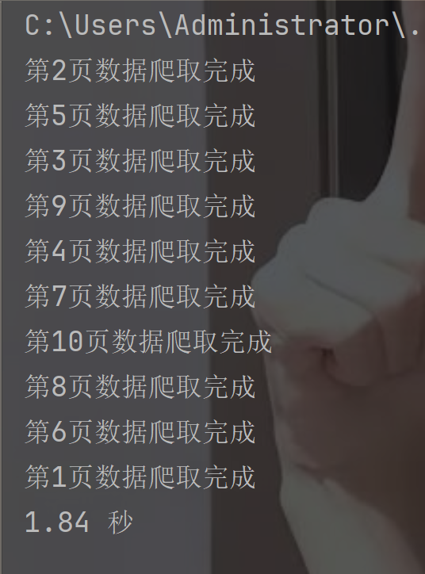


## 4K 桌面壁纸案例

```
D:\py-project\爬虫基础\多任务编程\协程\4k桌面风景壁纸下载.py
```

```
https://www.4kdesk.com/4kfengjing/
```


> `src`是懒加载占位图，页面真实图片在`data-original`

```python
from fake_useragent import UserAgent
import asyncio
import aiohttp
import aiofiles
from bs4 import BeautifulSoup
import os


class Desk_4k:
    def __init__(self):
        self.url_base = 'https://www.4kdesk.com/4kfengjing/'

    def url_page(self):
        url_page = []
        url_page.append(f'{self.url_base}index.html')    # 第一页的 URL
        
        for i in range(2, 11):
            url = f'{self.url_base}index_{i}.html'
            url_page.append(url)
        return url_page

    async def fetch_html(self, session, url):
        async with session.get(url, headers={'User-Agent': UserAgent().random}) as resp:
            html = await resp.text()
            return html

    def url_scr(self, html):
        soup = BeautifulSoup(html, 'html.parser')
        src_list = [
            img['data-original']
            for img in soup.select('a.item img.lazy')
            if img.get('data-original')
        ]

        return src_list

    async def download(self, session, scr):
        async with session.get(scr) as resp:
            async with aiofiles.open(f'D:/新建文件夹/{os.path.basename(scr)}','wb') as f:
                await f.write(await resp.read())
                print(f'{os.path.basename(scr)} 下载完成')

    async def main(self):
        page = self.url_page()

        # 只创建一个 session
        async with aiohttp.ClientSession() as session:

            for url_page in page:
                html = await self.fetch_html(session, url_page)
                scr_list = self.url_scr(html)

                # 并发下载
                tasks = []
                for url_scr in scr_list:
                    tasks.append(self.download(session, url_scr))

                await asyncio.gather(*tasks)


if __name__ == '__main__':
    wallpaper = Desk_4k()
    asyncio.run(wallpaper.main())
```


## 汽车之家配置页面数据获取

```url
https://www.che168.com/china/a0_0msdgscncgpi1ltocsp1exf4x0/
```

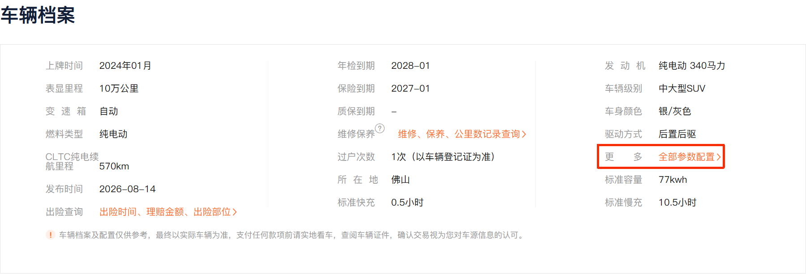

### API

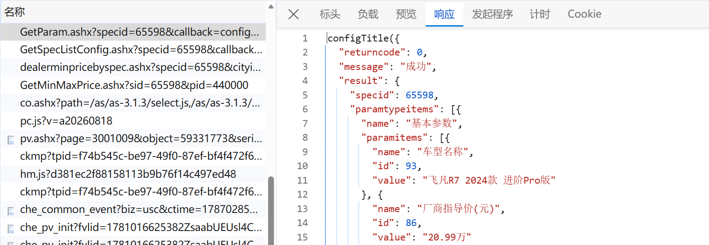

```url
https://cacheapigo.che168.com/CarProduct/GetParam.ashx?specid=65598&callback=configTitle

# callback=configTitle   JS里的回调函数
```

### 去掉回调函数

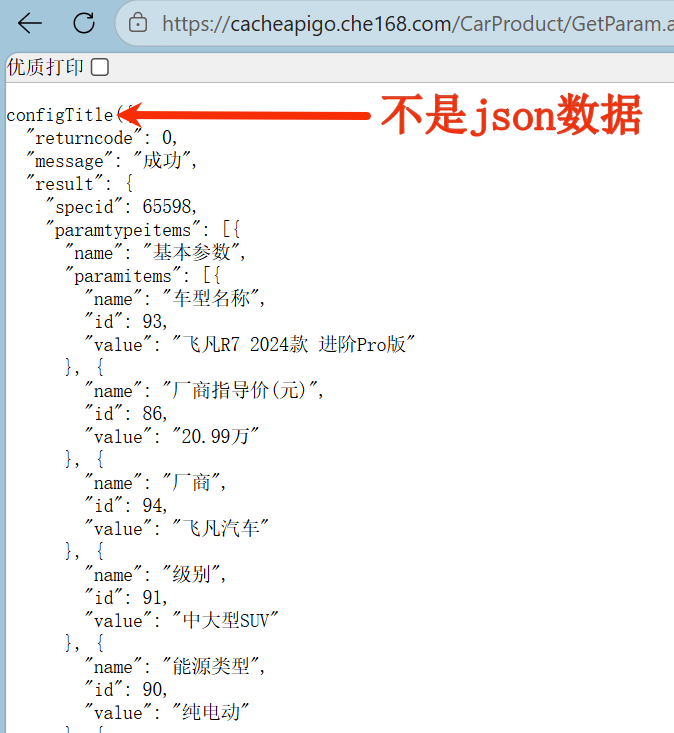

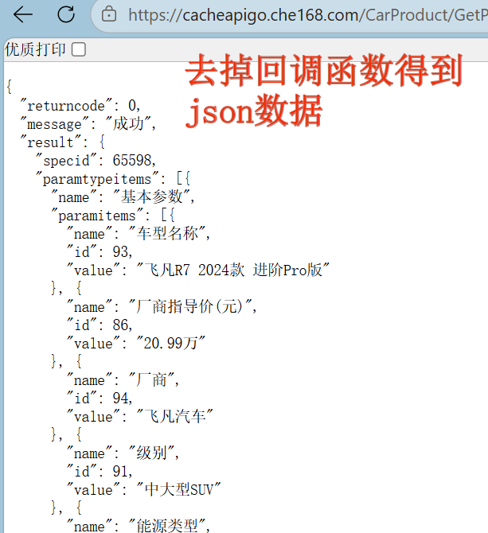

### 汽车 ID

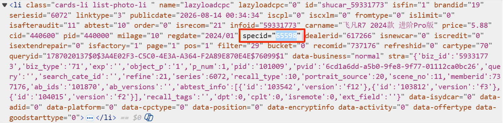


# IP 代理池

## 免费 IP 获取

```
https://www.kuaidaili.com/free/inha/1/
D:\py-project\爬虫\IP 代理池\免费 IP 获取.py
```

```python
'''
复制到 DrissionPage 文件夹执行
'''

from DrissionPage import Chromium, ChromiumOptions

co = ChromiumOptions()
co.set_browser_path(
    r"C:\Program Files (x86)\Microsoft\Edge\Application\msedge.exe"
)
co.set_proxy("http://127.0.0.1:8080")
co.set_argument("--start-maximized")
co.set_user_data_path("./chrome_data")

tab = Chromium(co).latest_tab
tab.get('https://www.kuaidaili.com/free/inha/')
tab.wait.ele_displayed(
    'xpath://*[@id="table__free-proxy"]/div/table/tbody'
)


page = 1
while True:
    success = tab.wait.ele_displayed('xpath://*[@id="table__free-proxy"]/div/table/tbody', timeout=2)
    if not success:
        tab.refresh()
        continue

    tables = tab.ele('xpath://*[@id="table__free-proxy"]/div/table/tbody')

    for i in tables.eles('css:tr'):
        ip = i.ele('css:td:nth-child(1)').text
        port = i.ele('css:td:nth-child(2)').text
        print(ip, port)
    print(f'第{page}页爬取完成')
    page += 1


    button = tab.ele('xpath://*[@id="pagination__free-proxy"]/ul/li[last()-1]')
    if not button.attr('data-index'):
        print('最后一页')
        tab.close()
        break
    else:
        button.click()
```

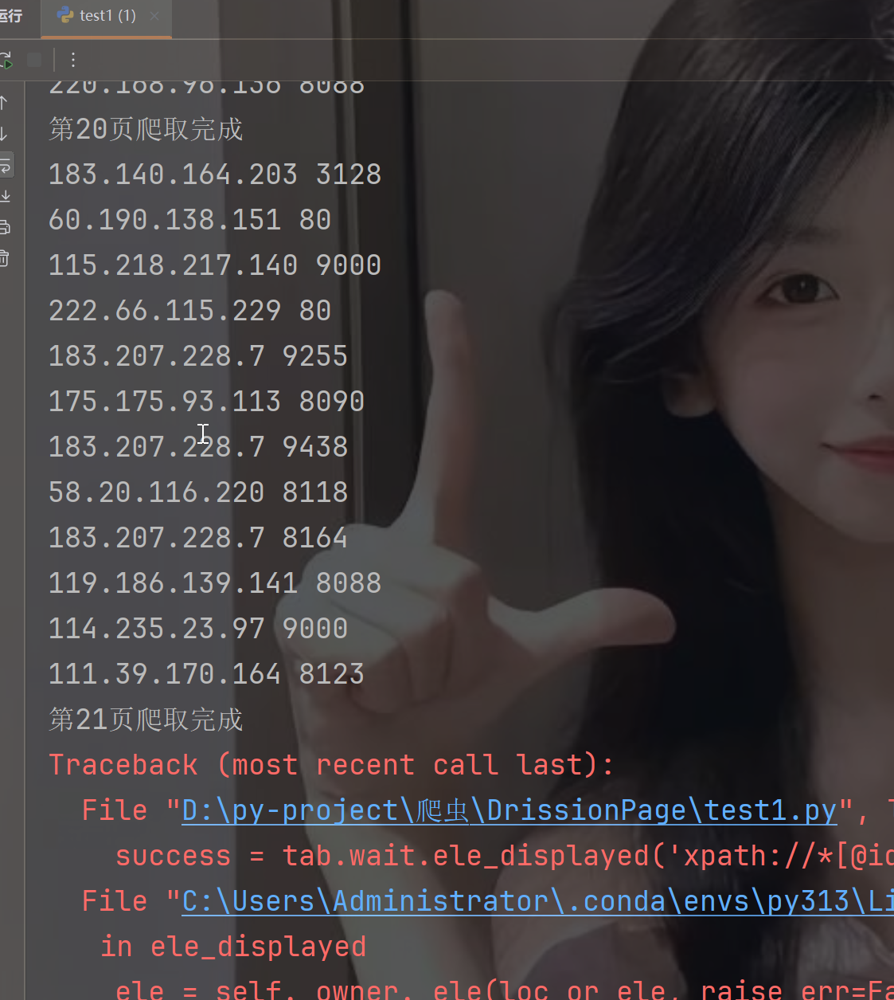

😐被封了


## 付费代理

```url
https://www.kuaidaili.com/uc/dps/?orderid=948686654912116
```

### 选择 API 链接获取

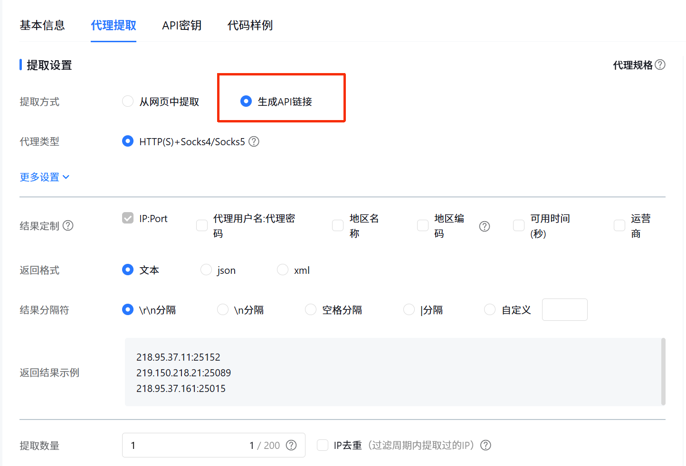

### 点击生成链接，复制

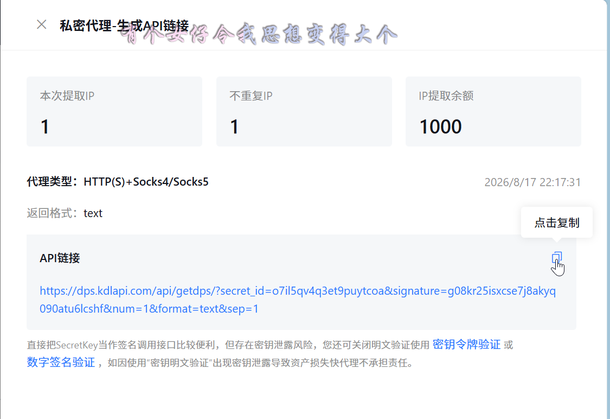

### 使用

> `https` 的 key 表示访问 HTTPS 网站时使用这个代理
>
> 后面的 `http://` 表示代理服务器本身使用 HTTP 协议连接

```python
import requests

api_url = 'https://dps.kdlapi.com/api/getdps/?secret_id=o7il5qv4q3et9puytcoa&signature=g08kr25isxcse7j8akyq090atu6lcshf&num=1&format=text&sep=1'
proxy_ip = requests.get(api_url).text

proxies = {
    "http": f"http://d2121168886:123456@{proxy_ip}",
    "https": f"http://d2121168886:123456@{proxy_ip}"
}

target_url = 'https://dev.kdlapi.com/testproxy'

response = requests.get(target_url, proxies=proxies)
print(response.text)
```


# scrapy 框架

> Python 环境：3.9
>
> 下载：
>
> ```
> pip install scrapy==2.6.3 Twisted==22.10.0 urllib3==1.26.18 parsel==1.7.0 setuptools==79.0.1
> ```
>
> 流程：
>
> ```
>                          scrapy crawl xxx
>                                 |
>                                 ↓
>                     ┌────────────────────┐
>                     │     Scrapy启动      │
>                     └────────────────────┘
>                                 |
>                                 ↓
>                     创建 Crawler / Engine
>                                 |
>                                 ↓
>         ┌────────────────────────────────────────┐
>         │          Spider 生命周期开始            │
>         └────────────────────────────────────────┘
>                                 |
>                                 ↓
>                  Spider.start_requests()
>                  （生成初始Request）
>                                 |
>                                 |
>               yield scrapy.Request(url,callback)
>                                 |
>                                 ↓
>       ════════════════════════════════════════════════
>                     Engine（核心调度）
>       ════════════════════════════════════════════════
>                                 |
>                                 ↓
>                     Scheduler 调度器
>                                 |
>                   ┌─────────────┐
>                   │             │
>                   ↓             ↓
>              入队保存        请求去重
>          （Request队列）   （dupefilter）
>                   |
>                   ↓
>       ═══════════════════════════════════════════════
>                  Downloader Middleware
>                    （下载中间件）
>       ════════════════════════════════════════════════
> 
>                  process_request()
> 
>                  - 设置代理
>                  - 修改Headers
>                  - 设置Cookie
>                  - Selenium打开浏览器
> 
>                   |
>                   ↓
> 
>       ═══════════════════════════════════════════════
>                     Downloader
>                     （下载器）
>       ═══════════════════════════════════════════════
>                   |
>                   ↓
> 
>               发送 HTTP 请求
> 
>                   |
>                   ↓
> 
>               目标网站服务器
> 
>                   |
>                   ↓
> 
>               返回 Response
> 
>       ════════════════════════════════════════════
>               Downloader Middleware
>       ════════════════════════════════════════════
> 
>                  process_response()
> 
>                  - 检查状态码
>                  - 修改Response
>                  - 重试请求
> 
>                   |
>                   ↓
> 
>      ═══════════════════════════════════════════
>                     Spider解析
>      ════════════════════════════════════════════
> 
>                  callback函数执行
> 
>                  ↓
> 
>              parse(response)
> 
>                  |
>         ┌────────┴────────┐
>         ↓                 ↓
> 
>     提取数据            产生新请求
> 
>  response.xpath()       yield Request()
> 
>  response.css()              |
>  response.get()              |
>  response.getall()           |
>                              |
>                              ↓
>                          Scheduler
>                          （继续循环）
> 
>         |
>         ↓
> 
>   生成 Item
> 
>   item = {}
> 
>   item['name']='python'
> 
>   yield item
> 
>                   |
>                   ↓
> 
> ═════════════════════════════════════════
>              Item Pipeline
> ═════════════════════════════════════════
> 
>              process_item(item, spider)
> 
>                   |
>         ┌─────────┴─────────┐
>         ↓                   ↓
> 
>     数据清洗              数据保存
> 
>  strip()               MySQL
>  replace()             MongoDB
>                        Redis
> 
>                   |
>                   ↓
> 
> ═══════════════════════════════════════════
>                爬虫结束
> ═══════════════════════════════════════════
> 
>              spider_closed()
> 
>                   |
>                   ↓
> 
>              关闭资源
> 
>              driver.quit()
> 
>              db.close()
> 
>              文件关闭
> ```

## 一、内置命令

### 创建项目

```
cd scrapy 框架

scrapy startproject 项目名
```

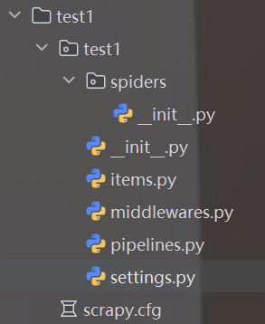

### 创建 Spider

```
cd test1

scrapy genspider 爬虫名 网站
```

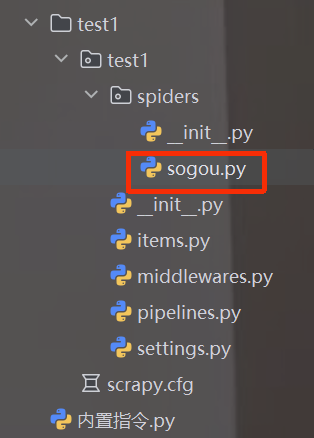

### 查看爬虫列表

```
scrapy list
```

### 运行爬虫

```
scrapy crawl 爬虫名
```

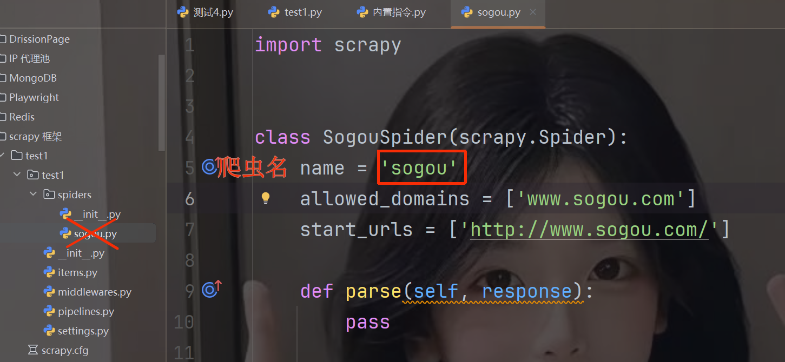

### 直接运行创建启动入口

```
项目根目录创建 run.py
```

```python
from scrapy.cmdline import execute    # 执行 scrapy 命令
import sys

# scrapy启动的时候，需要找到这个项目
sys.path.append(r"D:\py-project\爬虫基础\scrapy 框架\test1")

# 接收的是“命令行参数列表”
execute(["scrapy","crawl","sogou","--nolog"])    # --nolog 不输出日志信息
```


## 二、settings.py 核心配置

### 设置机器人协议

```python
ROBOTSTXT_OBEY = False
```

### 设置请求头

```python
# Override the default request headers:
DEFAULT_REQUEST_HEADERS = {
  'User-Agent':'Mozilla/5.0 (Windows NT 10.0; Win64; x64) AppleWebKit/537.36 (KHTML, like Gecko) Chrome/151.0.0.0 Safari/537.36 Edg/151.0.0.0'
}
```

### 开启 Pipeline

```python
ITEM_PIPELINES = {
    "test1.pipelines.类名":300       # 数字越小优先级越高，越先被执行
}
```


## 三、Spider 模板

### response

> Scrapy 下载回来的网页对象
>
> 自动创建 HtmlResponse 对象

### `parse(self, response):`

> **默认的响应解析方法（回调函数 callback）**
>
> 默认 `callback=self.parse`

### `start_requests(self)`

> 用于生成初始请求，在父类里
>
> 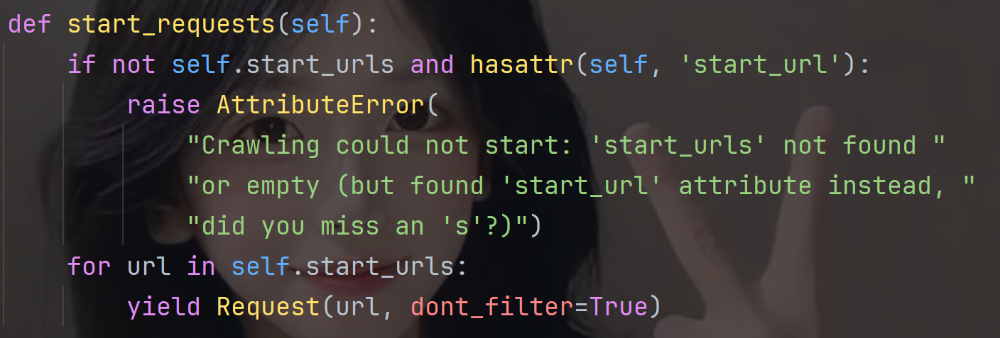
>
> 也可以重写
>
> ```python
> import scrapy
> 
> class SogouSpider(scrapy.Spider):
>        name = 'sogou'
>        # allowed_domains = ['www.sogou.com']          白名单
>        start_urls = ['http://www.sogou.com/']
>     
>        def start_requests(self):
> 
>            url = "https://www.baidu.com"
> 
>            yield scrapy.Request(url=url, callback=self.parse)
>         
>        def parse(self, response):
>            print(response)     # <200 https://www.sogou.com/>
> ```

|        代码        | 说明       |
| :----------------: | ---------- |
|  `response.text`   | 网页源码   |
|  `response.body`   | 二进制数据 |
| `response.status`  | 状态码     |
|   `response.url`   | 当前网址   |
| `response.headers` | 请求头     |

### 数据提取

#### `response.xpath()`

> 返回的是 Scrapy 的选择器列表对象，里面保存着匹配到的节点

#### `get()`/`getall()` 提取数据

> `get()` 取一个，没有返回 None
>
> `getall()` 取全部，没有返回空列表

### yield 关键字

> 将数据提交给管道


## 四、pipelines.py 数据清洗、保存

> `item` 接收 Spider 传过来的数据
>
> ```
> Spider产生Item
> 
>       |
>       ↓
> 
> open_spider()
> 
>       |
>       ↓
> 
> process_item()
> 
>       |
>       ↓
> 
> close_spider()
> ```
>
> 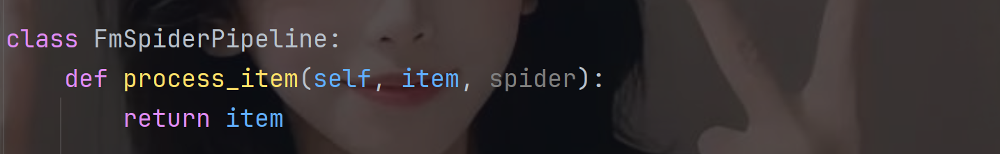

```python
from itemadapter import ItemAdapter
from pymongo import MongoClient


class FmSpiderPipeline:
    client = MongoClient("mongodb://localhost:27017/")
    collection = client['scrapy']['fm']
    def process_item(self, item, spider):
        self.collection.insert_one(item)
```


## 五、图片下载

> `ImagesPipeline` 是Scrapy内置用于下载和处理图片的组件，**Pillow** 是Python中一个强大的图像处理库
>
> ```
> pip install Pillow
> ```
>
> **settings.py 开启：**
>
> ```python
> ITEM_PIPELINES = {
>        '项目名.pipelines.类名': 200
> }
> 
> IMAGES_STORE="D:/新建文件夹"           # 保存位置
> ```
>
> **流程：**
>
> ```
> Spider
>    │
>    │ image_urls
>    ↓
> Item
>    │
>    ↓
> ImagesPipeline
>    │
>    │ 下载
>    ↓
> 本地 images/
>    │
>    │ 下载结果
>    ↓
> images
> ```

### 请求图片

#### Pipeline：

```python
yield Request(
    url,
    headers={
        "Referer":"https://xxx.com"
    }
)
```


### items.py

> 规定 Spider 爬到的数据，要以什么字段、什么结构保存和传递
>
> 属于 **Spider 解析数据之后，Pipeline 处理数据之前**
>
> **`scrapy.Field()` ：声明一个数据字段**
>
> `ImagesPipeline` 会自动寻找 `image_urls` 字段

```python
import scrapy


class MovieItem(scrapy.Item):

    title = scrapy.Field()

    image_urls = scrapy.Field()
```


### spider.py 传图片

> 必须是列表

```python
def parse(self,response):

    item = MovieItem()

    item["title"] = "肖申克的救赎"

    item["image_urls"] = [
        "https://img9.doubanio.com/p123.jpg"
    ]

    yield item
```


### images 字段

```python
images = scrapy.Field()    # Pipeline 返回下载结果
```


## 图片下载案例：豆瓣 top 250

```
D:\py-project\爬虫基础\scrapy 框架\douban
```

### 流程：

#### 1. Spider 提交 item

> ```
> {
>     'title':'泰坦尼克号',
>     'image_urls':[
>         'https://img9.doubanio.com/xxx.jpg'
>     ]
> }
> ```
>
> 进入 **ImagesPipeline**

#### 2. ImagesPipeline 创建图片请求

> 调用：
>
> ```python
> get_media_requests()
> ```
>
> 生成：
>
> ```python
> Request(
>     url='https://img9.doubanio.com/xxx.jpg'
> )
> ```

#### 3. 下载图片

> Scrapy 下载，得到二进制数据

#### 4. 调用 `file_path()`

> **ImagesPipeline** 内部会调用：
>
> ```python
> path = self.file_path(
>     request,
>     response,
>     info,
>     item=item
> )
> ```
>
> 得到：`title='泰坦尼克号'`
>
> return 返回 `泰坦尼克号.jpg`

#### 5. ImagesPipeline 保存文件

> 父类拿到：
>
> ```python
> path='泰坦尼克号.jpg'
> ```
>
> 内部执行：
>
> ```python
> open(
>     'images/泰坦尼克号.jpg',
>     'wb'
> )
> ```
>
> 


### Scrapy Pipeline 特殊方法

> `spider` ：当前正在运行的爬虫对象

#### 启动爬虫时调用

```python
def open_spider(self, spider):
```

#### 每个 item 来的时候调用

```python
def process_item(self, item, spider):
```

#### 关闭爬虫时调用

```python
def close_spider(self, spider):
```


### spiders.py

```python
import scrapy
from douban_2.items import DoubanItem

class Top2502Spider(scrapy.Spider):
    name = 'top250_2'
    # allowed_domains = ['movie.douban.com']
    start_urls = ['https://movie.douban.com/top250']

    def parse(self, response):
        movie_list = response.xpath('//ol[@class="grid_view"]/li')
        for li in movie_list:
            image = li.xpath('.//img/@src').get()
            title = li.xpath('.//span[@class="title"][1]/text()').get()
            rating = li.xpath(".//span[@class='rating_num']/text()").get()
            people = li.xpath(".//div[@class='bd']/div/span[4]/text()").get()

            # 实例化 Item
            item = DoubanItem()
            item['title'] = title
            item['rating'] = rating
            item['people'] = people
            # 图片管道要求 image_urls 是一个列表（即使只有一张图）
            item['image_urls'] = [image]  # 注意是列表

            yield item
```


### items.py

```python
import scrapy


class DoubanItem(scrapy.Item):
    # 原有字段（用于存储文本信息）
    title = scrapy.Field()
    rating = scrapy.Field()
    people = scrapy.Field()

    # 图片管道专用字段
    image_urls = scrapy.Field()  # 存放图片URL列表
    images = scrapy.Field()   # 下载后自动填充，包含路径等信息
```

### pipelines.py

```python
from itemadapter import ItemAdapter    # 用统一的方式读取和修改 Item 里的数据
from scrapy.pipelines.images import ImagesPipeline
import scrapy

import re
from pymysql import connect


class Douban2ImagePipeline(ImagesPipeline):

    # 重写父类方法
    '''
    告诉 Scrapy 这张图片保存的时候，请使用这个路径名
    '''
    def file_path(self, request, response=None, info=None, *, item=None):
        title = item['title']
        # 清理非法文件名
        title = re.sub(r'[\\/:*?"<>|]', '', title)

        return f'{title}.jpg'   # 保存图片名


    def get_media_requests(self, item, info):
        image_urls = ItemAdapter(item).get('image_urls', [])   # 获取 image_urls 列表，没有返回 []
        for url in image_urls:     # image_urls 是列表
            if url:  # 过滤空值
                yield scrapy.Request(
                    url,
                    headers={'Referer': 'https://movie.douban.com/top250',
                             'User-Agent':'Mozilla/5.0 (Windows NT 10.0; Win64; x64) AppleWebKit/537.36 (KHTML, like Gecko) Chrome/151.0.0.0 Safari/537.36 Edg/151.0.0.0'}
                    )


class Douban2Pipeline:
    
    def open_spider(self, spider):
        self.conn = connect(
            host='localhost',
            port=3306,
            user='root',
            password='root',
            database='scrapy',
            charset='utf8mb4',
            ssl_disabled=True    # 禁止使用 SSL 加密连接
        )
        self.cursor = self.conn.cursor()

        # 清空表
        self.cursor.execute("TRUNCATE TABLE douban")


    def process_item(self, item, spider):

        image_path = None   # 防止没有图片报错，保证后面的 SQL 语句能正常执行

        # 图片下载完成后，images 里会有 path 字段
        if item.get('images'):    # 没有返回 None（if item['images']: 会报错KeyError: 'images'）
            image_path = 'D:/新建文件夹/'+item['images'][0]['path']

        sql = '''
        INSERT INTO douban(title,rating,people,image_path)
        VALUES(%s,%s,%s,%s)
        '''
        self.cursor.execute(sql, (item['title'], item['rating'], item['people'], image_path))
        # 提交事务
        self.conn.commit()

        return item

    def close_spider(self, spider):
        if hasattr(self, 'cursor'):
            self.cursor.close()
            
        if hasattr(self, 'conn'):
            self.conn.close()
```


### settings.py

```python
BOT_NAME = 'douban_2'

SPIDER_MODULES = ['douban_2.spiders']
NEWSPIDER_MODULE = 'douban_2.spiders'


ROBOTSTXT_OBEY = False


DEFAULT_REQUEST_HEADERS = {
  'User-Agent':'Mozilla/5.0 (Windows NT 10.0; Win64; x64) AppleWebKit/537.36 (KHTML, like Gecko) Chrome/151.0.0.0 Safari/537.36 Edg/151.0.0.0'
}


ITEM_PIPELINES = {
    'douban_2.pipelines.Douban2ImagePipeline': 200,
    'douban_2.pipelines.Douban2Pipeline': 300,
}

IMAGES_STORE = r'D:\新建文件夹'
```


## 六、中间件

> 它负责在 **请求发送前、响应返回后** 对数据进行处理，可以在爬虫和 Scrapy 引擎之间插入自己的逻辑
>
> 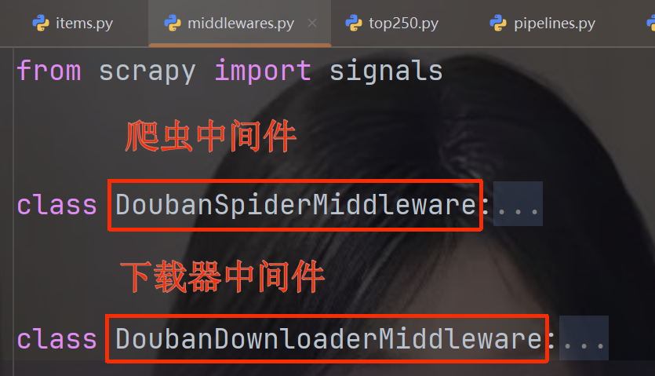
>
>  
>
> **流程：**
>
> ```
> Spider
>   |
>   | 产生 Request
>   ↓
> Spider Middleware
>   |
>   ↓
> Scrapy Engine
>   |
>   ↓
> Downloader Middleware
>   |
>   ↓
> Downloader
>   |
>   ↓
> Internet网站
>   |
>   ↓
> Downloader
>   |
>   ↓
> Downloader Middleware      # 都会经过下载器中间件，所以只用这个
>   |
>   ↓
> Scrapy Engine
>   |
>   ↓
> Spider Middleware
>   |
>   ↓
> Spider.parse()
> ```

### Downloader Middleware 下载器中间件

> 打开设置：
>
> ```python
> DOWNLOADER_MIDDLEWARES = {
>    'myproject.middlewares.DoubanDownloaderMiddleware': 543,
> }
> ```

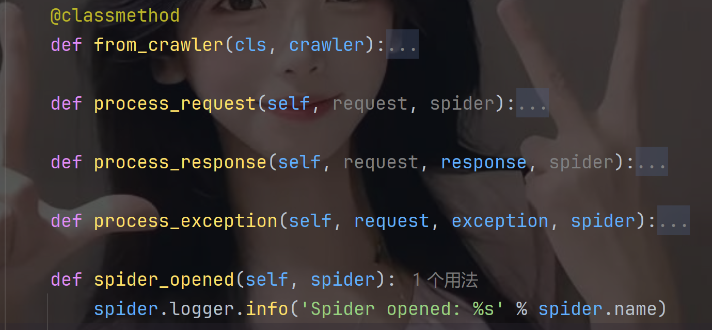

### `process_request()`

> 请求发送给服务器之前调用
>
> #### 返回值：`None`
>
> 按默认流程继续处理
>
> #### 返回值：`Request 对象`
>
> 不要发送当前这个请求了，换一个新的请求（一般用于重定向，修改请求地址）
>
> #### 返回值：`Response 对象`
>
> 不访问网站直接给一个响应
>
> #### 返回值：`抛异常 IgnoreRequest`
>
> 这个请求不要了，丢弃

### `process_response()`

> 服务器返回响应之后调用

### `process_exception()`

> 请求出现异常时调用

### 随机 UA

```python
def process_request(self, request, spider):
    user_agents = [
        "Mozilla/5.0 (Windows NT 10.0; Win64; x64) AppleWebKit/537.36 (KHTML, like Gecko) Chrome/139.0.0.0 Safari/537.36",
        "Mozilla/5.0 (Windows NT 10.0; Win64; x64) AppleWebKit/537.36 (KHTML, like Gecko) Chrome/139.0.0.0 Safari/537.36 Edg/139.0.0.0",
        "Mozilla/5.0 (Windows NT 10.0; Win64; x64; rv:142.0) Gecko/20100101 Firefox/142.0",
        "Mozilla/5.0 (Macintosh; Intel Mac OS X 15_6) AppleWebKit/605.1.15 (KHTML, like Gecko) Version/18.6 Safari/605.1.15",
        "Mozilla/5.0 (Linux; Android 15; SM-S928B) AppleWebKit/537.36 (KHTML, like Gecko) Chrome/139.0.0.0 Mobile Safari/537.36",
        "Mozilla/5.0 (iPhone; CPU iPhone OS 18_6 like Mac OS X) AppleWebKit/605.1.15 (KHTML, like Gecko) Version/18.6 Mobile/15E148 Safari/604.1",
        "Mozilla/5.0 (Windows NT 10.0; Win64; x64) AppleWebKit/537.36 (KHTML, like Gecko) Chrome/139.0.0.0 Safari/537.36 OPR/121.0.0.0",
        "Mozilla/5.0 (Linux; Android 15; SM-S938B) AppleWebKit/537.36 (KHTML, like Gecko) SamsungBrowser/28.0 Chrome/139.0.0.0 Mobile Safari/537.36"
    ]
    request.headers['User-Agent'] = random.choice(user_agents)
    
    return None
```


## 七、Extension

### Crawler 类

> 是 Scrapy 整个爬虫程序的“管理者/控制中心”
>
> `crawler` 是 Crawler 类创建出来的一个对象

### signals 信号

> ```python
> from scrapy import signals
> ```
>
> Scrapy 的某些特定时刻，例如：
>
> Spider 开始运行、结束、一个 Item 被处理、Engine 启动、停止
>
> ```
> Scrapy发生某个事件
>        ↓
>   发出 Signal
>        ↓
>   函数监听 Signal
>        ↓
>     执行代码
> ```
>
> 调用crawler对象的signals对象的 connect 方法：向 Scrapy 注册一个“事件监听函数”
>
> ```python
> crawler.signals.connectconnect(
>     my_function,    # 函数本身（不是调用结果）
>     signal = my_signal           # 监听事件
> )
> ```
>
> 监听 `my_signal` 这个事件，当 Spider 启动的时候，调用自己写的 `my_function` 函数

### 常见 Signals

|        事件         | 含义                      |
| :-----------------: | ------------------------- |
|   `spider_opened`   | Spider 启动               |
|   `spider_closed`   | Spider 关闭               |
|  `engine_started`   | Engine 启动               |
|  `engine_stopped`   | Engine 停止               |
|   `item_scraped`    | Item 成功处理             |
|   `item_dropped`    | Item 被丢弃               |
| `request_scheduled` | Request 进入调度器        |
|  `request_dropped`  | Request 被丢弃            |
| `response_received` | 收到 Response             |
|   `spider_error`    | Spider 处理请求时发生异常 |

### 打开 Extension

```python
EXTENSIONS = {
    '项目名.extensions.类名': 500,
}
```

### `from_crawler()`

> Scrapy 规定好的特殊方法名，创建 Extention 的时候会主动去找：`from_crawler` 调用

### 新建 my_extension.py 文件

```python
import requests
from scrapy import signals


class ProxyExtension:

    def __init__(self):
        self.proxy = None

    @classmethod        # 静态方法直接获取下面的函数传给 connect()
    def from_crawler(cls, crawler):
        extension = cls()    # 创建一个类对象
		
        # 给 crawler 对象添加一个叫 proxy_extension 的属性，并把类对象赋值给它
        crawler.proxy_extension = extension
        
        crawler.signals.connect(
            extension.spider_opened,
            signal = signals.spider_opened      # 监听启动事件
        )

        return extension

    
    def spider_opened(self, spider):
        # Spider启动的时候，先获取一个代理
        self.get_proxy()


    def get_proxy(self):
        api_url = 'https://dps.kdlapi.com/api/getdps/?secret_id=o7il5qv4q3et9puytcoa&signature=g08kr25isxcse7j8akyq090atu6lcshf&num=1&format=text&sep=1'

        proxy_ip = requests.get(api_url).text.strip()

        # 保存一个代理字符串即可
        self.proxy = f"http://d2121168886:123456@{proxy_ip}"

        print('获取到付费代理：', self.proxy)

        return self.proxy
```

### `request.meta['proxy']`

> 指定 Request 使用哪个代理服务器

### 利用共同的 `crawler` 来传递 Extension

```python
# middlewares.py

from scrapy import signals
import random


class DoubanSpiderMiddleware:...


class DoubanDownloaderMiddleware:...


class ProxyMiddleware:

    def process_request(self, request, spider):

        extension = spider.crawler.proxy_extension

        request.meta['proxy'] = extension.proxy

        print('本次请求使用的代理：', extension.proxy)


    def process_exception(self, request, exception, spider):

        extension = spider.crawler.proxy_extension

        print('代理出现异常：', exception)    # 请求过程中产生的异常（错误）对象

        extension.get_proxy()
        print('获取新的代理')

        request.meta['proxy'] = extension.proxy

        return request    # 重新发起请求
```

```python
# 打开中间件
DOWNLOADER_MIDDLEWARES = {
    'douban.middlewares.ProxyMiddleware': 544,
}
```


## 八、与 Selenium 结合

```
D:\py-project\爬虫基础\scrapy 框架\tx_work
https://careers.tencent.com/search.html?index=1&keyword=python
```

### 手动包装自动化测试工具得到的 Response 对象交给 parse

```python
from scrapy.http import HtmlResponse

class Middleware:
    
    def process_request(self, request, spider):
    ...
    return HtmlResponse(url=request.url, body=body, encoding='utf-8', request=request)
```

### Spiders

```python
import scrapy


class TxWorkInfoSpider(scrapy.Spider):
    name = 'tx_work_info'

    def start_requests(self):
        for page in range(1,33):
            url = f'https://careers.tencent.com/search.html?index={page}&keyword=python'
            yield scrapy.Request(url=url, callback=self.parse)


    def parse(self, response):
        div_list = response.xpath('//div[@class="recruit-wrap recruit-margin"]/div')
        for div in div_list:
            item = {}
            item['job_name'] = div.xpath('./a/div/span[1]/text()').get()
            item['location'] = div.xpath('./a/div/span[2]/span/text()').get()
            item['company'] = div.xpath('./a/p[1]/span[1]/text()').get()
            item['purpose'] = div.xpath('./a/p[2]/text()').get().replace('\r\n', '')

            print(item)
```

### Middlewares

```python
from scrapy import signals
from scrapy.http import HtmlResponse

from selenium import webdriver
from selenium.webdriver.support.ui import WebDriverWait
from selenium.webdriver.common.by import By
from selenium.webdriver.support import expected_conditions as EC


class TxWorkSpiderMiddleware:...


class TxWorkDownloaderMiddleware:...


class SeleniumMiddleware:
    def __init__(self):
        self.driver = webdriver.Edge()

    @classmethod
    def from_crawler(cls, crawler):
        # This method is used by Scrapy to create your spiders.
        s = cls()
        crawler.signals.connect(s.spider_closed, signal=signals.spider_closed)
        return s


    def process_request(self, request, spider):
        self.driver.get(request.url)
        WebDriverWait(self.driver, 10).until(
            EC.presence_of_all_elements_located((By.CLASS_NAME, 'recruit-list'))
        )

        body = self.driver.page_source
        
        return HtmlResponse(url=request.url, body=body, encoding='utf-8', request=request)


    def spider_closed(self):
        self.driver.quit()
```

### settings

```python
ROBOTSTXT_OBEY = False

DOWNLOADER_MIDDLEWARES = {
   'tx_work.middlewares.SeleniumMiddleware': 543,
}
```


# feapder 框架

## 安装

```
pip install "feapder[all]"
```
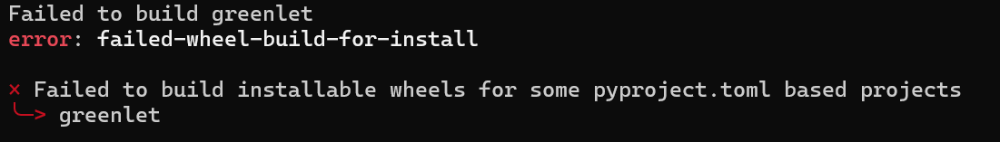
```
pip install gevent --only-binary :all:
```

## 内置命令

#### 查看命令

```
feapder -h
```

#### 创建项目

```
feapder create -p 项目名
```

#### 创建 Spider

```
feapder create -s 文件名

AirSpider : 普通爬虫
Spider : 基于 Redis 的分布式 Spider，适合大量任务、断点续爬
TaskSpider : 任务型爬虫
BatchSpider : 批次采集
```


## Spider 模版

### `start_callback(self)`

> 爬虫启动时只执行一次的初始化操作


## 保存数据到 MySQL

### 打开配置

```python
MYSQL_IP = "localhost"
MYSQL_PORT = 3306
MYSQL_DB = "feapder"
MYSQL_USER_NAME = "root"
MYSQL_USER_PASS = "root"

# 默认MysqlPipeline，不用额外打开管道
```

### 启动时清空数据

> 导入自己封装的 MySQL 数据库操作类
>
> ```python
> from feapder.db.mysqldb import MysqlDB
> 
> from feapder.db.mongodb import MongoDB
> ```
>
> ```python
> def start_callback(self):
>        mysql = MysqlDB()
>        # 清空表
>        mysql.execute("TRUNCATE TABLE douban_1")
> ```

### spider.py

```python
import feapder
from items.douban_item import DoubanItem

from feapder.db.mysqldb import MysqlDB

class Douban(feapder.AirSpider):
    # 爬虫启动时只执行一次的初始化操作
    def start_callback(self):
        mysql = MysqlDB()
        # 清空表
        mysql.execute("TRUNCATE TABLE douban_1")


    def start_requests(self):
        yield feapder.Request("https://movie.douban.com/top250")

    def parse(self, request, response):
        movie_list = response.xpath('//ol[@class="grid_view"]/li')
        for li in movie_list:
            title = li.xpath('.//span[@class="title"][1]/text()').get()
            rating = li.xpath(".//span[@class='rating_num']/text()").get()
            people = li.xpath(".//div[@class='bd']/div/span[4]/text()").get()
            print(title, rating, people)

            # 实例化 Item
            item = DoubanItem()
            item['title'] = title
            item['rating'] = rating
            item['people'] = people

            yield item


if __name__ == "__main__":
    Douban().start()
```

### items.py

```python
import feapder


class DoubanItem(feapder.Item):

    table_name = 'douban_1'
```


## 保存数据到 MongoDB

```js
use feapder

db.createCollection('douban_1')
```

### 打开配置

```python
MONGO_IP = "localhost"
MONGO_PORT = 27017
MONGO_DB = "feapder"

ITEM_PIPELINES = [
    # "feapder.pipelines.mysql_pipeline.MysqlPipeline",
    "feapder.pipelines.mongo_pipeline.MongoPipeline",
    # "feapder.pipelines.csv_pipeline.CsvPipeline",
    # "feapder.pipelines.console_pipeline.ConsolePipeline",
]
```

### spider.py

```python
from feapder.db.mongodb import MongoDB

class Douban(feapder.AirSpider):
    
	    def start_callback(self):
        mongo = MongoDB()
        # 清空集合
        mongo.collection.delete_many({})
        
        ...
```

### items.py

```python
import feapder


class DoubanItem(feapder.Item):

    table_name = 'douban_1'
```


## 下载中间件

> ```python
> def download_midware(self, request: Request):
>        pass
> ```

### 设置 IP 代理池

```python
class Douban(feapder.AirSpider):
    ...
    
    def download_midware(self, request: Request):
        api_url = 'https://dps.kdlapi.com/api/getdps/?secret_id=o7il5qv4q3et9puytcoa&signature=g08kr25isxcse7j8akyq090atu6lcshf&num=1&format=text&sep=1'
        proxy_ip = feapder.Request(api_url).get_response().text

        proxies = {
            "http": f"http://d2121168886:123456@{proxy_ip}",
            "https": f"http://d2121168886:123456@{proxy_ip}"
        }

        request.proxies = proxies
        
        return request
```


## 与 DP 自动化工具结合

```
D:\py-project\爬虫基础\feapder 框架\与DP结合\cninfo
```

### spider.py

```python
import feapder
from DrissionPage import Chromium, ChromiumOptions
import re


class Cninfo(feapder.AirSpider):

    def get_proxy(self):
        api_url = 'https://dps.kdlapi.com/api/getdps/?secret_id=o7il5qv4q3et9puytcoa&signature=g08kr25isxcse7j8akyq090atu6lcshf&num=1&format=text&sep=1'
        proxy_ip = feapder.Request(api_url).get_response().text.strip()

        return {
            "http": f"http://d2121168886:123456@{proxy_ip}",
            "https": f"http://d2121168886:123456@{proxy_ip}"
        }


    def start_callback(self):
        self.proxy = self.get_proxy()

        co = ChromiumOptions()
        co.set_browser_path(
            r"C:\Program Files (x86)\Microsoft\Edge\Application\msedge.exe"
        )
        co.set_proxy(self.proxy['http'])
        print('使用代理：', self.proxy['http'])

        co.set_argument("--start-maximized")
        co.set_user_data_path(r"D:\py-project\爬虫基础\DrissionPage\chrome_data")

        self.browser = Chromium(co)
        self.tab = self.browser.latest_tab


    def start_requests(self):
        yield feapder.Request("http://www.cninfo.com.cn/new/commonUrl?url=disclosure/list/notice#szse")


    def parse(self, request, response):
        try:
            self.tab.listen.start("/new/disclosure")
            self.tab.get(request.url)

            while True:
                for i in self.tab.listen.steps():
                    body = i.response.body

                    if 'classifiedAnnouncements' not in body:
                        continue

                    data = body['classifiedAnnouncements']

                    for j in data:
                        for k in j:
                            sec_code = re.findall(r'\d+', k['secCode'])
                            if not sec_code:
                                continue

                            print('代码：', sec_code[0])
                            print('简称：',k['secName'])
                            print('公告标题：',k['announcementTitle'])
                            print('---------------------------')
                    # 当前页处理完成
                    break

                button = self.tab.ele('xpath://*[@class="el-pagination is-background"]/button[last()]')

                if button.attr('disabled') == 'disabled':
                    print('最后一页')
                    break

                button.click()

        finally:
            self.tab.listen.stop()
            self.browser.quit()

if __name__ == "__main__":
    Cninfo().start()
```


# 码上爬练习

```url
https://www.mashangpa.com/
```

## 第二题

> 在 Hackbar 测试接口需要哪些请求头
>
> 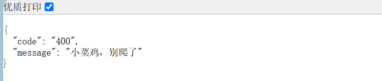
>
> 加 Referer 头
>
> 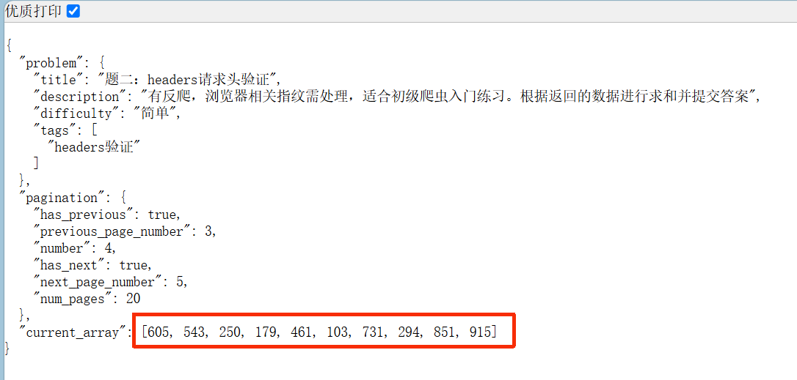


